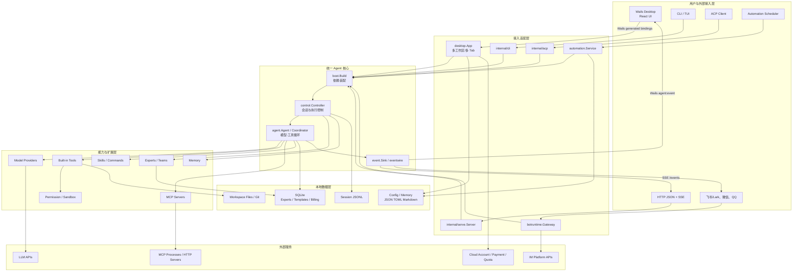
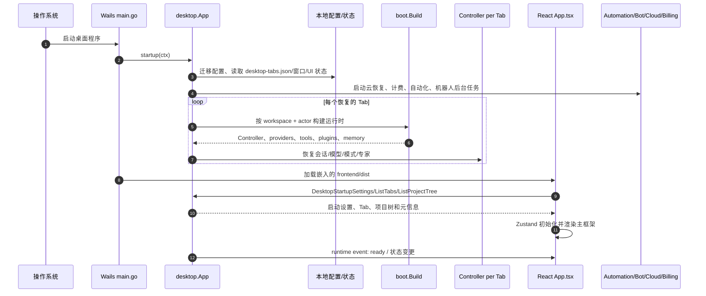
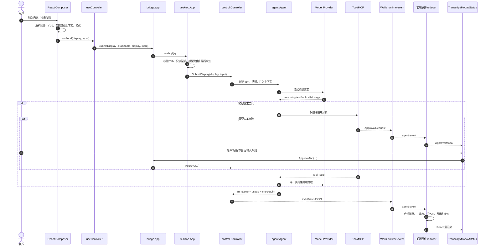
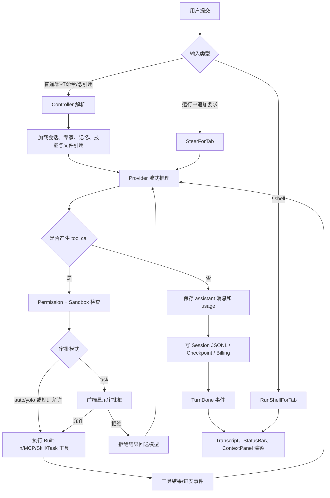
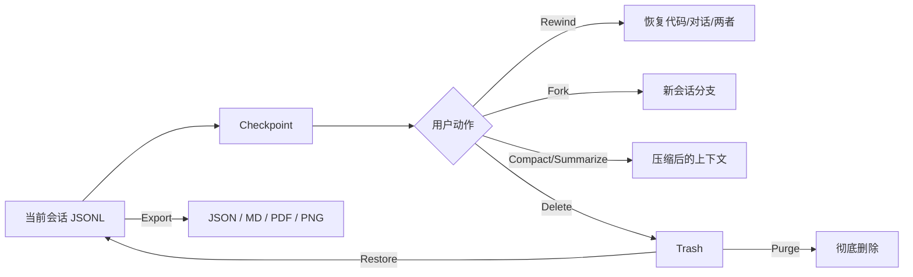
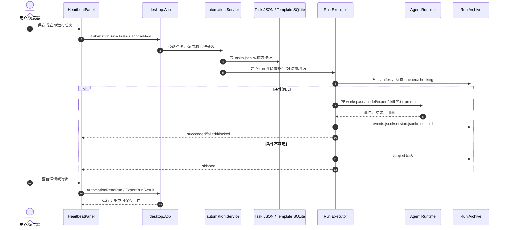
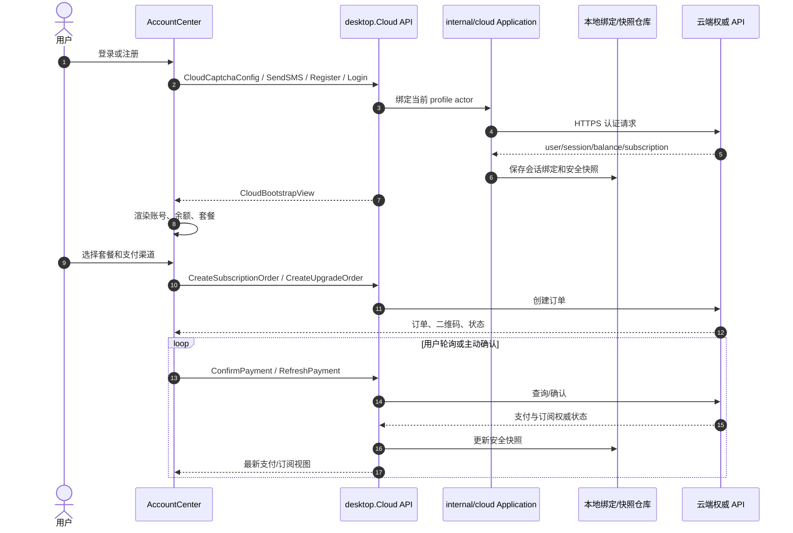
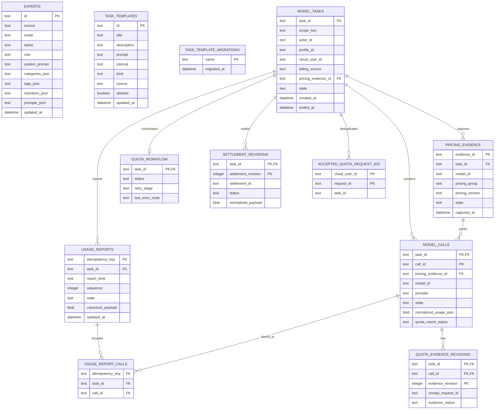
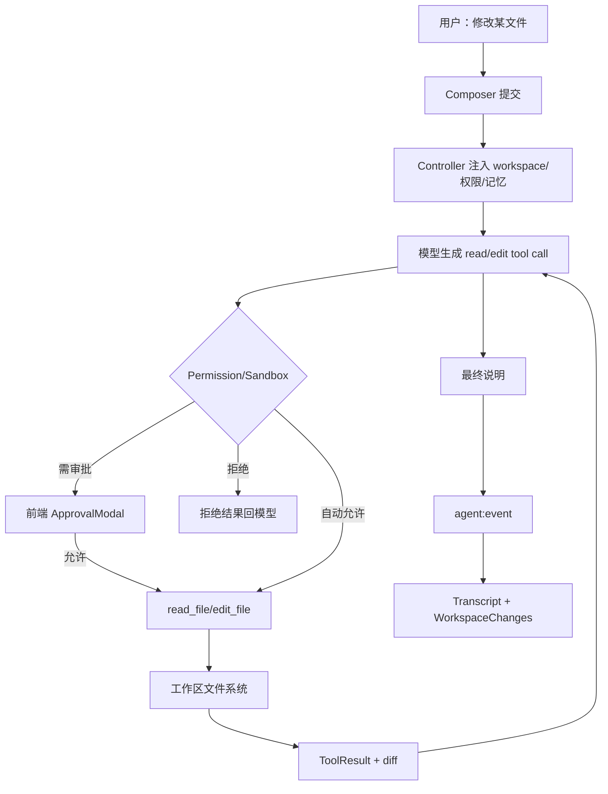
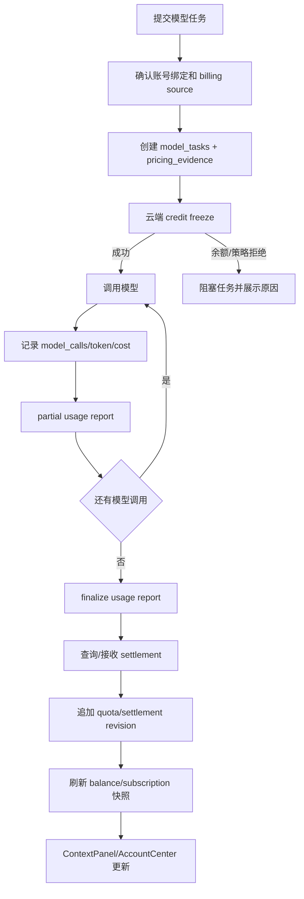

# 云智企办项目总体业务、架构与接口说明

> 状态：需要复核（业务与接口全景快照，不替代代码、测试和云端合同）
>
> 最近一次全文核对：2026-07-22，历史基线 `feature/model-hub@3ac06e22`。
>
> 2026-07-30 在 `origin/main-v3@32c251dc` 上刷新文档身份与基线声明；正文尚未逐项重跑接口、表结构和调用链核对，因此涉及当前实现时必须回到源码与测试确认。

## 1. 文档目标与结论

本文回答以下问题：

1. 当前项目是什么产品，已经实现哪些业务能力。
2. 用户在桌面页面点击后，请求如何进入 Go 后端，如何调用模型、工具、文件系统、Git、本地数据库或云端服务，再如何回到 React 页面渲染。
3. CLI、桌面端和 HTTP API 如何共享同一套 Agent 核心。
4. 本地 SQLite 表、文件型存储及云端数据之间是什么关系。
5. 前端可调用的 Wails 接口、HTTP API 和外部云 API 分别有哪些。

当前项目的核心定位是一个 **local-first（本地优先）的 AI Coding Agent / 桌面智能工作台**。主要交付形态是 Wails + React 桌面应用，同时提供 CLI、ACP、IM 机器人和无页面的 HTTP/SSE API。业务核心不在传统 CRUD 页面，而在“会话驱动的 Agent 执行闭环”：模型流式推理、工具调用、权限审批、工作区读写、Git 检查、会话恢复、自动化任务、专家/技能/MCP 扩展，以及云账号、订阅和模型用量结算。

### 1.1 当前实现边界

| 状态 | 结论 |
|---|---|
| 已确认 | Wails 桌面端是当前唯一产品 GUI，前端通过 Wails 生成绑定直接调用 Go `App`，不是通过本地 REST 请求。 |
| 已确认 | `internal/serve` 保留了 HTTP JSON + SSE API，但不提供浏览器 HTML 页面。 |
| 已确认 | CLI、桌面、HTTP、ACP、机器人最终复用 `boot.Build` 组装的 `control.Controller`、`agent.Agent`、provider 和工具注册表。 |
| 已确认 | 会话、配置、记忆、自动化等大量数据采用本地文件；专家、自动化模板和模型计费采用 SQLite。 |
| 已确认 | 云账号、余额、订阅、支付、额度冻结和结算由外部云服务权威管理；桌面端只保存绑定、缓存和恢复所需的本地快照。 |
| 配置门控 | 云服务可处于 disabled、fixture 或 real 模式；模型、MCP、机器人和网络代理也需要配置后才产生真实外部调用。 |
| 当前不存在 | 旧 Web/site 产品页面已移除；不要把 `serve` API 误认为仍有配套 Web UI。 |
| 仓库不可确认 | 云服务端数据库表结构不在本仓库中，因此本文只描述客户端合同和本地快照，不虚构云端 ER 图。 |

## 2. 技术栈与代码组织

### 2.1 技术栈

| 层次 | 技术与职责 |
|---|---|
| 桌面容器 | Wails v2；负责窗口、托盘、单实例、文件拖放、生命周期和 Go 方法绑定。 |
| 前端 | React 19、TypeScript 6、Vite 8、Zustand、TanStack Virtual、React Markdown、KaTeX、代码高亮。 |
| 后端核心 | Go 1.25+；Controller 编排 Agent，会话、权限、模型、工具、记忆、专家、自动化等均在 Go 内实现。 |
| 本地数据库 | SQLite（`modernc.org/sqlite`）；专家目录、自动化模板、模型调用与结算审计。 |
| 本地文件存储 | JSONL、JSON、Markdown、TOML 和运行产物目录；保存会话、配置、记忆、自动化运行和 UI 状态。 |
| 实时通信 | 桌面端使用 Wails runtime event；HTTP 接入面使用 SSE。 |
| 外部集成 | 模型 provider、MCP、云账号/支付/额度 API、飞书/Lark、微信、QQ Bot、更新与崩溃上报。 |

### 2.2 主要目录

| 路径 | 作用 |
|---|---|
| `cmd/` | CLI 可执行入口及辅助命令。 |
| `desktop/` | Wails Go 桌面壳、业务绑定、桌面后台 worker。 |
| `desktop/frontend/src/` | React 页面、组件、状态、Wails bridge 和前端测试。 |
| `internal/agent/` | 模型循环、流式响应、工具调用与 Agent 行为。 |
| `internal/control/` | 所有接入面的统一控制器；负责提交、取消、审批、模式、会话和检查点。 |
| `internal/boot/` | 依赖组装；构建 provider、工具、MCP、技能、专家、记忆、子 Agent 等。 |
| `internal/provider/` | 模型 provider 抽象与实现。 |
| `internal/tool/` | 内建工具注册、执行和工具协议。 |
| `internal/serve/` | 无 HTML 的 HTTP JSON/SSE API。 |
| `internal/automation/` | 定时任务、运行归档、业务诊断、模板和结果导出。 |
| `internal/modelbilling/` | 模型调用、本地计费证据、用量上报和额度结算状态机。 |
| `internal/cloud*` | 云账号、余额、订阅、支付、额度冻结、用量上报与恢复。 |
| `internal/expert/` | 内置/用户专家、收藏、最近使用和会话专家状态。 |
| `internal/memory*` | 长期记忆和记忆编译。 |
| `internal/bot/`、`internal/botruntime/` | 飞书/Lark、微信、QQ 消息适配和远程会话分发。 |
| `internal/cli/`、`internal/acp/` | 终端命令和 Agent Client Protocol 接入。 |
| `scripts/`、`tools/`、`workers/` | 代码守卫、构建/发布辅助和外围 worker。 |

## 3. 项目总体架构图



### 3.1 三类“前后端接口”必须分开理解

| 接口面 | 调用方式 | 是否经过 HTTP | 返回方式 |
|---|---|---:|---|
| 桌面 React → Go | `desktop/frontend/src/lib/bridge.ts` 调用 Wails 生成的 `App` 方法 | 否 | 普通 Promise 返回 + `agent:event` 异步事件 |
| 外部客户端 → `kwu serve` | JSON REST 风格命令 + SSE | 是 | 命令同步返回 HTTP 状态，执行结果从 `/events` 流出 |
| Go 桌面/核心 → 云服务 | 认证 HTTP API | 是 | JSON envelope；本地业务层再转换为安全视图 |

## 4. 桌面启动与运行时生命周期

### 4.1 启动时序图



### 4.2 生命周期功能

- 单实例：重复启动时将焦点交给现有窗口。
- 窗口与托盘：支持隐藏启动、关闭行为、窗口状态保存、托盘语言和菜单。
- Tab 恢复：从本地桌面 Tab 状态恢复全局/项目话题及最后会话。
- 后台运行：自动化调度、机器人网关、云事件/恢复、模型计费 worker 与崩溃补发。
- 前端加载：Go 嵌入 `frontend/dist`，React 完成后再通过 Wails bridge 读取运行态。
- 关闭阶段：按 `beforeClose`、`shutdown` 顺序保存状态并停止后台执行。

### 4.3 首次启动与模型接入

首次启动由 `NeedsOnboarding` 判断是否已有可用模型访问配置。需要引导时，前端收集 API Key 并调用 `ConnectKey`；Go 端验证/解析可用模型后返回候选列表，用户完成选择时调用 `CompleteOnboardingModelSelection(defaultModel, models)`。完成结果写入配置，随后桌面为当前 Tab 重新建立可用模型路由。该流程只解决本地模型接入，不等同于 Cloud AccountCenter 的注册或登录。

## 5. 前端页面与用户点击地图

### 5.1 主界面

`desktop/frontend/src/App.tsx` 组合以下可见区域：

| 区域 | 用户操作 | 对应业务 |
|---|---|---|
| 顶部 AppChrome | 切换/关闭/拖动 Tab，展开侧栏或右侧工作区 | 多工作区、多话题会话 |
| 左侧 ProjectTree | 新建会话、打开项目/话题/IM 会话、置顶、重命名、归档、删除 | 项目与会话导航 |
| 中央 Transcript | 查看用户/助手消息、推理、工具卡片、任务树和通知 | Agent 执行结果展示 |
| 底部 Composer | 输入文本、引用文件、粘贴图片/文件、选模型/专家/模式、提交/取消 | Agent 输入与执行控制 |
| StatusBar | 查看运行状态、上下文、模型、费用/余额、后台作业 | 运行观测 |
| 右侧 ContextPanel | 查看 token 窗口、会话费用、来源统计、当前专家 | 上下文与计费 |
| 右侧 WorkspacePanel | 浏览文件、变更、Git 历史和分支，打开/定位/引用文件 | 工作区与 Git |
| HistoryPanel | 预览、恢复、重命名、删除/恢复/彻底删除历史会话 | 会话管理 |
| SettingsPanel | 通用、模型、机器人、MCP、技能、记忆、权限、沙箱、外观、更新 | 系统配置 |
| HeartbeatPanel | 新建/编辑/触发自动化任务，查看运行、取消、导出、管理模板 | 自动化工作台 |
| ExpertDirectory | 搜索、选择、创建、编辑、复制、收藏、导入、删除专家 | 专家与多 Agent 团队 |
| ModelMarketplace | 浏览缓存模型与价格，手动刷新远程市场 | 模型发现 |
| AccountCenter | 注册、登录、切换账号、余额/订阅、下单、支付确认 | 云账号和商业化 |
| CommandPalette/Shortcuts | 快速查找动作和查看快捷键 | 桌面效率入口 |

### 5.2 设置页签

设置实现的标准页签为：

`general`、`models`、`bots`、`mcp`、`skills`、`memory`、`shortcuts`、`permissions`、`sandbox`、`appearance`、`updates`。

旧标识 `providers` 会被归一到 `models`，属于兼容入口而不是单独页面。

## 6. 核心对话业务闭环

### 6.1 从点击“发送”到页面渲染



### 6.2 功能实现流程图



### 6.3 输入和执行控制功能

- 普通消息、Slash Command、文件引用、会话引用和粘贴块。
- 图片/文件粘贴、系统文件选择、拖放附件，必要时保存为本地附件后传入模型上下文。
- 计划模式、Goal 模式、协作模式、自动计划、推理 effort、token economy 模式。
- 模型切换与计费来源路由；模型不可用时阻止提交并返回可见错误。
- 专家选择、最近专家、团队专家及专家 system prompt 注入。
- 运行中取消、Steer（追加指令）、回答 Agent 的结构化问题。
- 工具审批：`ask`、`auto`、`yolo`，支持一次、本会话和持久规则。
- 上下文压缩、会话快照、检查点、恢复、回退、分叉和局部总结。

### 6.4 内建工具能力

当前工具注册体系覆盖：

- Shell：`bash`、`bash_output`、`kill_shell`、`wait`。
- 代码与文件：`read_file`、`write_file`、`edit_file`、`multi_edit`、`move_file`、`delete_symbol`、`delete_range`、`code_index`。
- 搜索与目录：`grep`、`glob`、`ls`。
- Notebook 与工件：`notebook_edit`、`verify_artifact`。
- 工作管理：`todo_write`、`complete_step`、Agent task/parallel/read-only task。
- 交互：`ask`。
- 记忆：memory/remember/forget。
- 技能：run/read/read-only/install skill。
- 网络：`web_fetch`。
- MCP：按连接的服务和工具动态注册。

所有工具仍受权限规则、沙箱网络开关和接入面的能力限制约束。例如 HTTP `/submit` 明确禁止 `!` shell 命令。

## 7. 已实现业务功能总览

### 7.1 项目、Tab、话题和工作区

**前端入口**：AppChrome、ProjectTree、WorkspacePanel。

**业务闭环**：

1. 用户选择目录或点击项目/话题。
2. React 调用 `PickWorkspace`、`OpenProjectTab`、`OpenGlobalTab`、`ActivateTopic` 等 Wails 方法。
3. `desktop.App` 为目标 workspace 创建或复用独立 `WorkspaceTab`。
4. `boot.Build` 以 workspace、actor、模型和配置为边界构建 Controller。
5. Tab 元数据与项目树状态写入本地桌面状态文件。
6. Go 返回 `TabMeta`/`ProjectNode`，前端更新当前 Tab、项目树和工作区面板。

**已实现操作**：

- 添加、移除、切换工作区；工作区选择器。
- 全局 Tab、项目 Tab、空白会话面、指定话题/会话打开。
- Tab 激活、排序、关闭和恢复。
- 话题创建、重命名、置顶、移入回收站、删除。
- 项目重命名、颜色、置顶、排序。
- 项目树 revision 事件；IM 后台创建会话后前端可增量刷新。

### 7.2 会话、历史、检查点和导出

**前端入口**：ProjectTree、HistoryPanel、话题栏导出菜单、Composer Slash Command。

**处理与存储**：

- 会话主体写为 JSONL，旁边保存标题/元信息等 sidecar。
- 历史列表可以预览或恢复到当前/新 Tab。
- 删除采用回收站语义，支持恢复和彻底删除。
- Controller 维护检查点，可按 `code`、`conversation` 或 `both` 回退。
- 分叉从指定 turn 建立新的会话分支。
- 总结支持从某 turn 开始或总结到某 turn；压缩会将结果持久化。
- 前端可导出 JSON、Markdown、PDF、PNG；文件保存通过原生保存对话框和一次性 token 完成。



### 7.3 工作区文件与 Git

**前端入口**：WorkspacePanel、Composer `@` 文件引用、附件按钮。

**已实现功能**：

- 受 workspace 根目录约束的目录列表、文件搜索、文件预览。
- 使用系统默认应用打开文件/目录，或在文件管理器中定位。
- 查看工作区变更；查看 Git 历史、单次提交详情和指定文件历史。
- 列出 Git 分支并执行 checkout。
- 将文件、变更或预览内容加入对话上下文。
- 粘贴图片、剪贴板图片、数据 URL 文件和桌面拖放。

文件数据通常不进入 SQLite；工具直接受控访问 workspace，前端只接收预览或状态视图。

### 7.4 专家与团队 Agent

**前端入口**：ExpertDirectory、Composer 专家选择器、ContextPanel。

**业务闭环**：

1. 前端加载内置专家、用户专家、收藏/最近状态。
2. 用户筛选、选择、创建、编辑、复制、导入或删除专家。
3. Go 侧校验专家数据并写入专家 SQLite 或用户专家存储。
4. 选择专家后，当前 Tab 的 `expert.State` 被更新。
5. 下一次提交时，专家角色、system prompt、团队成员和预设问题参与上下文构造。
6. 运行事件和 ContextPanel 显示当前专家；使用记录回写最近列表。

**专家字段**包括：来源、模式、名称、角色、描述、system prompt、分类、标签、图标、语气、头像、团队成员、预设问题、排序和时间戳。

### 7.5 Skills、Commands 和 MCP

**前端入口**：Settings → Skills / MCP，Composer Slash 菜单。

**Skills**：

- 列出技能与技能路径；添加/移除技能路径。
- 启用/禁用技能、刷新技能、重载命令。
- Agent 可通过 skill 工具读取或运行技能。
- 记忆建议可以被接受为新技能建议文件。

**MCP**：

- 添加、更新、移除、启用/禁用、重连 MCP 服务。
- 支持清除认证状态、设置 tier。
- 可按工具粒度信任/取消信任。
- MCP 工具和 surface ready 状态通过事件进入前端。
- 传输实现包含 stdio JSON-RPC 及 streamable HTTP 等配置路径。

### 7.6 长期记忆

**前端入口**：Settings → Memory，MemoryPanel。

**记忆闭环**：

1. 前端按当前 Tab/workspace 读取 `MemoryForTab` 和建议。
2. 用户手工 Remember、Forget、保存文档，或接受自动提取的记忆/技能建议。
3. 后端根据 global/project scope 写 Markdown/事实文件。
4. 后续 `boot.Build` 或会话上下文组装阶段重新加载相关记忆。
5. 模型输出和设置页展示生效后的记忆状态。

### 7.7 自动化任务与业务诊断

**前端入口**：左侧自动化按钮 → HeartbeatPanel。

**已实现功能**：

- 新建、编辑、批量保存、重载任务；生成任务 ID。
- 调度类型：单次、固定间隔、日历；支持时区、执行时间窗。
- 前置条件、模型、workspace、专家、技能、审批模式、超时、并发和归档策略。
- 立即触发、查看运行列表/详情、取消运行。
- 模板保存、删除（软删除）、恢复和旧 heartbeat 迁移状态。
- 导出运行结果：Markdown、DOCX、TXT、JSON、XLSX、PPTX。
- 业务诊断数据类型：销售、库存、采购、财务、退货。
- 诊断数据源：CSV、XLSX、HTTP、MCP；输出结构化 JSON 工件与 Markdown 报告。
- 数据质量问题或关键指标不完整时可以阻塞执行，而不是静默给出错误结论。

**运行状态**：`queued` → `checking_condition` → `running` → `succeeded`/`failed`/`blocked`/`canceled`，条件不满足时为 `skipped`。



### 7.8 模型市场、Provider 和模型路由

**模型设置**：

- Provider 的创建、更新、删除、访问移除和 API Key 设置/清除。
- 从 provider 拉取模型列表；刷新官方模型。
- 设置默认模型、当前 Tab 模型、planner 模型、subagent 模型和推理 effort。
- `SetModelRouteForTab` 同时指定模型引用和 billing source。

**模型市场**：

- `ModelMarketplace()` 只读取磁盘/内存缓存，不隐式访问网络。
- 用户点击刷新才调用 `RefreshModelMarketplace()`。
- 当前远程价格源为 `https://api.airclaudeai.com/api/pricing`，请求有超时；失败时保留并返回可用缓存。
- 页面展示 vendor、模型、标签、分组、endpoint、价格和 tier。

### 7.9 云账号、余额、订阅和支付

**前端入口**：AccountCenter。

**已实现用户流程**：

- 获取验证码策略、发送注册短信、注册。
- 登录、切换账号、退出、刷新账号资产。
- 展示用户、余额、免费/订阅余额、冻结金额、套餐和当前订阅。
- 创建订阅订单、升级订单；支付渠道支持支付宝和微信二维码。
- 主动确认/刷新支付结果。
- 前端状态覆盖 anonymous、authenticating、authenticated、refreshing、expired、offline。
- 支付状态覆盖 order_created、paying、payment_confirming、succeeded、closed、failed、timeout、manual_required。



**重要边界**：余额和订阅只接受云端权威结果，本地没有“直接加余额/改套餐”的业务入口。

### 7.10 模型计费、额度和结算

模型调用链路会额外记录本地审计证据，并与云端额度合同协作：

1. 创建 `model_tasks` 任务记录。
2. 固化本次采用的 `pricing_evidence`。
3. 每次 provider 调用写 `model_calls`，记录模型、token、费用、request ID 和证据引用。
4. 订阅额度任务启动前可请求云端 credit freeze。
5. 执行中发送 partial usage report，结束时 finalize。
6. `usage_reports` 与实际 calls 通过 `usage_report_calls` 多对多绑定。
7. 额度证据、工作流与 settlement 使用追加式 revision，当前状态由 view 提供。
8. 云端终态结算回写本地审计；不可变 trigger 阻止已接受事实被篡改。
9. 单独的 accepted request registry 防止同一 cloud user/request 重复接受。

### 7.11 IM 机器人

当前代码明确包含：

- 飞书与 Lark（共享 Feishu provider，以 domain 区分）。
- 微信 iLink Bot，支持扫码/轮询安装和本地账号状态。
- QQ 官方 Bot API v2 适配器。

**处理流程**：平台适配器接收消息 → 规范化 `InboundMessage` → 根据连接、聊天、用户和线程映射远程会话 → 为连接选择模型/workspace/审批模式 → 复用 Controller 执行 → 将文本和状态通过对应平台适配器回发。桌面端可安装、轮询、诊断和测试连接，并显示 Bot Runtime 状态。

### 7.12 权限和沙箱

- Permission 支持模式和 allow/deny 规则。
- Sandbox 控制 shell、network、workspace root、额外可写路径和 shell 类型。
- 工具调用先通过信任边界检查，再决定自动执行、请求审批或拒绝。
- 凭据以环境变量名/安全存储引用保存；业务视图不应回传明文秘密。

### 7.13 更新、崩溃、遥测和桌面体验

- 版本查看、更新检查、打开下载页、下载、安装和应用更新。
- 崩溃报告本地缓冲与补发。
- 遥测和 metrics 可配置开关。
- 桌面语言、主题、样式、布局、状态栏、思考内容展开、关闭行为、托盘语言。
- 窗口大小/位置状态持久化。

### 7.14 CLI、ACP 和 HTTP 接入

CLI 命令覆盖：

- `run`、`chat`/`code`：交互/一次性 Agent 执行。
- `serve`：启动 JSON/SSE 服务。
- `setup`、`config`、`init`：初始化与配置。
- `acp`、`mcp`：协议接入与 MCP 管理。
- `doctor`、`review`、`bot`、`upgrade`/`update`、`version`、`help`。
- Bot 子命令含 `start`、`doctor`、`weixin-login`。

这些入口使用不同的输入输出适配器，但业务状态机和工具能力来自统一 Agent 核心。

## 8. 前端状态与事件回传

### 8.1 Wails 异步事件

桌面执行结果不是 `SubmitDisplayToTab` 的 Promise 返回值。该方法只表示提交是否被接收；真正的输出经 `runtime.EventsEmit("agent:event", ...)` 进入 React。

主要事件类型包括：

| 分类 | 事件 |
|---|---|
| Turn | TurnStarted、TurnDone、Steer、Retrying |
| 文本 | Reasoning、Text、Message、Notice、Phase |
| 工具 | ToolDispatch、ToolProgress、ToolResult、MCPSurfaceReady |
| 人机交互 | ApprovalRequest、AskRequest |
| 上下文 | Usage、CompactionStarted、CompactionDone |
| 安全审计 | GuardianAssessment、AuditEvent |
| 任务树 | TreeCreated、NodeAdded/Updated/Started/Output/Completed/Failed、TreeCompleted、Summary |
| 记忆 | MemoryCompilerStatsEvent |

### 8.2 前端渲染职责

- 事件 reducer 按 Tab 隔离 transcript、运行状态、pending approval/question、usage 和任务树。
- Transcript 将消息、推理、Markdown、代码、公式和工具卡片渲染为可视内容。
- ApprovalModal 和 AskCard 将用户响应再写回对应 Controller。
- StatusBar、ContextPanel 和任务视图消费 usage、jobs、balance、cost 和 phase。
- 项目树使用独立 revision 事件同步后台机器人或自动化产生的新会话。

## 9. 数据持久化与表关系

### 9.1 数据库与文件存储总览

| 数据 | 介质 | 权威性/用途 |
|---|---|---|
| 会话消息与工具记录 | JSONL + sidecar | 本地会话权威记录 |
| 桌面 Tab、窗口、显示、标题、回收站 | JSON/本地状态文件 | UI 与导航恢复 |
| 配置、provider、权限、沙箱 | TOML/环境凭据引用 | 本地运行配置 |
| 记忆文档和自动记忆事实 | Markdown | 提示上下文来源 |
| 自动化任务 | `tasks.json` | 任务定义权威记录 |
| 自动化模板 | `templates.sqlite` | 模板 CRUD、软删除与迁移 |
| 自动化运行 | 目录 + manifest/events/session/result | 可审计运行归档 |
| 专家目录 | SQLite `experts` | 专家 CRUD 和团队定义 |
| 模型计费 | `model-billing.sqlite` | 调用、证据、报告、额度与结算审计 |
| 已接受额度请求 | 独立 SQLite | 跨重启幂等性 |
| 模型市场 | JSON cache | 远程价格查询的可用缓存 |
| 云账号/资产/支付 | 本地绑定与快照 + 云 API | 云端是业务权威，本地用于恢复与离线展示 |

### 9.2 本地 SQLite 关系依赖图



说明：`experts`、自动化模板和模型计费通常位于不同数据库文件；ER 图把它们放在同一张图中是为了展示全项目数据域，不代表存在跨 SQLite 文件外键。

### 9.3 模型计费约束

- SQLite 显式开启 foreign keys，并使用事务保证状态迁移原子性。
- `usage_reports` 只允许订阅计费任务。
- 已被云端接受的 report 及其 call 绑定不可更新或删除。
- quota evidence 和 settlement revision 必须顺序追加，不能回退完整状态。
- `model_tasks.started_at` 在首次进入 running 后不可任意改写。
- current view 只暴露每个实体的最新 revision。

### 9.4 自动化运行文件结构

```text
runs/
└── <task-id>/
    └── <run-id>/
        ├── manifest.json   # 运行状态、时间、错误和元数据
        ├── events.jsonl    # 执行事件流
        ├── session.jsonl   # Agent 会话
        └── result.md       # 最终可读结果
```

## 10. 桌面 Wails 接口文档

以下接口是 React 的主要“前后端合同”。同名 `ForTab` 方法表示显式指定 Tab；无后缀方法通常作用于当前活动 Tab。返回 `error` 时，Wails 会使前端 Promise reject。

### 10.1 对话与执行

| 方法 | 主要参数 | 返回 | 用途 |
|---|---|---|---|
| `Submit` / `SubmitToTab` | input | error | 提交原始输入。 |
| `SubmitDisplay` / `SubmitDisplayToTab` | display, input | error | 展示文本与实际模型输入分离。 |
| `RunShell` / `RunShellForTab` | command | error | 在桌面受控执行 shell。 |
| `Cancel` / `CancelTab` | tabID | void | 取消运行。 |
| `Steer` / `SteerForTab` | text | error | 运行中追加要求。 |
| `Approve` / `ApproveTab` | id, allow, session, persist | void | 回复工具审批。 |
| `AnswerQuestion` / `ForTab` | id, answers | void | 回复结构化提问。 |
| `SetMode` / `SetCollaborationMode` | mode | void | 切换 Agent/协作模式。 |
| `SetPlanMode` | on | void | 兼容计划模式开关。 |
| `SetGoal` / `ClearGoal` | goal | void | 设置/清除目标。 |
| `SetToolApprovalMode` / `ForTab` | ask/auto/yolo | void | 工具审批策略。 |
| `SetAutoApproveTools` / `SetBypass` | on | void | 兼容审批开关。 |
| `ReplayPendingPrompts` | - | void | 前端重载后重放待审批/待回答请求。 |

### 10.2 会话与历史

| 方法组 | 功能 |
|---|---|
| `NewSession`、`ClearSession` | 新建或清空当前会话。 |
| `History`、`HistoryForTab` | 返回当前 transcript 历史。 |
| `ListSessions`、`PreviewSession` | 列表与只读预览。 |
| `ResumeSession`、`ResumeSessionForTab` | 恢复历史会话并返回消息。 |
| `OpenChannelSessionForTab` | 打开 IM 渠道会话。 |
| `RenameSession`、`DeleteSession` | 改名或移入回收站。 |
| `ListTrashedSessions`、`RestoreSession`、`PurgeTrashedSession` | 回收站管理。 |
| `Checkpoints`、`CheckpointsForTab` | 列出检查点。 |
| `Rewind(turn, scope)` | 按范围回退。 |
| `Fork(turn)` | 从 turn 分叉，返回新 `TabMeta`。 |
| `SummarizeFrom`、`SummarizeUpTo`、`Compact` | 总结与上下文压缩。 |
| `ScanPromptHistory` | 从请求文本提取/扫描历史引用。 |

### 10.3 Tab、项目与话题

| 方法组 | 功能 |
|---|---|
| `ListTabs`、`SetActiveTab`、`ReorderTabs`、`CloseTab` | Tab 生命周期。 |
| `OpenProjectTab`、`OpenGlobalTab` | 打开项目/全局 Tab。 |
| `OpenTopicSession`、`ActivateTopic` | 打开指定话题或会话。 |
| `EnsureBlankSurface`、`EnsureBlankTab` | 保证空白输入面。 |
| `CreateTopic`、`RenameTopic`、`SetTopicPinned` | 话题 CRUD/置顶。 |
| `TrashTopic`、`DeleteTopic` | 归档/删除话题。 |
| `RenameProject`、`SetProjectColor`、`SetProjectPinned`、`ReorderProjects` | 项目树展示属性。 |
| `ListProjectTree`、`ProjectTreeRevision` | 读取项目树和增量 revision。 |
| `ContextPanel(tabID)` | 返回指定 Tab 的上下文/费用视图。 |

### 10.4 工作区、文件和 Git

| 方法组 | 功能 |
|---|---|
| `PickWorkspace`、`ListWorkspaces`、`SwitchWorkspace`、`RemoveWorkspace` | 工作区管理。 |
| `ListDir` / `ForTab` | 列目录。 |
| `SearchFileRefs` / `ForTab` | 搜索 `@` 文件引用。 |
| `ReadFile` / `ForTab` / `ForWorkspace` | 安全读取预览。 |
| `OpenWorkspacePath*`、`RevealWorkspacePath*`、`RevealPath` | 打开/定位文件。 |
| `WorkspaceChanges(tabID)` | 返回 Git/文件变更视图。 |
| `GitBranches`、`GitCheckout` | 分支列表与切换。 |
| `WorkspaceGitHistory`、`WorkspaceGitCommitDetail` | Git 历史与详情。 |
| `SavePastedImage`、`SaveClipboardImage`、`SavePastedFile`、`AttachDropped` | 附件导入。 |
| `AttachmentDataURL` | 将允许的附件转换为前端可渲染数据。 |
| `PickExportFile`、`SaveExportFile` | 安全导出文件。 |

### 10.5 模型、状态和命令

| 方法组 | 功能 |
|---|---|
| `Models` / `ModelsForTab`、`SetModel*` | 模型列表和路由选择。 |
| `Effort` / `EffortForTab`、`SetEffort*` | 推理强度。 |
| `SetTokenMode*` | token economy 模式。 |
| `ContextUsage*`、`Balance*`、`Jobs*`、`Meta*` | 状态栏和上下文数据。 |
| `Commands`、`SlashArgs`、`ReloadCommands` | Slash Command 列表与参数解析。 |
| `Capabilities`、`Platform` | 前端功能开关与平台差异。 |

### 10.6 专家、技能、MCP 与记忆

| 领域 | 主要方法 |
|---|---|
| 专家目录 | `ListExperts`、`ListExpertsByFilter`、`CreateExpert`、`UpdateExpert`、`DeleteExpert`、`ResetExperts` |
| 用户专家 | `ListUserExperts*`、`CreateUserExpert`、`UpdateUserExpert`、`DeleteUserExpert`、`DuplicateExpert`、`ImportExpertConfig` |
| 专家状态 | `ExpertLibraryState*`、`CurrentExpert*`、`SetExpert*`、`ClearExpert*`、`SetExpertFavorite` |
| Skills | `SkillsSettings`、`PickSkillFolder`、`AddSkillPath`、`RemoveSkillPath`、`RefreshSkills`、`SetSkillEnabled` |
| MCP | `MCPServers`、`Add/Update/Remove/ReconnectMCPServer`、`SetMCPServerEnabled/Tier`、认证清除和工具信任方法 |
| Memory | `Memory*`、`Remember*`、`Forget*`、`SaveDoc*`、`MemorySuggestions*`、`AcceptMemorySuggestion*`、`AcceptSkillSuggestion*` |

### 10.7 自动化、机器人、云和桌面系统

| 领域 | 主要方法 |
|---|---|
| 自动化任务 | `AutomationListTasks`、`ReloadTasks`、`SaveTasks`、`TriggerNow`、`GenerateID` |
| 自动化运行 | `AutomationListRuns`、`ReadRun`、`CancelRun`、`ExportRunResult` |
| 自动化模板 | `AutomationListTemplates`、`SaveTaskTemplate`、`DeleteTaskTemplate`、`RestoreTaskTemplate` |
| 迁移/路由 | `AutomationHeartbeatMigrationStatus`、`AutomationModels`、`PickAutomationSourceFile` |
| 机器人 | `StartBotConnectionInstall`、`PollBotConnectionInstall`、`DiagnoseBotConnection`、`TestBotConnection`、`BotRuntimeStatus` |
| 云账号 | `CloudBootstrap`、`CloudCaptchaConfig`、`CloudSendRegisterSMS`、`CloudRegister`、`CloudLogin`、`CloudSwitchAccount`、`CloudLogout`、`CloudRefreshAssets` |
| 云支付 | `CloudCreateSubscriptionOrder`、`CloudCreateUpgradeOrder`、`CloudConfirmPayment`、`CloudRefreshPayment` |
| 模型市场 | `ModelMarketplace`、`RefreshModelMarketplace` |
| 首次引导 | `NeedsOnboarding`、`ConnectKey`、`CompleteOnboardingModelSelection` |
| 更新 | `Version`、`CheckUpdate`、`OpenDownloadPage`、`DownloadUpdate`、`InstallUpdate`、`ApplyUpdate` |
| 桌面 | `DesktopStartupSettings`、`Settings`、`SaveWindowState`、`ConfirmAction`、`ReportCrash` |

### 10.8 设置写接口

设置接口覆盖：默认/planner/subagent 模型、模型计费来源、effort、自动计划、默认审批、记忆编译、provider 和 API key、权限规则、沙箱、机器人与 secret、关闭行为、语言、托盘、主题、布局、状态栏、更新、遥测、metrics、思考展开、Agent 参数、cold resume 清理和 reasoning language。

## 11. HTTP JSON/SSE API 文档

### 11.1 通用约定

- 服务不返回产品 HTML 页面。
- 执行事件：`GET /events`，`Content-Type: text/event-stream`，每个 `data:` 帧是 eventwire JSON；15 秒发送 keepalive comment。
- 除登录外，所有 POST 必须使用 `Content-Type: application/json`，否则返回 `415`。
- 默认不启用 CORS；只有显式 `HandlerWithCORS(exactOrigin)` 才允许指定 origin。
- 鉴权模式：`none`、`token`、`password`。
  - token 可通过 `?token=` 首次交换为 HttpOnly `kwu_token` Cookie，随后重定向移除 URL token。
  - password 使用 `POST /login` 表单、bcrypt 校验和 HMAC 签名的 `kwu_session` Cookie；默认 30 天。
  - 登录按 IP 限制为每分钟 5 次；代理头只有在 `behindProxy` 配置下才可信。
- `GET /history` 和 `GET /context` 支持 ETag / `If-None-Match`，未变化返回 `304`。

### 11.2 核心执行接口

| 方法与路径 | 请求 | 成功响应 | 说明 |
|---|---|---|---|
| `GET /events` | - | SSE | Controller 实时事件。 |
| `GET /history` | - | 消息数组 | 包含 reasoning、toolCalls、tool result；支持 ETag。 |
| `GET /context` | - | `{used, window}` | 上下文用量；支持 ETag。 |
| `POST /submit` | `{input}` | `202` 或 `204` | 普通提交返回 202；`/model`、`/effort` 切换成功返回 204；禁止 `!` shell。 |
| `POST /cancel` | `{}` | `204` | 取消当前 turn。 |
| `POST /approve` | `{id, allow, session, persist}` | `204` | 工具审批。 |
| `POST /answer` | `{id, answers}` | `204` | 回复 Agent 问题。 |
| `POST /plan` | `{on}` | `204` | 计划模式。 |
| `POST /goal` | `{goal}` | `204` | 设置目标。 |
| `POST /tool-approval-mode` | `{mode}` | `204` | ask/auto/yolo。 |
| `POST /auto-approve-tools` | `{on}` | `204` | 兼容接口。 |
| `POST /bypass` | `{on}` | `204` | 兼容接口。 |

### 11.3 会话接口

| 方法与路径 | 请求/查询 | 返回/作用 |
|---|---|---|
| `POST /compact` | `{}` | 压缩并持久化当前会话。 |
| `POST /new` | `{}` | 新会话。 |
| `POST /rewind` | `{turn, scope}` | scope 为 code/conversation/both。 |
| `POST /fork` | `{turn, name}` | 返回新会话路径。 |
| `POST /summarize` | `{turn, mode}` | mode 为 from/upto。 |
| `POST /resume` | `{path}` | 恢复受 session 目录和 `.jsonl` 后缀约束的会话。 |
| `GET /checkpoints` | - | 检查点数组。 |
| `GET /branches` | - | 会话分支数组。 |
| `GET /status` | - | 当前运行状态。 |
| `GET /sessions` | - | 会话列表。 |
| `POST /delete-session` | `{name}` | 删除会话。 |

### 11.4 专家、技能与任务接口

| 方法与路径 | 作用 |
|---|---|
| `GET /skills` | 技能列表。 |
| `GET /experts`、`GET /expert` | 专家目录和当前专家。 |
| `POST /expert` | `{id}`；空 id 清除当前专家。 |
| `GET /user-experts`、`GET /expert-library` | 用户专家和目录状态。 |
| `POST /user-expert` | 创建 `UserExpertInput`。 |
| `POST /user-expert/update` | `{id, input}`。 |
| `POST /user-expert/delete` | `{id}`。 |
| `POST /expert/duplicate` | `{id}`。 |
| `POST /expert/favorite` | `{id, favorite}`。 |
| `POST /expert/import` | 解析导入 payload。 |
| `GET /todos` | 当前任务清单。 |
| `POST /forget` | `{name}`，删除记忆。 |

### 11.5 自动化接口

| 方法与路径 | 请求/查询 | 返回 |
|---|---|---|
| `GET /automation/tasks` | - | 任务数组。 |
| `POST /automation/tasks` | `SaveTasksRequest` | 保存结果。 |
| `POST /automation/tasks/{id}/trigger` | `{}` | `TriggerNowResponse`。 |
| `GET /automation/runs?taskId=&limit=` | taskId、limit | `RunSummary[]`。 |
| `GET /automation/runs/{taskID}/{runID}` | 路径参数 | `RunDetail`。 |
| `POST /automation/runs/{taskID}/{runID}/cancel` | `{}` | `CancelRunResponse`。 |
| `GET /automation/migration/heartbeat` | - | 旧 heartbeat 迁移状态。 |

## 12. 外部云接口合同

下表是当前客户端实现实际调用的主要云端路径。它们不是本地 `serve` API。

| 领域 | 方法与路径 | 用途 |
|---|---|---|
| 注册 | `GET /api/v1/auth/captcha-config` | 注册验证码策略。 |
| 注册 | `GET /api/v1/auth/register-password-crypto` | 获取一次性密码加密参数，不持久化。 |
| 注册 | `POST /api/v1/auth/sms/register/send` | 发送注册短信。 |
| 注册 | `POST /api/v1/auth/register` | 创建账号并返回 session/奖励/余额。 |
| 会话 | `POST /api/v1/auth/login` | 登录。 |
| 会话 | `POST /api/v1/auth/refresh` | 刷新 token。 |
| 会话 | `POST /api/v1/auth/logout` | 退出。 |
| 账号 | `GET /api/v1/me` | 用户、余额、订阅权威快照。 |
| 模型访问 | `GET /api/v1/me/maas-key` | 获取当前 MaaS 访问能力。 |
| 订阅 | `GET /api/v1/subscription-plans` | 套餐列表。 |
| 额度 | `POST /api/v1/credit-freezes` | 任务开始前冻结额度。 |
| 额度 | `GET /api/v1/credit-freezes/{freezeID}` | 查询冻结状态。 |
| 用量 | `POST /api/v1/usage-reports/partial` | 上报执行中用量。 |
| 用量 | `POST /api/v1/usage-reports/finalize` | 最终用量结算请求。 |
| 结算 | `GET /api/v1/task-settlements/{taskID}` | 查询权威结算。 |

支付下单/确认由 `internal/cloud` 的 payment application/client 封装，桌面只消费领域结果；云端响应必须经过 scope、版本、金额精度和状态校验后才能写入本地快照。

## 13. 典型跨层数据流

### 13.1 文件修改类请求



### 13.2 云订阅模型调用



## 14. 安全与一致性边界

1. **工作区边界**：文件读写和会话恢复均应限制在预期根目录；HTTP resume 还限制 `.jsonl`。
2. **工具审批**：危险工具必须经过权限、沙箱、Hook 和审批模式共同判断。
3. **HTTP CSRF/CORS**：POST JSON 内容类型门槛；默认无 CORS；跨源只允许精确配置 origin。
4. **HTTP 鉴权**：token 使用常量时间比较；password 使用 bcrypt；session HMAC 签名；Cookie 为 HttpOnly。
5. **代理信任**：默认不信任 forwarded headers，只有 behindProxy 开启后使用。
6. **云 HTTPS**：非私有云地址要求 HTTPS，base URL 不允许夹带凭据、路径、query 或 fragment。
7. **云 scope**：profile、cloud user 和 binding generation 不匹配时拒绝跨账号快照。
8. **计费不可变性**：accepted reports、quota evidence、settlements 用 SQLite trigger 保持追加和不可变。
9. **秘密保护**：前端设置只传配置视图和 secret 引用，日志/接口不应返回凭据明文。
10. **模型市场**：页面普通读取不触网，只有显式刷新才执行网络调用。

## 15. 实现状态矩阵

| 能力 | UI | Go 后端 | 本地持久化 | 外部依赖 | 状态 |
|---|---:|---:|---:|---:|---|
| Agent 对话/流式输出 | 是 | 是 | 会话 JSONL | 模型 provider | 已实现，需模型配置 |
| 工具调用/审批/沙箱 | 是 | 是 | 权限配置/审计 | 可选 MCP | 已实现 |
| 多项目/多 Tab/话题 | 是 | 是 | JSON 状态 | 无 | 已实现 |
| 历史/回退/分叉/压缩 | 是 | 是 | JSONL/检查点 | 无 | 已实现 |
| 文件/Git 工作区 | 是 | 是 | 直接工作区 | Git/系统应用 | 已实现 |
| 专家/团队 | 是 | 是 | SQLite/用户存储 | 无 | 已实现 |
| Skills/MCP | 是 | 是 | 配置/技能文件 | MCP 服务 | 已实现，服务配置门控 |
| Memory | 是 | 是 | Markdown | 无 | 已实现 |
| 自动化/模板/导出 | 是 | 是 | JSON/SQLite/运行目录 | 模型；数据源可选 | 已实现 |
| 业务诊断 | 是 | 是 | JSON/Markdown 工件 | CSV/XLSX/HTTP/MCP | 已实现，数据质量门控 |
| 模型市场 | 是 | 是 | JSON cache | AirClaude pricing | 已实现，刷新时联网 |
| 云注册/登录/资产 | 是 | 是 | 绑定/安全快照 | Cloud API | 已实现，cloud mode 门控 |
| 订阅/支付 | 是 | 是 | 支付/订阅快照 | Cloud API/支付渠道 | 已实现，云端权威 |
| 模型计费/额度/结算 | 部分展示 | 是 | SQLite | Cloud quota API | 已实现 |
| 飞书/Lark/微信/QQ Bot | 设置/状态 | 是 | 连接配置/会话 | IM 平台 | 已实现，凭据/登录门控 |
| CLI/ACP | 不适用 | 是 | 复用核心 | 调用方 | 已实现 |
| HTTP JSON/SSE | 无配套 Web 页面 | 是 | 复用核心 | HTTP 客户端 | API 已实现，HTML 已移除 |
| 更新/托盘/崩溃/遥测 | 是 | 是 | 桌面状态/缓存 | 更新与上报端点 | 已实现，配置门控 |

## 16. 关键源码证据索引

| 主题 | 主要文件 |
|---|---|
| Wails 入口/生命周期 | `desktop/main.go`、`desktop/app.go` |
| React 主框架 | `desktop/frontend/src/App.tsx` |
| React-Go bridge | `desktop/frontend/src/lib/bridge.ts` |
| 对话状态与事件 | `desktop/frontend/src/lib/useController.ts`、`internal/event/event.go`、`internal/eventwire/` |
| 核心控制器 | `internal/control/controller.go` 及同目录会话/审批实现 |
| Agent 与依赖装配 | `internal/agent/`、`internal/boot/` |
| 工具 | `internal/tool/` |
| 会话与历史 | `internal/history/`、`desktop/app.go` |
| Tab/项目树 | `desktop/tabs.go`、`desktop/frontend/src/components/ProjectTree.tsx` |
| 工作区/Git | `desktop/workspace_changes.go`、`desktop/frontend/src/components/WorkspacePanel.tsx` |
| 设置 | `desktop/settings_app.go`、`desktop/frontend/src/components/SettingsPanel.tsx` |
| 专家 | `desktop/experts_app.go`、`internal/expert/`、`desktop/frontend/src/components/ExpertDirectory.tsx` |
| 记忆 | `desktop/memory_suggestions.go`、`internal/memory/`、`MemoryPanel.tsx` |
| 自动化 | `internal/automation/`、`desktop/automation.go`、`HeartbeatPanel.tsx` |
| 云账号/支付 | `desktop/cloud_api.go`、`internal/cloud/`、`internal/cloudregistration/`、`AccountCenter.tsx` |
| 模型计费 | `internal/modelbilling/`、`internal/cloudquota/`、`desktop/model_billing_accepted_requests.go` |
| 模型市场 | `desktop/model_marketplace_app.go`、`ModelMarketplace.tsx` |
| IM Bot | `internal/bot/`、`internal/botruntime/`、`desktop/bot_connection_app.go` |
| HTTP API/鉴权 | `internal/serve/serve.go`、`internal/serve/auth.go` |
| CLI | `internal/cli/cli.go` |

## 17. 阅读和维护建议

如果要修改某个业务，建议按以下顺序定位：

1. 从 React 可见按钮或组件开始，确认它调用的 bridge 方法。
2. 在 `desktop/*.go` 找到对应 Wails `App` 方法，识别 Tab/workspace/actor scope。
3. 继续跟进到 `control`、领域 application/service 或 `boot.Build` 注入的依赖。
4. 明确最终写入的是 workspace、JSONL/JSON/Markdown、SQLite，还是外部云 API。
5. 找到 event sink 或普通返回值，确认前端 reducer/组件如何展示成功、错误和运行中状态。
6. 同时检查对应 Go 测试和 `desktop/frontend/src/__tests__`，不要只根据文件名推断功能。

本文档描述的是当前工作树已交付实现，而不是规划文档中的目标能力；后续如果恢复 Web UI、调整云合同或修改数据库 schema，应同步更新本文的接口、状态矩阵和 Mermaid 图。
