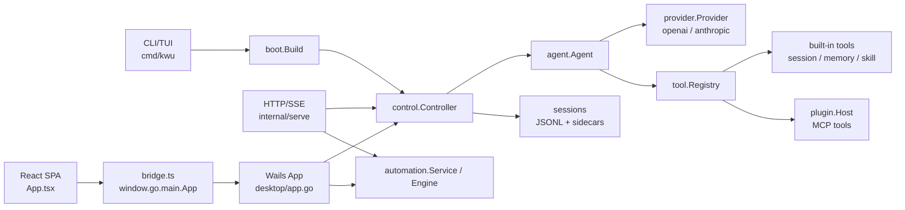

# 项目结构与架构说明

> 状态：需要复核（辅助架构说明，不替代代码与测试）
>
> 最近一次全文核对：2026-07-08；本次仅在 2026-07-30 的
> `origin/main-v3@32c251dc` 上刷新文档身份、导航与过期基线声明。
>
> 当前用户品牌为“云智企办（Clouvia）”；Go module、CLI 二进制及部分兼容标识
> 仍使用 `kwu`。本文中的包名和命令按实际代码保留。

本文以中文为主。路径、接口名、命令、包名、事件名和技术名保留英文，方便直接搜索代码。

## 1. 项目定位

云智企办是一个本地优先的桌面 Agent OS 与智能工作台，同时保留完整的
AI Coding Agent 能力。它不是传统的前后端 Web 服务，而是一个 Go 核心运行时加多种外壳：

- CLI/TUI：命令行和交互式终端界面。
- HTTP/SSE：供集成客户端使用的远程控制 API。
- Desktop：Wails 原生桌面窗口加 React 前端。
- Plugin Runtime：兼容 MCP 的插件系统，把远程工具统一适配为本地工具。
- 周边服务：Cloudflare crash-report worker。

核心运行链路是：

```text
CLI / HTTP API / Desktop UI
  -> internal/boot.Build
  -> internal/control.Controller
  -> internal/agent.Agent
  -> internal/provider.Provider
  -> internal/tool.Registry
  -> built-in tools / MCP plugin tools
```

这个分层是理解仓库的主线：UI 外壳只负责输入、展示、审批和状态同步；真正的会话、模型调用、工具执行、权限、持久化都在 Go 核心里。

### 1.1 可拆分的大模块

按维护边界看，这个项目可以拆成 8 个大模块：

| 模块 | 主要位置 | 职责 |
|---|---|---|
| Go 核心运行时 | `internal/boot`、`internal/control`、`internal/agent` | 装配配置、控制会话生命周期、驱动模型和 tool-call 循环。 |
| 模型、工具和插件层 | `internal/provider`、`internal/tool`、`internal/plugin`、`internal/permission` | 接入模型 provider、内置工具、MCP 插件和权限审批。 |
| CLI/HTTP 接入层 | `cmd/kwu`、`internal/cli`、`internal/serve` | 提供命令行、TUI 和 HTTP/SSE API。 |
| Desktop Go 壳 | `desktop/*.go` | Wails 生命周期、桌面系统集成、Go 方法绑定和事件转发。 |
| Desktop React 前端 | `desktop/frontend/src` | 聊天工作台、设置、历史、项目树、审批、自动化等页面级视图。 |
| 本地能力域 | `internal/automation`、`internal/memory`、`internal/expert`、`internal/bot` | 自动化任务、记忆、专家系统和 IM bot。 |
| 持久化与状态 | `internal/store`、`internal/agent/save.go`、各 domain store | session、checkpoint、goal、jobs、automation archive、SQLite/JSONL 状态。 |
| 周边分发与运营 | `workers/crash-report`、`npm/kwu`、`.github/workflows`、`scripts` | 崩溃上报、npm 包装、发布和仓库检查。 |

## 2. 技术栈

| 层级 | 技术 | 位置 |
|---|---|---|
| Go 核心 | Go module `kwu`，Go `1.25.0`，toolchain `go1.26.4` | [`../go.mod`](../go.mod) |
| Desktop Go | nested module `kwu/desktop`，`replace kwu => ../` | [`../desktop/go.mod`](../desktop/go.mod) |
| 桌面壳 | Wails v2 | [`../desktop/wails.json`](../desktop/wails.json) |
| 桌面前端 | React 19、Vite 8、TypeScript 6、Zustand | [`../desktop/frontend/package.json`](../desktop/frontend/package.json) |
| CLI UI | Bubble Tea、Lipgloss | [`../go.mod`](../go.mod) |
| HTTP API | Go `net/http` + SSE | [`../internal/serve`](../internal/serve) |
| 模型接入 | OpenAI-compatible provider、Anthropic provider | [`../internal/provider`](../internal/provider) |
| 插件 | MCP-compatible JSON-RPC，支持 `stdio` 和 `streamable-http` | [`../internal/plugin/plugin.go`](../internal/plugin/plugin.go) |
| 本地存储 | JSONL、sidecar JSON/directories、Markdown、SQLite | `internal/agent`、`internal/store`、`internal/memory`、`internal/expert`、`internal/automation` |
| 崩溃上报 | Cloudflare Worker、D1、Rate Limiter | [`../workers/crash-report`](../workers/crash-report) |
| 分发 | GoReleaser、GitHub Actions | [`../.github/workflows`](../.github/workflows) |

## 3. 总体架构



几个关键边界：

- UI 不直接调用模型。所有会话都通过 `control.Controller`。
- `Controller` 管会话生命周期、审批、plan mode、goal、checkpoint、jobs、snapshot、resume/fork/rewind。
- `Agent` 管模型流式响应和 tool call 循环。
- `Provider` 和 `Tool` 是接口。具体模型和工具来自 registry、config 或 plugin。
- Wails desktop 是 nested Go module，目的是隔离 CGO/WebKit，不污染 CLI 的静态二进制构建。

## 4. 顶层目录

| 路径 | 作用 |
|---|---|
| [`../cmd`](../cmd) | Go 可执行入口。包含主 CLI、benchmark、MCP 插件示例。 |
| [`../internal`](../internal) | Go 核心后端。运行时、模型、工具、插件、配置、HTTP server、自动化、记忆、IM bot 都在这里。 |
| [`../desktop`](../desktop) | Wails 桌面应用。包含桌面 Go 绑定、自动化桌面适配、React 前端。 |
| [`../desktop/frontend/src`](../desktop/frontend/src) | React SPA 源码。`App.tsx` 是桌面工作台，`lib` 放 bridge/state/types，`components` 放 UI 组件。 |
| [`../docs`](../docs) | 工程规格、设计文档、资产和本结构文档。 |
| [`../workers/crash-report`](../workers/crash-report) | Cloudflare Worker，处理 crash、usage、metrics、stats/admin。 |
| [`../scripts`](../scripts) | 仓库检查脚本，例如 `code_guard`。 |
| [`../benchmarks`](../benchmarks) | benchmark 程序和数据。 |
| [`../tools`](../tools) | 小型工具程序。 |

## 5. 运行入口

### 5.1 CLI/TUI

主要文件：

- [`../cmd/kwu/main.go`](../cmd/kwu/main.go)：进程入口，注入 version 后调用 `cli.Run`。
- [`../internal/cli/cli.go`](../internal/cli/cli.go)：命令路由、flag 解析、setup wizard、配置迁移、交互式会话、serve 模式。

`cli.Run` 识别的主要命令：

| 命令 | 作用 |
|---|---|
| `run` | 一次性执行 agent。 |
| `chat` / `code` | 进入交互式 TUI。 |
| `serve` | 启动 HTTP/SSE API。 |
| `setup` | 配置向导，写入 TOML 和全局 key env。 |
| `config` | 配置管理。 |
| `init` | 给出项目记忆初始化提示，实际初始化在会话内完成。 |
| `acp` | Agent Client Protocol 相关入口。 |
| `mcp` | MCP/plugin 状态和管理。 |
| `doctor` | 诊断。 |
| `review` | review 工作流。 |
| `bot` | IM bot 集成入口。 |
| `upgrade` / `update` | 升级器。 |
| `version` / `help` | 版本和帮助。 |

CLI 不直接 new provider 或 tool。它通过 `setup(...)` 调 `boot.Build(...)`，拿到可驱动的 `control.Controller`。

### 5.2 HTTP/SSE API

主要文件：

- [`../internal/serve/serve.go`](../internal/serve/serve.go)
- [`../internal/serve/automation.go`](../internal/serve/automation.go)
- [`../internal/serve/broadcaster.go`](../internal/serve/broadcaster.go)
- [`../internal/eventwire/wire.go`](../internal/eventwire/wire.go)：Serve 与 Desktop 共用的前端事件契约。

路由分组：

| 分组 | 路由 |
|---|---|
| 会话和聊天 | `GET /events`、`POST /submit`、`POST /cancel`、`POST /approve`、`POST /plan`、`POST /compact`、`POST /new`、`POST /rewind`、`POST /fork`、`POST /resume`、`GET /history`、`GET /status` |
| 上下文和技能 | `GET /context`、`GET /skills`、`GET /todos` |
| 会话列表 | `GET /sessions`、`POST /delete-session`、`GET /checkpoints`、`GET /branches` |
| 专家系统 | `GET /experts`、`GET /expert`、`POST /expert`、`GET /user-experts`、`GET /expert-library`、user-expert CRUD、favorite、import |
| 自动化 | `GET /automation/tasks`、`POST /automation/tasks`、`POST /automation/tasks/{id}/trigger`、`GET /automation/runs`、`GET /automation/runs/{taskID}/{runID}`、`POST /automation/runs/{taskID}/{runID}/cancel` |

状态修改请求走 `csrfGuard`，要求 JSON content type。实时输出通过 `GET /events` 的 SSE 发送。

### 5.3 Desktop 桌面端

主要文件：

- [`../desktop/main.go`](../desktop/main.go)：Wails options、资源嵌入、生命周期 hook、绑定 `App`。
- [`../desktop/app.go`](../desktop/app.go)：Wails 绑定对象，暴露大量 Go 方法给 React。
- [`../desktop/automation.go`](../desktop/automation.go)：自动化任务的 Wails 方法。
- [`../internal/eventwire/wire.go`](../internal/eventwire/wire.go)：Go event 转共享 wire event。
- [`../desktop/tabs.go`](../desktop/tabs.go)：补充 tab 路由字段并向 Wails runtime 发送事件。
- [`../desktop/frontend/src/lib/bridge.ts`](../desktop/frontend/src/lib/bridge.ts)：前端唯一直接接触 `window.go.main.App` 的桥。

桌面事件通道：

- Go 侧向 Wails runtime 发 `agent:event`。
- React 通过 `window.runtime.EventsOn("agent:event", ...)` 订阅。
- 普通浏览器 `pnpm dev` 没有 Wails runtime 时，`bridge.ts` 使用 mock binding。

核心 Wails 方法类别：

| 类别 | 方法示例 |
|---|---|
| 聊天控制 | `Submit`、`SubmitToTab`、`Cancel`、`CancelTab`、`Approve`、`ApproveTab`、`SetPlanMode`、`NewSession`、`History` |
| workspace/session | tab open/close/reorder、workspace switch、session resume、checkpoint、changed files、git history、project tree |
| settings/capabilities | `MCPServers`、model catalog、provider settings、tool approval mode、memory |
| automation | task list/save/trigger、run list/read/cancel/export、templates、heartbeat migration |

### 5.4 周边入口

- [`../workers/crash-report`](../workers/crash-report)：Cloudflare worker，包含 `/v1/report`、`/v1/ping`、`/v1/metrics`、`/login`、`/stats`、`/admin` 等路径。

## 6. 后端模块详解

| 模块 | 职责 | 关键文件 |
|---|---|---|
| `internal/boot` | 把 config 装配成 `control.Controller`。负责 provider、tool registry、MCP、permission、memory、skill、expert。 | [`../internal/boot/boot.go`](../internal/boot/boot.go) |
| `internal/control` | transport-agnostic 会话控制器。负责 send/run、approval、plan mode、goal、snapshot、checkpoint、job、resume/fork/rewind。 | [`../internal/control/controller.go`](../internal/control/controller.go) |
| `internal/agent` | 模型和工具循环。负责 session、provider stream、tool dispatch、compaction、task/subagent、session save/list/migrate。 | [`../internal/agent/agent.go`](../internal/agent/agent.go)、[`../internal/agent/save.go`](../internal/agent/save.go) |
| `internal/provider` | 模型 provider 接口、消息类型、tool-call 类型、provider registry。 | [`../internal/provider/provider.go`](../internal/provider/provider.go) |
| `internal/provider/openai` | OpenAI-compatible chat completion provider，也覆盖 DeepSeek 等兼容端点差异。 | [`../internal/provider/openai`](../internal/provider/openai) |
| `internal/provider/anthropic` | Anthropic Messages API provider。 | [`../internal/provider/anthropic`](../internal/provider/anthropic) |
| `internal/tool` | Tool 接口、registry、schema 暴露、MCP tool name helper。 | [`../internal/tool/tool.go`](../internal/tool/tool.go) |
| `internal/tool/builtin` | 内置 filesystem/shell 等工具，编译期注册。 | [`../internal/tool/builtin`](../internal/tool/builtin) |
| `internal/tool/sessiontool` | 会话列表和会话读取工具，供模型读取历史。 | [`../internal/tool/sessiontool`](../internal/tool/sessiontool) |
| `internal/plugin` | MCP host/client、stdio/http transport、lazy/eager startup、remote tool adapter。 | [`../internal/plugin/plugin.go`](../internal/plugin/plugin.go) |
| `internal/config` | TOML 配置、路径解析、默认值、迁移、env expansion。 | [`../internal/config`](../internal/config) |
| `internal/permission` | 每次 tool call 的审批和规则匹配。 | [`../internal/permission`](../internal/permission) |
| `internal/serve` | HTTP/SSE API，对外包装 Controller 和 automation service。 | [`../internal/serve`](../internal/serve) |
| `internal/event` | Typed event stream，被 CLI、serve、desktop、archive 共用。 | [`../internal/event`](../internal/event) |
| `internal/memory` | 层级文档记忆和 auto-memory，提供 remember/forget/recall tools。 | [`../internal/memory`](../internal/memory) |
| `internal/expert` | 专家目录、SQLite store、prompt 注入、expert team。 | [`../internal/expert`](../internal/expert) |
| `internal/skill` | Skill discovery、index prompt、run/read/install skill tools。 | [`../internal/skill`](../internal/skill) |
| `internal/automation` | 定时/手动自动化任务、调度引擎、运行归档、模板、结果导出。 | [`../internal/automation`](../internal/automation) |
| `internal/bot` | Feishu、Weixin、QQ bot 集成。 | [`../internal/bot`](../internal/bot) |
| `internal/lsp` | Language server 辅助和测试夹具。 | [`../internal/lsp`](../internal/lsp) |

## 7. 一次聊天回合的后端流程

1. UI 或 CLI 调 `Controller.Send` 或 `Controller.Run`。
2. `Controller` 建立本回合的运行环境：取消、审批、goal、checkpoint、jobs、session snapshot。
3. `Agent.Run` 把用户输入追加到 `agent.Session`。
4. `Agent` 构造 `provider.Request`，包含历史消息和 tool schemas。
5. `Provider.Stream` 流式返回文本、reasoning、usage、tool-call chunks。
6. `Agent` 收集完整 tool calls 后，通过 `tool.Registry` 查找工具。
7. `executeBatch` 保持模型给出的顺序，但允许连续 read-only tools 并行执行。
8. `executeOne` 做 plan-mode 检查、permission gate、pre-edit preview、tool execution、event emission、output truncation、receipt。
9. tool result 作为 provider message 追加进 session，继续下一轮 provider stream。
10. 模型给出 final answer 或回合停止后，`Controller.Snapshot` 持久化 session 和 sidecars。

## 8. Provider、Tool、Plugin 合约

### 8.1 Provider

`internal/provider.Provider` 的核心方法是：

```text
Stream(ctx, Request) (<-chan Chunk, error)
```

Provider 通过 `provider.Register(kind, factory)` 注册。配置项决定 provider kind、base URL、models、key env、reasoning protocol、effort、pricing 等。新增 OpenAI-compatible vendor 通常应优先改配置，而不是写新代码。

### 8.2 Tool

`internal/tool.Tool` 的核心形状是：

```text
Name()
Description()
Schema()
Execute(ctx, json.RawMessage)
ReadOnly()
```

`ReadOnly()` 会影响：

- plan mode 是否允许调用；
- permission 是否需要审批；
- 是否能被并行批处理；
- UI 如何显示 tool card。

### 8.3 Plugin / MCP

`internal/plugin.Host` 管理 MCP clients。远端工具会包装成 `remoteTool`，模型可见名称格式是：

```text
mcp__<server>__<tool>
```

Plugin host 还负责：

- eager/background/lazy startup；
- server status；
- prompts/resources discovery；
- hot add/remove；
- 把 MCP `readOnlyHint` 映射到 `Tool.ReadOnly()`，但 plan mode 仍保持保守策略。

## 9. 前端应用结构

桌面前端是一个 React SPA，没有传统 URL route。用户看到的“页面”是 `App.tsx` 根据 `workspaceView`、overlay、drawer、tab state 挂载出来的页面级视图。

### 9.1 前端入口和外壳

| 文件 | 职责 |
|---|---|
| [`../desktop/frontend/src/main.tsx`](../desktop/frontend/src/main.tsx) | React entry。 |
| [`../desktop/frontend/src/App.tsx`](../desktop/frontend/src/App.tsx) | 主 workbench，组合 sidebar、tabs、chat transcript、composer、right dock、settings/history overlays。 |
| [`../desktop/frontend/src/lib/bridge.ts`](../desktop/frontend/src/lib/bridge.ts) | Wails binding contract 和 browser dev mock。 |
| [`../desktop/frontend/src/lib/useController.ts`](../desktop/frontend/src/lib/useController.ts) | 事件 reducer 和命令封装，负责 chat/session/tab 状态。 |
| [`../desktop/frontend/src/lib/types.ts`](../desktop/frontend/src/lib/types.ts) | 前端共享类型和 wire types。 |
| [`../desktop/frontend/src/styles.css`](../desktop/frontend/src/styles.css) | 全局样式。 |

### 9.2 前端页面级视图

| 页面/视图 | 主要文件 | 具体职责 | 后端接口 |
|---|---|---|---|
| Chat workbench | `App.tsx`、`Transcript.tsx`、`Composer.tsx`、`Message.tsx`、`ToolCard.tsx` | 展示聊天记录、流式 assistant 输出、tool cards、输入框、附件、slash menu、arg menu。 | `SubmitToTab`、`CancelTab`、`HistoryForTab`、`ContextForTab`、`agent:event` |
| Project/topic sidebar | `ProjectTree.tsx`、`TabBar.tsx`、`AppChrome.tsx` | 展示 workspace、topic、global/project sessions、tabs 和导航操作。 | `ListTabs`、`OpenProjectTab`、`OpenGlobalTab`、`ActivateTopic`、`CreateTopic`、`RenameTopic`、`DeleteTopic` |
| Right workspace dock | `WorkspacePanel.tsx`、`DiffView.tsx`、`CodeViewer.tsx` | 文件树、变更列表、代码预览、git history/detail。 | `WorkspaceTree`、`WorkspaceChanges`、`WorkspaceGitHistory`、`WorkspaceGitCommitDetail`、`OpenWorkspacePath`、`RevealWorkspacePath` |
| Approval/question | `ApprovalModal.tsx`、`AskCard.tsx`、`ClearContextCard.tsx` | tool approval、plan approval、ask-tool 选择、clear-context 确认。 | `ApproveTab`、`AnswerQuestion`、`approval_request`、`ask_request` |
| Todo/status | `TodoPanel.tsx`、`StatusBar.tsx`、`ContextPanel.tsx` | 任务列表、上下文用量、模型/effort/status/jobs/checkpoints。 | `Todos`、`StatusForTab`、`JobsForTab`、`CheckpointsForTab`、`ModelsForTab` |
| Settings | `SettingsPanel.tsx` | provider/model 设置、tool approval、声音、bot、capabilities、updater。 | provider/model/settings/bot 相关 Wails methods |
| Expert directory | `ExpertDirectory.tsx`、`ExpertTeamFlowCard.tsx` | 内置专家、用户专家、收藏、最近使用、expert/team selection。 | `Experts`、`UserExperts`、`ExpertLibrary`、`SetExpert`、user-expert CRUD |
| Model marketplace | `ModelMarketplace.tsx` | 模型和 provider 浏览、连接流程。 | model marketplace 和 provider access methods |
| History drawer | `HistoryPanel.tsx`、`PromptShelf.tsx` | 保存会话、按 scope 过滤、resume、preview、delete/trash。 | `Sessions`、`PreviewSession`、`ResumeSession`、`DeleteSession`、`RestoreSession` |
| Automation modal | `custom/features/heartbeat/HeartbeatPanel.tsx` | 自动化任务列表/编辑器、模板、运行历史、运行详情、手动触发、结果导出。 | `AutomationListTasks`、`AutomationSaveTasks`、`AutomationTriggerNow`、`AutomationListRuns`、`AutomationReadRun`、`AutomationExportRunResult` |
| Memory | `MemoryPanel.tsx` | 本地记忆和记忆文档。 | `Memory`、remember/forget/recall |

### 9.3 前端状态模式

`useController.ts` 是桌面前端的状态核心：

- `historyMessagesToItems`：把后端 history 转成 transcript items。
- `applyEvent`：处理 `agent:event` 流式事件。
- `loadSessionDataForTab`：分阶段加载 history、context、jobs、checkpoints、effort、balance。
- `sendToTab`、`cancel`、`approve`、`answerQuestion`：供 `App.tsx` 调用的命令层。
- tab 切换时保留后台 tab 的运行输出、pending approval、ask card 和 transcript state。

约定：组件不应该直接碰 `window.go.main.App`。只有 `bridge.ts` 做底层绑定，其余代码调用 `app` proxy 或 `useController`。

## 10. 后端功能纵切示例：自动化任务

自动化任务是最适合看全链路的功能，因为它贯穿前端页面、Wails binding、后端 service、调度 engine、运行归档、结果导出和 HTTP API。

### 10.1 前端页面

主要文件：

- [`../desktop/frontend/src/custom/features/heartbeat/HeartbeatPanel.tsx`](../desktop/frontend/src/custom/features/heartbeat/HeartbeatPanel.tsx)
- [`../desktop/frontend/src/custom/features/heartbeat/heartbeat.bridge.ts`](../desktop/frontend/src/custom/features/heartbeat/heartbeat.bridge.ts)
- [`../desktop/frontend/src/custom/features/heartbeat/heartbeat.types.ts`](../desktop/frontend/src/custom/features/heartbeat/heartbeat.types.ts)
- [`../desktop/frontend/src/custom/features/heartbeat/heartbeat.css`](../desktop/frontend/src/custom/features/heartbeat/heartbeat.css)

页面职责：

- 面板打开时加载 tasks 和 templates。
- 编辑 prompt、schedule、conditions、model、skills、expert、source file、approval behavior。
- 保存任务列表，并且只在后端保存成功后更新本地状态。
- 手动触发任务。
- 显示 run summaries 和 run detail。
- 展示 archived run events。
- 导出最终结果，支持 `md`、`txt`、`json`、`docx`、`xlsx`、`pptx`。
- 兼容旧的 heartbeat UI 数据结构，并转换成新的 automation backend shape。

关键 bridge functions：

- `heartbeatListTasks`
- `heartbeatSaveTasks`
- `heartbeatTriggerNow`
- `heartbeatListTemplates`
- `heartbeatSaveTaskTemplate`
- `automationExportRunResult`
- `heartbeatTaskToAutomationTask`

### 10.2 Desktop Binding

主要文件：

- [`../desktop/automation.go`](../desktop/automation.go)
- [`../desktop/automation_runner.go`](../desktop/automation_runner.go)
- [`../desktop/automation_topic.go`](../desktop/automation_topic.go)
- [`../desktop/heartbeat_compat.go`](../desktop/heartbeat_compat.go)

Wails methods：

- `AutomationListTasks`
- `AutomationReloadTasks`
- `AutomationSaveTasks`
- `AutomationTriggerNow`
- `AutomationListRuns`
- `AutomationReadRun`
- `AutomationExportRunResult`
- `AutomationCancelRun`
- `AutomationListTemplates`
- `AutomationSaveTaskTemplate`
- `AutomationDeleteTaskTemplate`
- `AutomationRestoreTaskTemplate`
- `AutomationGenerateID`
- `AutomationHeartbeatMigrationStatus`

桌面 app 在 Wails lifecycle 中启动和停止 automation engine。自动化运行不是独立的另一个 agent，它仍然复用 Go kernel 的 Controller/Agent 能力，只是由 background runner 驱动。

### 10.3 后端 Domain

主要文件：

- [`../internal/automation/model.go`](../internal/automation/model.go)：task、schedule、run status、transition rules、error codes。
- [`../internal/automation/store.go`](../internal/automation/store.go)：task 和 template 持久化。
- [`../internal/automation/service.go`](../internal/automation/service.go)：给 UI/API 用的 service interface。
- [`../internal/automation/engine.go`](../internal/automation/engine.go)：scheduler、manual trigger、condition checks、run lifecycle。
- [`../internal/automation/runner.go`](../internal/automation/runner.go)：每次 run 创建一个新的 background Controller。
- [`../internal/automation/archive.go`](../internal/automation/archive.go)：run directory layout、manifest、result、run list。
- [`../internal/automation/archive_sink.go`](../internal/automation/archive_sink.go)：记录本次 run 的 runtime events。
- [`../internal/automation/export.go`](../internal/automation/export.go)：构造 result export payload。
- [`../internal/automation/migration_heartbeat.go`](../internal/automation/migration_heartbeat.go)：从 legacy heartbeat tasks 迁移。
- [`../internal/automation/templates.go`](../internal/automation/templates.go)：内置和用户保存的 task templates。

运行生命周期：

```text
HeartbeatPanel trigger/save
  -> heartbeat.bridge.ts
  -> Wails App Automation* method
  -> automation.Service
  -> automation.Engine.Trigger 或 Engine.Tick
  -> Store.CreateRun + ArchiveSink
  -> BootRunner 创建 background Controller
  -> Controller 执行编译后的 automation prompt
  -> ArchiveSink 记录 events 和 result
  -> Service 暴露 run list/detail/export
  -> HeartbeatPanel 刷新运行结果
```

Run statuses：

- `queued`
- `checking_condition`
- `skipped`
- `running`
- `succeeded`
- `failed`
- `blocked`
- `canceled`

### 10.4 HTTP Automation API

`internal/serve/automation.go` 暴露同一个 automation service：

- `GET /automation/tasks`
- `POST /automation/tasks`
- `POST /automation/tasks/{id}/trigger`
- `GET /automation/runs`
- `GET /automation/runs/{taskID}/{runID}`
- `POST /automation/runs/{taskID}/{runID}/cancel`

这意味着桌面自动化和 HTTP 自动化不是两套业务逻辑。差异主要在入口绑定和展示层。

### 10.5 自动化存储

自动化数据位于 KWU state root 下：

- task list JSON；
- templates SQLite：`templates.sqlite`；
- 每次 run 的 manifest、result、events；
- lease files，用于避免重复 owner/run；
- heartbeat migration marker，用于旧数据迁移幂等。

## 11. 数据和状态布局

| 数据 | Owner | 形态 |
|---|---|---|
| 用户配置 | `internal/config` | `KWU_HOME/config.toml` 或平台默认路径。 |
| Secrets | `internal/config` | 全局 `.env`。provider config 只写 env var 名，不写 secret value。 |
| Sessions | `internal/agent/save.go` | newline-delimited `provider.Message` JSONL。 |
| Session metadata | `internal/agent/branch.go`、`internal/store/session.go` | `<session>.jsonl.meta`。 |
| Goal state | `internal/store/session.go` | `<session>.goal-state.json`。 |
| Checkpoints | `internal/store/session.go`、`internal/control/checkpoint.go` | `<session>.ckpt/`。 |
| Background jobs | `internal/store/session.go`、`internal/jobs` | `<session>.jobs/`。 |
| Memory docs | `internal/memory` | `KWU.md`、`AGENTS.md`、`CLAUDE.md`。 |
| Auto-memory | `internal/memory/store.go` | 每条 fact 一个 Markdown 文件，分 project/global 目录。 |
| Experts | `internal/expert/store.go` | `experts.sqlite`。 |
| Automation | `internal/automation` | task JSON、templates SQLite、archived run directories。 |
| Crash reports | `workers/crash-report` | Cloudflare D1 和 worker 渲染页面。 |

## 12. 代表性用户流程

### 12.1 Desktop Chat Prompt

```text
Composer
  -> useController.sendToTab
  -> bridge app.SubmitToTab
  -> desktop.App.SubmitToTab
  -> control.Controller.Send
  -> agent.Agent.Run
  -> provider.Stream
  -> tool.Registry / plugin.Host
  -> event.Event
  -> eventwire.ToWire / desktop.toWireTab
  -> bridge.onEvent("agent:event")
  -> useController.applyEvent
  -> Transcript / ToolCard / StatusBar
```

### 12.2 Tool Approval

```text
Agent.executeOne
  -> permission gate 触发 ask/deny/allow
  -> event.ApprovalRequest
  -> ApprovalModal
  -> bridge app.ApproveTab
  -> Controller.Approve
  -> Agent 继续或拒绝 tool execution
```

### 12.3 Session Resume

```text
HistoryPanel / ProjectTree
  -> PreviewSession 或 ResumeSessionForTab
  -> agent.LoadSession
  -> desktop tab rebinding
  -> useController.loadSessionDataForTab
  -> Transcript 从 HistoryMessage[] hydrate
```

### 12.4 HTTP API Submit

```text
POST /submit
  -> serve.submit
  -> Controller.Send
  -> event broadcaster
  -> GET /events SSE client
```

## 13. 构建、测试和 CI

Root commands：

- `make build`：静态 CLI 和 plugin example，使用 `CGO_ENABLED=0`。
- `make test`：`go test ./...`。
- `make vet`：`go vet ./...`。
- `make pr-ready`：`code_guard`、baseline 检查、`go vet ./...`、`go test ./...`。

Desktop：

- `cd desktop && wails dev`
- `cd desktop && wails build`
- `cd desktop/frontend && pnpm dev`
- `cd desktop/frontend && pnpm build`
- `cd desktop/frontend && pnpm test:all`

Other：

- `cd workers/crash-report && npm run typecheck`
- `cd workers/crash-report && npm run deploy`

扫描到的测试规模：

- Go `_test.go` 文件：436 个，分布在 `cmd`、`internal`、`desktop`。
- 前端测试文件：77 个，位于 `desktop/frontend/src/__tests__`。
- GitHub Actions 包括 `ci.yml`、`codeql.yml`、`release.yml`、`release-desktop.yml`、`deploy-crash-worker.yml` 等。

## 14. 项目约定和注意点

- root CLI 构建故意保持 `CGO_ENABLED=0`。不要把 desktop 的 CGO/WebKit 依赖引入 root module。
- `desktop/frontend/dist/.gitkeep` 是为了让 `go:embed all:frontend/dist` 在前端 build 前也有目录可嵌入。
- `desktop/frontend/wailsjs` 是 generated binding。手写的前端契约在 `lib/bridge.ts`。
- `bridge.ts` 不应过早固定 `window.go`，因为 Wails runtime 可能在模块初始化后注入。
- 前端“页面切换”是 React state，不是 URL route。
- `plan mode` 和 `tool approval` 是两个概念，不要在 UI 或后端逻辑里合并。
- MCP read-only annotation 不能完全信任。未受信任的 read-only MCP tool 在 plan mode 下仍可能被阻止。
- session sidecars 故意放在 `.jsonl` 旁边，不要另造第二套 session index。
- project `.env` 用于 plugin/workspace variable expansion，不用于 provider secrets。provider secrets 在全局 KWU `.env`。
- 自动化前端路径仍叫 `heartbeat`，这是 legacy 兼容命名，不代表后端仍只有心跳功能。

## 15. 常见修改入口

| 想改什么 | 从哪里看起 |
|---|---|
| 新增或修改 CLI 命令 | [`../internal/cli/cli.go`](../internal/cli/cli.go) |
| 新增 provider kind | [`../internal/provider/provider.go`](../internal/provider/provider.go)，再看具体 provider package |
| 新增 OpenAI-compatible 模型或 vendor | 优先改 config，除非协议行为不同 |
| 新增 built-in tool | [`../internal/tool`](../internal/tool)，通常还会碰 `internal/tool/builtin` |
| 修改 MCP plugin 行为 | [`../internal/plugin/plugin.go`](../internal/plugin/plugin.go) |
| 修改聊天回合行为 | [`../internal/control/controller.go`](../internal/control/controller.go)、[`../internal/agent/agent.go`](../internal/agent/agent.go) |
| 修改桌面聊天 UI | [`../desktop/frontend/src/App.tsx`](../desktop/frontend/src/App.tsx)、`Transcript`、`Composer`、`useController` |
| 修改桌面 bridge/API | [`../desktop/app.go`](../desktop/app.go)、[`../desktop/frontend/src/lib/bridge.ts`](../desktop/frontend/src/lib/bridge.ts) |
| 修改设置页 | [`../desktop/frontend/src/components/SettingsPanel.tsx`](../desktop/frontend/src/components/SettingsPanel.tsx) |
| 修改项目侧边栏/topic | [`../desktop/frontend/src/components/ProjectTree.tsx`](../desktop/frontend/src/components/ProjectTree.tsx)，以及 desktop tab/session methods |
| 修改自动化 UI | [`../desktop/frontend/src/custom/features/heartbeat/HeartbeatPanel.tsx`](../desktop/frontend/src/custom/features/heartbeat/HeartbeatPanel.tsx) |
| 修改自动化后端 | [`../internal/automation`](../internal/automation)、[`../desktop/automation.go`](../desktop/automation.go)、[`../internal/serve/automation.go`](../internal/serve/automation.go) |
| 修改 session 持久化 | [`../internal/agent/save.go`](../internal/agent/save.go)、[`../internal/store/session.go`](../internal/store/session.go) |
| 修改 memory | [`../internal/memory`](../internal/memory) |
| 修改 expert catalog/team | [`../internal/expert`](../internal/expert)、[`../desktop/frontend/src/components/ExpertDirectory.tsx`](../desktop/frontend/src/components/ExpertDirectory.tsx) |
| 修改 crash reporting | [`../workers/crash-report/src`](../workers/crash-report/src) |

## 16. 本文档的验证方式

已读取或检查：

- 用户上传的 onboarding template。
- `project-structure` skill 说明。
- README、desktop README、engineering spec。
- root、desktop、frontend、worker manifests。
- CLI、boot、controller、agent、provider、tool、plugin、serve、desktop bridge、frontend app/controller、automation 前后端文件。
- 当前 worktree status。
- 测试文件和 GitHub Actions workflow 清单。

本次只修改文档，没有运行完整构建或测试。对本文档的验证方式是 source inspection、关键章节检索和 Markdown diff 检查。
