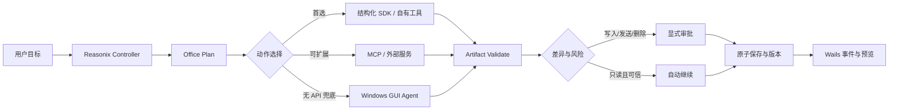

# GitHub 高质量办公 Agent 调研与 Reasonix 验证方案

> 日期：2026-07-21
> 基线：`D:\project\Reasonix-worktrees\integration-main-v3-20260721`，`HEAD 879e78cf`
> 性质：调研与 PoC 方案，不是依赖选型结论，也不授权直接引入第三方代码
> 证据：GitHub 仓库与论文正文、仓库元数据、Reasonix 当前实现；检索运行保存在本 worktree 的 `.agent-search/20260721T125501Z-0a68ceca/`

## 1. 结论先行

Reasonix 已经具备统一 Agent 内核、工具审批、MCP、Skills、自动化任务、工作区、附件、Bot 和事件流。办公 Agent 不应再造第二套 Agent runtime，而应围绕现有 `boot.Build -> control.Controller -> agent.Agent` 增加一个统一的 **Office Artifact Engine**。

首轮建议按下面的优先级研究：

1. **P0：Univer + 自有 Artifact 契约**——验证结构化表格/文档模型、嵌入式预览和 headless 执行，优先解决可编辑 Artifact 基座。
2. **P0：office-ai-agent 的安全保存闭环**——只借鉴原子保存、版本历史、差异、回滚、局部编辑和视觉 QA 的设计，不把这个新仓库当稳定依赖。
3. **P1：OfficeDex 的产品边界**——借鉴 Wails 桌面壳与独立生成 runtime 的解耦、Office 预览工作台和任务交互；受 GPL-3.0 约束，未经许可证审查不得复制代码。
4. **P1：OpenAdapt 的确定性工作流**——验证“演示一次、编译、无模型回放、漂移时受控修复、失败即停”，用于高频重复办公流程。
5. **P1：UFO 的 Windows GUI/API 分层**——用于研究没有结构化 API 时的兜底路径，不作为首选执行面。
6. **P2：Rowboat 的知识工作闭环**——研究邮件、会议、长期工作上下文与后台 Agent，待 Artifact 层稳定后再进入产品验证。

明确不建议：

- 直接采用另一个通用 Agent 内核替换 Reasonix。
- 第一阶段就依赖像素点击完成 Word/Excel/PPT 主流程。
- 因 star 数高就引入仓库。
- 未经许可证评估复制 GPL-3.0 或 AGPL-3.0 实现。
- 把已归档的 TaskWeaver、Office-Word-MCP-Server 当作长期运行依赖。

## 2. 本次调研问题

调研需要回答五个可决策问题：

1. 哪些项目在 Office Artifact、桌面执行、知识工作、流程治理方面提供了可复用设计？
2. 哪些能力 Reasonix 已经实现，哪些只是配置门控，哪些仍缺失？
3. 候选的工程质量、维护状态、许可证和安全边界是否允许直接依赖？
4. 最小 PoC 应验证什么，才能避免“演示可用、真实流程不可用”？
5. PoC 达到哪些量化门槛后才能进入产品实现？

## 3. 检索和质量筛选方法

### 3.1 检索范围

- GitHub 仓库：完整办公 Agent、Office SDK/MCP、Windows/desktop Agent、知识工作 Agent、确定性自动化。
- 一手证据：仓库 README、源码树、测试、release、license、归档状态和最后 push 时间。
- 反证：GUI Agent 的多初始状态鲁棒性和环境注入/隐私风险研究。
- 时间截点：2026-07-21；软件活跃度优先看近 240 天，但稳定基础库可放宽。

### 3.2 “高质量”不是 star 排名

候选必须同时评估：

| 维度 | 权重 | 通过证据 |
|---|---:|---|
| 与 Reasonix 的架构匹配 | 20 | 能接入现有 Controller、MCP、审批、workspace 和 Wails，而非替换核心 |
| Office Artifact 完整度 | 20 | 生成、读取、局部编辑、验证、预览、差异、版本和回滚 |
| 安全与治理 | 15 | 路径边界、审批、审计、原子保存、失败即停、敏感数据控制 |
| 工程质量 | 15 | 测试、CI、release、文档、错误处理、清晰模块边界 |
| 维护与社区 | 10 | 非归档、近期 push/release、issue 响应、多个贡献者 |
| 许可证可用性 | 10 | 优先 MIT/Apache-2.0；GPL/AGPL 单独评估 |
| PoC 与落地成本 | 10 | Windows、Wails、Go/TypeScript 适配、运行时体积、部署复杂度 |

任何候选触发以下条件，不能进入“直接依赖”名单：仓库归档、无明确许可证、核心能力仅存在于商业闭源层、无法建立路径/权限边界、无法自动验证输出、发生失败仍继续执行。

## 4. Reasonix 当前项目基线

### 4.1 已确认实现

| 能力 | 当前证据 | 对办公 Agent 的意义 |
|---|---|---|
| 统一 Agent 内核 | [`internal/boot/boot.go`](../../internal/boot/boot.go)、[`internal/control/controller.go`](../../internal/control/controller.go)、[`internal/agent/agent.go`](../../internal/agent/agent.go) | 不重建 runtime；办公能力作为工具、服务、Skill 或子流程接入 |
| 自动化调度与治理 | [`internal/automation/model.go`](../../internal/automation/model.go) | 已有 once/interval/calendar、条件、审批、超时、归档模型 |
| 业务数据输入 | [`internal/automation/business.go`](../../internal/automation/business.go) | 已支持 CSV、XLSX、HTTP、MCP，可作为报表生成输入层 |
| 基础 Office 导出 | [`internal/automation/export.go`](../../internal/automation/export.go) | 已能从 Markdown 块生成 DOCX/XLSX/PPTX；这是起点，不是完整编辑引擎 |
| Wails/React 桌面 | [`desktop/wails.json`](../../desktop/wails.json)、[`desktop/frontend/package.json`](../../desktop/frontend/package.json) | 可承载 Artifact 预览、局部选择、差异审阅和版本恢复界面 |
| 审批与 MCP 信任 | [`desktop/app.go`](../../desktop/app.go) | 已有 per-tab 审批和 MCP trusted-read-only 边界，可复用到 Office 写操作 |
| 事件投影 | [`internal/eventwire/wire.go`](../../internal/eventwire/wire.go)、[`desktop/tabs.go`](../../desktop/tabs.go) | 可发送生成进度、校验结果、预览更新和审批事件 |
| 只读文件预览 | [`desktop/app.go`](../../desktop/app.go) | 已有受限文本/媒体/PDF 预览，但没有 DOCX/XLSX/PPTX 的结构化编辑工作台 |

完整端到端架构见 [`docs/PROJECT_BUSINESS_ARCHITECTURE.md`](../PROJECT_BUSINESS_ARCHITECTURE.md)。

### 4.2 配置门控能力

- 模型 provider、MCP 服务、Skills、Bot、网络代理和云服务需要配置后才会发起真实外部调用。
- MCP 可动态连接并标记可信只读工具，但新的 Office 写工具仍必须默认进入审批路径。
- Bot 已能复用 Controller，但“远程生成并交付文件”需要额外的收件人、文件范围、内容预览和发送确认。

### 4.3 关键缺口

1. 缺少统一 `Artifact` 领域模型：格式、版本、来源、父版本、校验、渲染产物、差异和审计没有统一契约。
2. 当前导出偏向“一次性生成”，缺少读取现有 Office 文件后局部编辑、保留格式、公式和批注的往返能力。
3. 缺少 DOCX/XLSX/PPTX 内嵌结构化预览、局部选择和“建议修改/接受/拒绝”交互。
4. 缺少统一的原子保存、请求级版本历史、差异和一键回滚。
5. 缺少 Artifact QA：OOXML 合法性、公式引用、内容溢出、字体缺失、图表数据、可访问性和跨 Office/LibreOffice 打开验证。
6. 缺少将一次成功办公操作固化为确定性可重复工作流的机制。
7. 邮件、会议和长期知识上下文尚未形成办公闭环。

## 5. 候选项目矩阵

仓库状态和 release 信息均为 2026-07-21 检索快照。

| 候选 | 角色 | 质量信号 | 主要可借鉴能力 | 主要限制 | 建议 |
|---|---|---|---|---|---|
| [dream-num/univer](https://github.com/dream-num/univer) | 可嵌入 Office SDK | Apache-2.0；活跃；有测试、CI、release；浏览器/Node 共用架构 | 插件架构、Facade API、公式引擎、headless、React 嵌入 | Sheets 最成熟；Slides 仍发展中；导入导出等能力部分在 Pro | **P0 PoC**，优先验证开源能力边界 |
| [microsoft/UFO](https://github.com/microsoft/UFO) | Windows GUI/API Agent | MIT；约 9.3k stars；近期 release；tests/文档/安全修复 | GUI/API 混合动作、应用级 Agent、DAG 任务分解 | Python runtime；GUI 风险高；不能把宣传的可靠性当本项目证据 | **P1 架构研究**，仅作兜底执行面 |
| [officecli/officedex](https://github.com/officecli/officedex) | 完整办公桌面产品 | 与 Reasonix 同为 Wails v2 + React 19；有 unit/E2E；持续 release | 桌面壳/生成 runtime 解耦、内嵌预览、办公 workspace、上下文连续编辑 | GPL-3.0；仓库较新；生成 runtime 是另一仓库 | **P1 产品标杆**，先做许可证隔离 |
| [MO-HU-P/office-ai-agent](https://github.com/MO-HU-P/office-ai-agent) | 完整 Office 文件 Agent | Apache-2.0；实现说明具体；有 pytest | 原子保存、版本历史、请求级 diff/rollback、局部编辑、视觉 QA、批注/修订 | 2026-07 新建；单贡献者；无 release、无采用信号 | **设计样本**，不得作为稳定依赖 |
| [OpenAdaptAI/OpenAdapt](https://github.com/OpenAdaptAI/OpenAdapt) | 确定性 GUI 工作流 | MIT；活跃 release/CI；主动披露成熟度边界 | 演示编译、无模型健康回放、受控修复、postcondition、失败即停 | 通用 Windows 仍是 scoped acceptance；部署栈不同 | **P1 PoC**，验证重复流程治理 |
| [rowboatlabs/rowboat](https://github.com/rowboatlabs/rowboat) | 本地优先 AI coworker | Apache-2.0；活跃；跨平台 release；CI | 长期知识图谱、邮件、会议、后台 Agent、MCP | 产品面广，直接接入会扩大范围；并非 Office 文件引擎 | **P2 标杆**，Artifact 稳定后再做 |
| [ONLYOFFICE/DocumentBuilder](https://github.com/ONLYOFFICE/DocumentBuilder) | 多格式生成/编辑引擎 | 成熟 release；支持 DOCX/XLSX/PPTX/PDF；跨平台 | 脚本模板、广泛格式、无需打开完整编辑器 | AGPL-3.0 并提供商业许可；集成体积和分发需验证 | **许可证/商业评估**，不直接复制 |
| [GongRzhe/Office-Word-MCP-Server](https://github.com/GongRzhe/Office-Word-MCP-Server) | Word MCP | MIT；接口细；曾有 release | Word 工具粒度、MCP schema、资源/工具分离 | **已归档**；只覆盖 Word | **协议参考，不依赖** |
| [microsoft/TaskWeaver](https://github.com/microsoft/TaskWeaver) | 数据分析 Agent | MIT；代码优先分析思路成熟 | 分析计划、代码解释器、插件式数据任务 | **已归档**；与 Reasonix 内核重叠 | **历史设计参考** |

## 6. 从候选中提炼的目标能力

### 6.1 P0：Office Artifact Engine

统一模型建议至少包含：

```text
Artifact
├── id / workspace / owner / format
├── source_path / working_copy / output_path
├── version / parent_version / request_id
├── content_model / metadata / provenance
├── validation_report / render_manifest
├── diff_to_parent / rollback_receipt
└── approval_and_audit
```

统一操作：

- `import`：读取现有 DOCX/XLSX/PPTX，生成受控工作副本。
- `inspect`：返回结构、样式、公式、图表、批注、媒体和可编辑区域。
- `plan_edit`：形成机器可读 edit plan，不立即写文件。
- `apply_edit`：在审批后对工作副本执行局部变更。
- `validate`：结构校验、业务规则校验、视觉校验。
- `render`：生成桌面预览需要的 HTML/SVG/图片/PDF/网格数据。
- `diff`：按段落、单元格、公式、图表、幻灯片和资源生成差异。
- `commit_version` / `rollback`：原子替换并保留可恢复版本。
- `deliver`：保存、复制或远程发送；始终独立审批。

### 6.2 P1：受控办公工作流

结构化 API 的优先级必须高于 GUI：



GUI 兜底需要：应用身份校验、初始状态识别、动作前后条件、可观察副作用、敏感字段遮罩、最大动作数、超时、失败即停和完整回放日志。

### 6.3 P2：知识工作闭环

- 邮件：先检索和草拟；发送、删除、移动和批量操作必须审批。
- 会议：本地录音/转写、行动项、决策、负责人和截止时间进入可追溯知识条目。
- 项目上下文：workspace/topic/session 与 Artifact、邮件线程、会议纪要互相关联。
- 后台任务：复用现有 automation，而不是另建 scheduler。

## 7. 分阶段调研与 PoC

### Phase 0：基线冻结与契约设计（2～3 天）

产出：

- `Artifact`、`ArtifactVersion`、`EditPlan`、`ValidationReport`、`RenderManifest`、`DeliveryReceipt` 的 JSON schema 草案。
- 当前 `internal/automation/export.go` 和桌面文件预览的能力/缺口测试表。
- 第三方许可证矩阵和“不复制代码”边界。
- 12 个固定样本：每种格式 4 个，覆盖简单、复杂、异常、第三方来源。

退出门槛：三种格式共用同一生命周期；所有写操作都有 request id、工作副本、版本和审计字段。

### Phase 1：Artifact 引擎双轨 PoC（5～8 天）

并行验证两条路线，但只保留一个产品主路径：

1. **Univer 路线**：嵌入 React 预览；Node headless 操作工作簿/文档；验证开源版导入导出边界。
2. **Python OOXML sidecar 路线**：借鉴 office-ai-agent 的 `python-docx/openpyxl/python-pptx` 组合，通过 stdio JSON-RPC 接入，不把 Python 逻辑塞入 Go 核心。

每条路线完成：打开现有文件、局部编辑、验证、预览、diff、原子保存、回滚。PPTX 必须包含溢出检测；XLSX 必须保留公式；DOCX 必须验证段落/表格/批注或修订边界。

退出门槛：

- 12/12 样本无损打开并生成可审阅预览。
- 目标修改 12/12 正确，非目标内容无变化。
- 任何失败不覆盖原文件。
- 12/12 可回滚到字节或语义等价版本。
- 路径逃逸、隐藏历史目录和越权 workspace 访问全部被拒绝。

### Phase 2：确定性办公流程 PoC（4～6 天）

选择两个真实流程：

- Excel 月报：读取固定模板 → 导入 CSV/XLSX → 更新表格/公式/图表 → 生成摘要 → 审批 → 保存。
- PPT 周报：读取模板 → 生成 5～8 页 → 渲染 → 检测溢出/遮挡 → 修改 → 审批 → 交付。

对比三种执行面：自有结构化工具、MCP、Windows GUI。参考 OpenAdapt，为成功流程生成可重放步骤和 postconditions。

退出门槛：

- 每个流程连续 20 次执行，**0 次静默错误**。
- 至少 5 种非默认初始状态仍能恢复或明确停止。
- GUI 路线的成功率、平均动作数和恢复率单独报告，不与 API 路线混算。
- 健康的确定性回放不调用模型；检测到漂移时先停下，再请求受控修复。

### Phase 3：安全、审批与对抗验证（3～5 天）

必须覆盖：

- 文档内容中的提示注入、隐藏文本、超链接和外部资源。
- Excel 公式注入、CSV 注入、宏文件、外部链接和数据连接。
- GUI 中的恶意提示、欺骗性默认项、窗口焦点变化和遮挡。
- 敏感数据上传、外部模型调用、剪贴板、邮件收件人和远程交付。
- ask/auto/yolo 三种模式与 MCP trusted-read-only 组合。

退出门槛：

- 内容中的指令永远不能提升工具权限。
- 写入、发送、删除、覆盖原件、启用宏和外部链接必须被独立策略识别。
- 审批卡展示目标文件、差异摘要、外部目的地、数据范围和不可逆影响。
- 安全失败必须进入 DecisionAudit，不能只写普通日志。

### Phase 4：决策与产品化方案（2 天）

最终形成一份 ADR：

- 选择的 Artifact runtime 与弃选理由。
- 第三方依赖、许可证、更新策略和 SBOM。
- Go/sidecar/前端边界、故障隔离和版本兼容策略。
- 首个产品场景、非目标、迁移方式、性能预算和发布门槛。
- 是否进入邮件/会议/长期知识上下文的 Phase 2 产品路线。

## 8. 验收指标

| 类别 | 指标 | 最低门槛 |
|---|---|---:|
| 正确性 | 目标修改成功率 | 100% 固定样本；真实样本 ≥ 95% |
| 非破坏性 | 非目标内容变化 | 0 个不可解释变化 |
| 静默错误 | 系统报告成功但结果错误 | 0 |
| 可恢复性 | 写失败保留原件 | 100% |
| 回滚 | 已提交版本可恢复 | 100% |
| 预览 | 关键元素与 Office 打开结果一致 | ≥ 95% 样本通过人工双检 |
| Excel | 公式、类型、格式和图表引用保持 | 100% 固定样本 |
| PPT | 文本溢出/遮挡检出 | ≥ 95%，且不得漏掉 P0 遮挡 |
| DOCX | 段落、表格、媒体、批注/修订边界 | 100% 约定支持集 |
| GUI 鲁棒性 | 非默认初始状态 | 成功恢复或明确停止 ≥ 95% |
| 安全 | 注入导致越权动作 | 0 |
| 审批 | 高风险动作具备完整上下文 | 100% |
| 性能 | 10 MB 文档首次预览 | 目标 ≤ 5 秒，超限需给进度 |

## 9. 风险与停止条件

### 9.1 GUI Agent 风险

[WorldGUI](https://arxiv.org/html/2502.08047v4) 覆盖 Word、Excel、PowerPoint 等应用，并表明当前 GUI Agent 在非默认初始状态下会显著退化。因此 UI 自动化的验收必须包含中间状态、焦点变化、弹窗和布局变化，不能只从干净起点跑一次。

[Fine-Print Injection 研究](https://arxiv.org/html/2504.11281v1) 显示，GUI Agent 会被上下文中低显著度的恶意内容影响，而且人工监督本身不能保证安全。因此必须把策略校验、数据流限制和后置条件放在 Agent 之外。

### 9.2 许可证风险

- OfficeDex：GPL-3.0；可以做黑盒产品研究，复制实现前必须完成法务判断。
- ONLYOFFICE DocumentBuilder：AGPL-3.0/商业双轨；PoC 前先确定分发和网络使用义务。
- MIT/Apache-2.0 也需要保留 notice、核查传递依赖和商标限制。

### 9.3 立即停止 PoC 的条件

- 无法保证失败时不覆盖原文件。
- 结构化路线不能保留关键公式、样式或媒体，且只能退回像素级 GUI。
- 预览与真实文件偏差大到无法支持审批。
- 外部进程获得超出 workspace 的文件访问能力且无法可靠收敛。
- 许可证与 Reasonix 预期分发方式不兼容。
- 20 次重复执行中出现任何未被系统检测的错误写入。

## 10. 推荐的首个切片

首个实现切片建议是“**受控 Excel 月报 Artifact**”，原因是 Reasonix 已有 XLSX 输入、业务诊断和 XLSX 导出，能以最短路径验证 Artifact 生命周期：

1. 从 workspace 选择现有 `.xlsx` 模板并创建工作副本。
2. 导入现有 CSV/XLSX/HTTP/MCP 业务数据。
3. 生成结构化 edit plan，展示将改动的 sheet/range/公式/图表。
4. 审批后执行，运行公式和引用校验。
5. 在 Wails 中显示网格、图表摘要和单元格 diff。
6. 原子提交新版本，保留一键回滚。
7. 保存到本地；远程发送留到后续独立切片。

这个切片能复用当前最多的能力，又能暴露 Artifact 契约、审批、预览、差异和回滚中的核心问题。Word/PPT 在契约稳定后沿同一生命周期扩展。

## 11. 预期交付物

- `docs/adr/`：Artifact runtime 选型 ADR。
- `docs/design/`：Artifact schema、权限矩阵、事件协议和 sidecar 协议。
- `internal/artifact/`：只在 ADR 通过后建立的 Go 领域接口与生命周期。
- `desktop/frontend/src/features/artifacts/`：预览、diff、版本、审批交互。
- `testdata/office-artifacts/`：脱敏固定样本、预期 diff 和验证规则。
- PoC 报告：每个候选的分数、命令、结果、失败、许可证和去留结论。

## 12. 证据索引

### 外部一手来源

- [Univer repository](https://github.com/dream-num/univer)
- [Microsoft UFO repository](https://github.com/microsoft/UFO)
- [OfficeDex repository](https://github.com/officecli/officedex)
- [Office AI Agent repository](https://github.com/MO-HU-P/office-ai-agent)
- [OpenAdapt repository](https://github.com/OpenAdaptAI/OpenAdapt)
- [Rowboat repository](https://github.com/rowboatlabs/rowboat)
- [ONLYOFFICE DocumentBuilder repository](https://github.com/ONLYOFFICE/DocumentBuilder)
- [Office-Word-MCP-Server repository](https://github.com/GongRzhe/Office-Word-MCP-Server)
- [TaskWeaver repository](https://github.com/microsoft/TaskWeaver)

### 独立反证

- [WorldGUI: An Interactive Benchmark for Desktop GUI Automation from Any Starting Point](https://arxiv.org/html/2502.08047v4)
- [The Obvious Invisible Threat: LLM-Powered GUI Agents' Vulnerability to Fine-Print Injections](https://arxiv.org/html/2504.11281v1)

### 本地实现证据

- [`docs/PROJECT_BUSINESS_ARCHITECTURE.md`](../PROJECT_BUSINESS_ARCHITECTURE.md)
- [`internal/automation/`](../../internal/automation/)
- [`internal/boot/`](../../internal/boot/)
- [`internal/control/`](../../internal/control/)
- [`internal/agent/`](../../internal/agent/)
- [`internal/eventwire/wire.go`](../../internal/eventwire/wire.go)
- [`desktop/app.go`](../../desktop/app.go)
- [`desktop/tabs.go`](../../desktop/tabs.go)

## 13. 当前不确定项

- Univer 开源版对现有 DOCX/PPTX 的导入、保真编辑和导出是否满足目标，需要真实文件 PoC，不能由 README 推断。
- OfficeDex 的独立 `officecli` runtime 是否允许技术和许可证上与 Reasonix 隔离集成，需要单独审查。
- Python OOXML 方案对复杂 SmartArt、宏、嵌入对象和高级图表的保真度尚未验证。
- Windows GUI 执行在不同 Office/WPS 版本、语言、缩放和主题下的稳定性未知。
- 邮件和会议能力是否属于下一产品阶段，需要产品范围确认；本方案只把它们列为 P2。
