# Office Agent 自动化与经营诊断业务实现全景

> 文档日期：2026-07-21
>
> 代码基线：`D:\project\Reasonix-worktrees\integration-main-v3-20260721` 当前工作区
>
> 业务范围：自动化任务、经营诊断、Agent 后台执行、运行归档、Office 文件导出
>
> 上位文档：[项目总体业务与架构](../PROJECT_BUSINESS_ARCHITECTURE.md)
>
> 调研输入：[GitHub 高质量办公 Agent 调研方案](./2026-07-21-github-office-agent-research-plan.md)
>
> 后续实施：[Office Agent 业务分阶段实施计划](./2026-07-21-office-agent-phased-implementation-plan.md)

## 1. 文档目的

本文从用户在桌面前端的每一次关键点击出发，沿着 Wails 桥接、Go 服务、调度引擎、Agent 控制器、数据源、文件/SQLite 持久化，再回到 React 页面渲染，说明当前 Office Agent 业务的真实实现。

本文只描述当前工作区中可以由源码证明的行为，并使用以下状态：

- **已实现**：当前调用链已经接通。
- **宿主差异**：桌面端与 `kwu serve` 的执行器不同。
- **配置门控**：代码存在，但需要模型、Provider、登录、工作区或外部数据源可用。
- **未实现**：界面或底层尚未形成完整闭环。

### 1.1 项目身份与架构形态

**已确认：** Reasonix/KWU 是以 Go Agent 内核为中心、同时提供 CLI、Wails Desktop 和 HTTP/SSE 接入的模块化单体。Desktop 是独立 Go module，通过 `replace kwu => ..` 复用根模块的 `internal/*` 内核；Office Agent 自动化不是第二套 Agent，而是复用 `control.SessionAPI`、Provider、Tools、Skills、MCP、Topic 和 Session 能力。

本业务采用“宿主适配层 + 共享 Automation Core + 混合本地持久化”的架构：

- React 页面只负责表单、状态和结果渲染。
- Wails/HTTP 适配层把宿主请求转换成共享 Service DTO。
- Service 处理用例，Engine 处理调度、状态机、租约和 Runner 派发。
- Desktop Runner 调用既有 Agent 会话；serve Runner 可以走确定性经营诊断。
- 任务和运行主要以文件归档，只有模板使用 SQLite。

### 1.2 技术栈

| 范围 | 当前技术 | 在本业务中的作用 | 证据 |
|---|---|---|---|
| 核心语言 | Go 1.25，toolchain Go 1.26.4 | Service、Engine、Runner、HTTP、归档和 Office 导出 | `go.mod`、`desktop/go.mod` |
| 桌面壳 | Wails v2.12 | Go 方法绑定、原生文件对话框、拖放和桌面生命周期 | `desktop/go.mod`、`desktop/wails.json` |
| 前端 | React 19、TypeScript 6、Vite 8 | 自动化面板、任务编辑器、运行详情 | `desktop/frontend/package.json` |
| 前端状态 | React hooks + Zustand | 页面局部状态与全局 overlay/workspace 导航 | `HeartbeatPanel.tsx`、`src/store/*` |
| Markdown 展示 | react-markdown + remark-gfm/math + rehype-katex | 运行结果摘要渲染 | `desktop/frontend/package.json` |
| 本地数据库 | modernc.org/sqlite | 任务模板与模板迁移标记 | `internal/automation/store.go` |
| 文件存储 | JSON、JSONL、Markdown、Open XML ZIP | 任务、租约、运行事件、结果和导出产物 | `internal/automation/archive.go`、`export.go` |
| HTTP | Go `net/http` | `kwu serve` Automation JSON API | `internal/serve/serve.go` |
| 测试 | Go test + Node/tsx 合同测试 | 引擎、存储、业务诊断、导出和页面契约 | `*_test.go`、`desktop/frontend/src/__tests__` |

### 1.3 业务运行入口

| 入口 | 启动点 | 自动化装配 |
|---|---|---|
| Desktop | `desktop/main.go:96` → `App.startup` | `desktop/app.go:552` 调用 `startAutomation`，创建 Desktop Runner 和带模型检查器的 Engine |
| CLI/HTTP | `cmd/kwu/main.go:18` → `internal/cli` | `internal/cli/cli.go:644` 创建 `BusinessDiagnosticsRunner(BootRunner)` 并注入 HTTP Server |
| React | `desktop/frontend/src/main.tsx:84` | 渲染 `App`，再由侧边栏或 overlay 懒加载 `HeartbeatPanel` |
| 定时任务 | `Engine.Start` goroutine | 默认每 30 秒执行一次 `Tick` |
| 手动任务 | Wails 或 HTTP trigger | 进入同一个 Engine `Trigger`、租约、条件和归档流程 |

## 2. 核心结论与边界

### 2.1 当前已形成的业务闭环

1. 用户可以在桌面“自动化任务”页面新建、编辑、启停、删除任务。
2. 用户可以套用内置模板，也可以把普通任务保存为用户模板。
3. “经营诊断”模板可以配置时间范围、区域、收件人，以及销售、库存、采购、财务、退货数据源。
4. 数据源支持本地 CSV、本地 XLSX、HTTP CSV/JSON/XLSX，以及在任务 JSON 中内嵌的 MCP rows。
5. 自动化引擎每 30 秒扫描一次到期任务，也支持用户点击“立即运行”。
6. 每次运行都经过任务租约、模型路由、前置条件、运行状态机和归档流程。
7. 桌面任务复用或创建话题，通过共享 `control.SessionAPI` 执行 Agent turn；最终助手 Markdown 被归档为 `result.md`。
8. 用户可以查看运行摘要、状态事件、错误和用量，并导出 MD、TXT、JSON、DOCX、XLSX、PPTX。
9. 模板元数据保存到 SQLite；任务、租约、运行清单、事件和结果使用本地文件保存。
10. `kwu serve` 提供 Automation HTTP API，并对经营诊断任务使用确定性数据处理器。

### 2.2 必须明确的实现差异

桌面端与 HTTP 服务端共享 `automation.Service`、`Engine` 和 `Store`，但 Runner 组装不同：

| 宿主 | Runner | 经营诊断的实际处理方式 | 产物 |
|---|---|---|---|
| Wails Desktop | `desktopAutomationRunner` | 把 `businessDiagnostics` 写入编译后的 Agent prompt，由会话 Agent 使用文件/工具完成分析 | `manifest.json`、`events.jsonl`、`result.md`、会话快照；不保证生成结构化诊断 JSON |
| `kwu serve` | `BusinessDiagnosticsRunner(BootRunner)` | 有诊断配置时直接读取并归一化数据、做质量门禁、计算固定指标；普通任务继续交给 `BootRunner` | 额外生成 `business-diagnostics.json` 和确定性 `result.md` |

因此，不能把 `BusinessDiagnosticsRunner` 的确定性指标计算描述为桌面点击后的必经路径。桌面端目前是 **Agent 驱动路径**；HTTP/CLI serve 是 **确定性诊断路径**。

### 2.3 当前不是完整 Office 编辑器

当前 Office 能力是“从 Markdown 结果生成 Office Open XML 文件”，并不是 Word/Excel/PowerPoint 文档的双向编辑系统：

- DOCX：把标题、段落、列表、引用转换为 Word 段落。
- XLSX：输出 `type / level / text` 三列的结构化结果表。
- PPTX：按 Markdown 标题切分幻灯片，正文生成文本块。
- 不支持读取现有 DOCX/PPTX 后保持版式编辑。
- 不支持公式、图表、图片、批注、修订、母版和复杂表格的保真往返。
- 收件人目前是诊断配置和 prompt 上下文的一部分，未发现自动发邮件的交付调用链。

## 3. 项目总体架构图

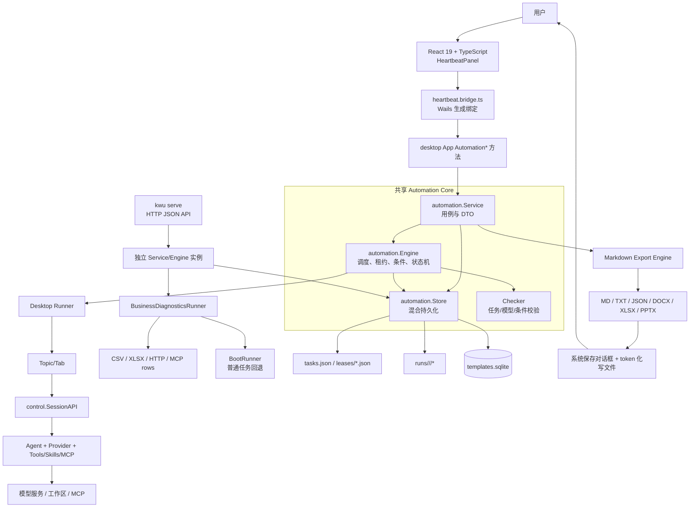

## 4. 关键模块与职责

| 层 | 文件 | 主要职责 |
|---|---|---|
| 前端页面 | `desktop/frontend/src/features/automation/heartbeat/HeartbeatPanel.tsx` | 任务列表、筛选、编辑器、模板、经营数据源、运行详情、取消与导出交互 |
| 前端桥接 | `desktop/frontend/src/features/automation/heartbeat/heartbeat.bridge.ts` | 把旧 Heartbeat 表单模型映射为 Automation Task，并调用 Wails 绑定 |
| 前端 DTO | `desktop/frontend/src/features/automation/heartbeat/heartbeat.types.ts` | Task、Run、Event、Export、BusinessDiagnostics TypeScript 类型 |
| Wails 门面 | `desktop/automation.go` | 暴露 `Automation*` 方法，延迟创建 Service/Engine，启动后台调度 |
| 桌面 Runner | `desktop/automation_runner.go` | 模型路由、绑定话题、设置审批模式、编译 prompt、执行 Agent、提取结果 |
| 话题绑定 | `desktop/automation_topic.go` | 创建/复用 global 或 project topic，持久化 `topicId` |
| 模型路由 | `desktop/automation_route.go` | 在订阅池和 BYOK Provider 中验证并解析模型与计费来源 |
| 服务层 | `internal/automation/service.go` | 任务、模板、运行、导出、取消等共享用例 |
| 引擎 | `internal/automation/engine.go` | 定时扫描、租约、条件检查、状态转换、Runner 派发、最终归档 |
| 调度 | `internal/automation/schedule.go` | once、interval、calendar、时区与运行窗口判断 |
| 条件 | `internal/automation/condition.go` | 工作区、冷却时间、自定义条件 prompt 和模型可用性门禁 |
| 存储 | `internal/automation/store.go` | `tasks.json`、`templates.sqlite`、旧模板迁移 |
| 租约 | `internal/automation/lease.go` | 每任务跨进程限时租约；默认 2 分钟，但当前 Engine 未续租 |
| 运行归档 | `internal/automation/archive.go`、`archive_sink.go` | manifest、events、session、result 的稳定目录结构 |
| Prompt | `internal/automation/prompt.go` | 拼装角色、技能、运行元数据、辅助文件和诊断数据源上下文 |
| 经营诊断 | `internal/automation/business.go` | 数据读取、标准化、质量门禁、指标、Markdown 和 JSON 产物 |
| 结果导出 | `internal/automation/export.go` | Markdown AST 简化解析与六种格式生成 |
| HTTP 适配 | `internal/serve/automation.go` | Automation REST handler、错误到 HTTP 状态码映射 |

### 4.1 与本业务相关的目录地图

```text
cmd/kwu/                                  # CLI 总入口
desktop/                                 # 独立 Wails Go module
├── main.go                              # Desktop 进程入口
├── app.go                               # 生命周期与原生文件接口
├── automation.go                        # Wails Automation 门面与 Engine 装配
├── automation_runner.go                 # Desktop Agent Runner
├── automation_topic.go                  # Topic/Tab 绑定
├── automation_route.go                  # 模型与计费路由
└── frontend/
    └── src/
        ├── App.tsx                      # 自动化工作区/弹层入口
        ├── lib/bridge.ts                # Wails 绑定适配
        └── features/automation/heartbeat/
            ├── HeartbeatPanel.tsx       # 页面、编辑器、详情、导出
            ├── heartbeat.bridge.ts      # 新旧任务 DTO 转换
            ├── heartbeat.types.ts       # TypeScript 合同
            └── heartbeat.css            # 页面样式
internal/
├── automation/                          # 宿主无关业务核心
│   ├── service.go                       # 用例层
│   ├── engine.go                        # 调度与状态机
│   ├── model.go                         # Task/Run DTO 与校验
│   ├── schedule.go / condition.go       # 到期与条件判断
│   ├── store.go / lease.go              # SQLite、JSON 与租约
│   ├── archive.go / archive_sink.go     # 运行归档
│   ├── business.go                      # 确定性经营诊断
│   ├── prompt.go / result.go            # Agent 输入与结果提取
│   └── export.go                        # Office Open XML 导出
├── control/                             # Desktop Agent 会话控制接口
├── agent/ / provider/ / tool/ / skill/  # Agent 执行内核
├── serve/                               # HTTP JSON/SSE 适配
└── cli/                                 # serve 装配与命令入口
```

### 4.2 依赖方向与约束

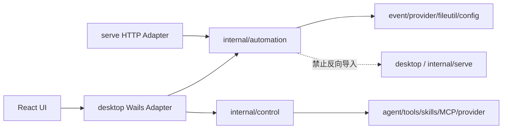

`internal/automation/architecture_test.go` 会扫描非测试 Go 文件，禁止 Automation Core 导入 `kwu/desktop`、`kwu/internal/serve` 或 provider 子实现，从测试层保证共享核心不反向依赖宿主。

## 5. 前端页面与点击入口

### 5.1 页面入口

自动化页面目前有三类真实入口：

1. 主工作区侧边栏“自动化”按钮调用 `openAutomationWorkspace`，将 `workspaceView` 切换为 `automation`，以内嵌模式渲染 `HeartbeatPanel`。
2. 侧边栏工具按钮调用 `setHeartbeatOpen(true)`，以 overlay/modal 模式打开同一个组件。
3. 组件通过 React `lazy + Suspense` 加载，避免进入普通聊天工作区时立即加载自动化页面代码。

两种展示模式共用任务、模板、运行和导出逻辑；差异只在容器、关闭行为和工作区导航。

### 5.2 打开自动化面板

当 `HeartbeatPanel` 的 `open` 变为 `true`：

1. 清空编辑、运行详情、模板模式和筛选状态。
2. 并行调用：
   - `AutomationReloadTasks()`：加载任务；
   - `ListWorkspaces()`：加载可选工作区；
   - `AutomationListTemplates()`：加载内置和用户模板。
3. 对每个任务调用 `AutomationListRuns(taskId, 3)`，加载最近三次运行。
4. React 更新 `tasks`、`templates`、`runsByTask`，渲染任务卡片和最近状态。

### 5.3 页面功能清单

| 用户动作 | 前端处理 | 后端入口 | 持久化/副作用 | 页面结果 |
|---|---|---|---|---|
| 打开面板 | `loadTasks()` | ReloadTasks、ListTemplates、ListWorkspaces、ListRuns | 只读 | 列表、模板、工作区、最近运行 |
| 新建任务 | 生成 ID，打开 `TaskEditor` | `AutomationGenerateID` | 无 | 空白编辑器 |
| 使用模板 | 模板转表单；经营模板建立诊断草稿 | GenerateID | 无 | 预填编辑器 |
| 选择/拖入数据文件 | 记录本地绝对路径 | `PickAutomationSourceFile` 或 Wails drop | 保存前仅前端状态 | 显示文件名和路径 |
| 保存任务 | 全量替换任务数组 | `AutomationSaveTasks` | 原子写 `tasks.json` | 以本地 `next` 更新列表；服务端规范化值要下次 reload 才回显 |
| 保存为模板 | 先保存任务，再保存模板 | `AutomationSaveTaskTemplate` | SQLite upsert | 模板列表更新 |
| 启停任务 | 修改 `enabled` 后全量保存 | `AutomationSaveTasks` | `tasks.json` | 卡片状态改变 |
| 删除任务 | 从数组移除后全量保存 | `AutomationSaveTasks` | `tasks.json` | 卡片消失；历史运行文件不会随之删除 |
| 立即运行 | `handleTrigger(id)` | `AutomationTriggerNow` | 创建运行目录并执行 | 完成后重新加载列表 |
| 打开运行详情 | `openRunDetail` | `AutomationReadRun` | 只读归档 | 展示 manifest、摘要、事件 |
| 刷新详情 | `refreshRunDetail` | `AutomationReadRun` | 只读 | 更新运行状态 |
| 取消运行 | `handleCancelRun` | `AutomationCancelRun` | 取消当前进程内 context | 刷新列表和详情 |
| 导出结果 | 请求格式、选路径、写文件 | ExportRunResult → PickExportFile → SaveExportFile | 写用户选择的文件 | 按钮恢复或显示错误 |
| 删除/恢复模板 | 调用模板 API | Delete/RestoreTaskTemplate | SQLite 软删除/恢复 | 模板列表更新 |
| 打开关联话题 | 关闭弹层并调用 `onOpenTopic` | activate/open global/project topic | 切换活动 Tab、刷新元数据 | 回到聊天页并显示该任务会话 |

前端兼容桥 `heartbeatTriggerNow` 会把 Go 返回的 `TriggerNowResponse` 转成 `Promise<void>`。因此当前 UI 不直接消费响应里的 `runId/status`，而是在同步调用完成后重新加载任务和运行列表；这也是“立即运行”按钮会等待本轮结束的原因。

## 6. 任务创建与保存总流程

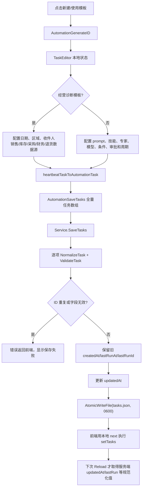

### 6.1 Task 核心字段

| 字段 | 作用 | 校验/默认 |
|---|---|---|
| `id` | 任务稳定标识，也是运行目录和租约文件的逻辑键 | 必填、同批次唯一 |
| `name` | 页面标题与导出文件名来源 | 必填 |
| `enabled` | 定时扫描是否执行；手动触发仍按具体服务调用处理 | 布尔值 |
| `scope` | `global`、`project` 或业务语义范围 | project 需要工作区 |
| `workspaceRoot` | Agent 工作目录和本地数据文件上下文 | 桌面端转换为绝对路径 |
| `topicId` | 复用的会话话题 | 首次运行后可回写 |
| `newConversationEachRun` | 每次运行是否创建新话题 | 默认 false |
| `prompt` | prompt、role、skills、model、billingSource | billingSource 只接受空、subscription_pool、newapi_byok |
| `schedule` | once / interval / calendar | 必须是支持的 kind |
| `conditions` | 条件 prompt 与失败冷却 | 可选 |
| `execution` | ask / auto / yolo、审批超时、并发上限 | 默认 auto、2m；并发仅允许 0 或 1 |
| `archive` | 可见性、保留策略、会话/事件开关 | 当前归档核心文件仍由运行链生成 |
| `businessDiagnostics` | 经营数据源与诊断范围 | 存在时必须通过业务配置校验 |
| `createdAt/updatedAt` | 任务审计时间 | 服务端规范化维护 |
| `lastRunAt/lastRunId` | 最近成功或特定跳过运行 | 引擎结束时回写 |

## 7. 经营诊断配置流程

### 7.1 数据源类型

| 类型 | 页面输入 | 后端读取 | 注意事项 |
|---|---|---|---|
| `csv` | 选择或拖入 `.csv` | `encoding/csv` | 路径在执行机器上必须可读 |
| `xlsx` | 选择或拖入 `.xlsx` | ZIP + Open XML 解析首个工作表 | 不是完整 Excel 计算引擎 |
| `http` | URL + csv/json/xlsx 格式 | 30 秒超时 HTTP Client | 外部地址属于不可信输入；可用性依赖网络 |
| `mcp` | 页面内 JSON rows | 直接把 `[]map[string]any` 转字符串行 | 当前不是运行时主动调用 MCP Server，而是内嵌 rows |

### 7.2 业务数据分类与必需字段

| kind | 业务含义 | 关键字段示例 |
|---|---|---|
| `sales` | 销售订单 | date、order_id、sku、quantity、amount、region |
| `inventory` | 库存快照 | date、sku、on_hand_qty、reserved_qty、warehouse、region |
| `purchase` | 采购记录 | date、purchase_id、sku、quantity、amount、supplier、region |
| `finance` | 财务科目 | date、account、amount、category、region |
| `returns` | 退货记录 | date、return_id、order_id、sku、quantity、amount、reason、region |

页面把这些配置保存进 `Task.businessDiagnostics`。保存阶段会统一 trim、规范化 kind/type/format，并验证：目标开始时间早于结束时间、至少一个数据源、source id 唯一、类型合法，以及文件路径/URL/rows 与 source type 匹配。必需业务列、数值/日期、当前期数据、环比/同比基线和重复记录属于确定性 Runner 的运行期质量门禁，不在保存时读取源文件验证；HTTP `format` 也在真正读取时才推断或报不支持。

## 8. 手动运行时序图（Desktop）

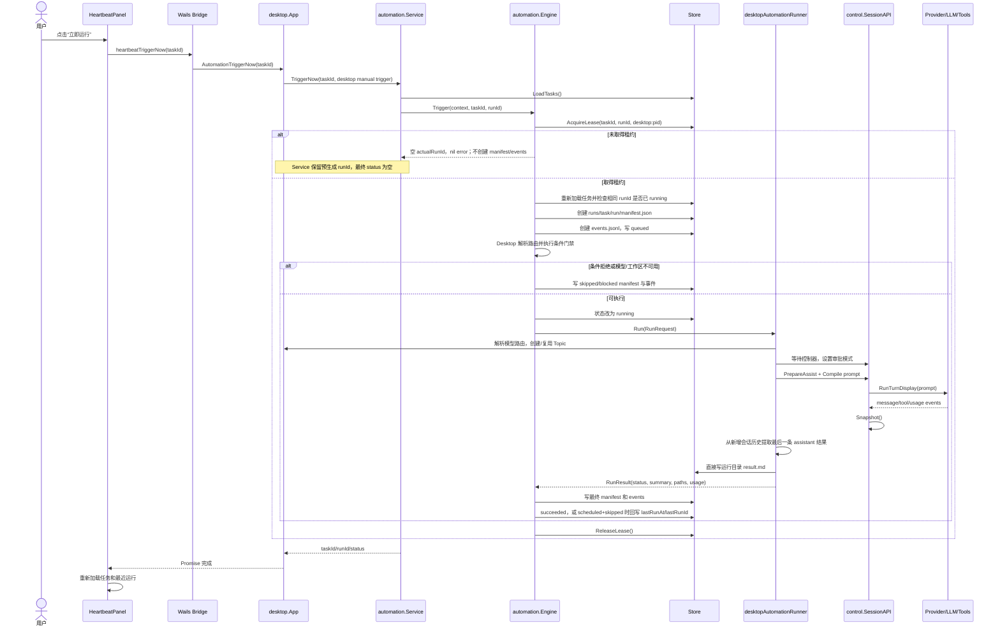

### 8.1 桌面 Runner 内部流程

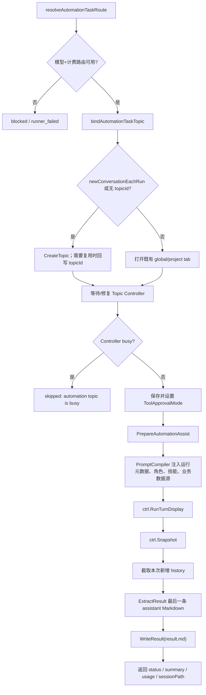

### 8.2 定时任务路径

应用启动时 `App.startup()` 调用 `startAutomation()`；Engine 启动 goroutine，每 30 秒执行一次 `Tick`：

1. `Store.LoadTasks()` 读取任务。
2. `Due(task, now)` 按 once、interval 或 calendar + timezone + time window 判断是否到期。
3. 仅处理 `enabled && due` 的任务。
4. 单次 `Tick` 内按任务列表串行执行，没有 Tick 内多任务并发队列；但手动 `Trigger` 没有全局锁，不同 task 的手动运行可并发，也可能与 Tick 重叠。
5. 定时与手动触发复用同一套租约、条件、Runner、状态机和归档路径。

## 9. 确定性经营诊断时序图（kwu serve）

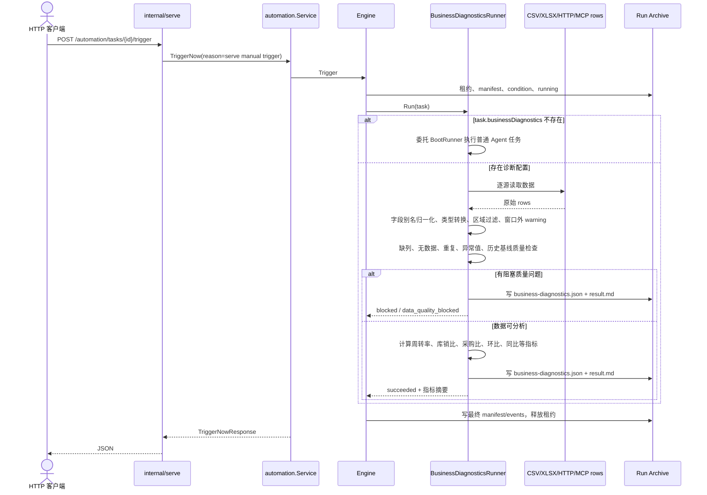

### 9.1 确定性诊断处理步骤

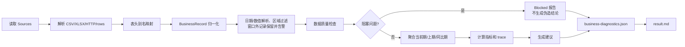

每个指标的 `trace` 保存 `sourceId + kind + rows`，用于从汇总结果追溯到原始输入行。

## 10. 前置条件、租约与运行状态

### 10.1 执行门禁顺序

1. 获取任务租约；在租约有效期内阻止 Desktop 和 serve 同时接管同一任务。默认 TTL 为 2 分钟，当前 Engine 不调用 `RefreshLease`，所以这不是无限期互斥。
2. 重新读取最新任务，防止使用扫描时的过期配置。
3. 定时触发再次判断 `enabled` 和 due。
4. 检查相同 `runId` 是否已经是 `running`；历史中其他 runId 的 stale running 记录不会阻止租约过期后的新运行。
5. 执行宿主提供的 TaskResolver/ModelResolver：Desktop 会解析并回写模型与计费路由；serve 使用默认 Checker，主要验证模型字段，不执行 Desktop 的计费目录解析。
6. 创建 queued manifest 和 event sink。
7. 转为 `checking_condition`，执行工作区、失败冷却、自定义条件等检查。
8. 通过后转为 `running` 并派发 Runner。
9. 统一写最终状态、错误、用量和任务最近运行字段。

### 10.2 状态机

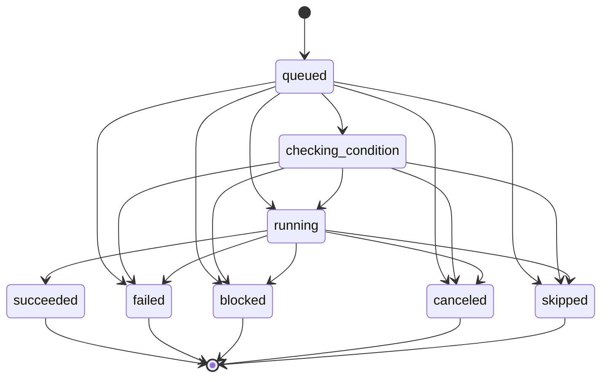

常见错误码包括 `model_unavailable`、`workspace_missing`、`condition_rejected`、`condition_invalid_json`、`lease_unavailable`、`approval_timeout`、`runner_failed`、`snapshot_failed`、`archive_failed`、`canceled` 和 `data_quality_blocked`。

## 11. 运行详情与页面渲染

用户点击某次运行后：

1. 前端调用 `AutomationReadRun(taskId, runId)`。
2. Service 读取 `manifest.json`。
3. 若存在 `result.md`，读取最多 4096 个 rune 作为 `resultSummary`，并标记是否截断。
4. 只要结果非空，就返回六种 `availableResultFormats`。
5. 扫描 `events.jsonl`，返回最多 50 条事件摘要；单条文本有长度限制。
6. 前端 `RunDetailView` 展示：
   - status、trigger、owner、model、billingSource、workspace、时间和用量；
   - 条件原因、跳过原因、错误码与错误消息；
   - 最终结果摘要；
   - 事件时间线；
   - 可取消时的取消按钮；
   - 六种结果导出按钮。

当前 `RunDetail` 返回的是摘要而不是完整 `result.md`，因此页面适合查看结果概览；完整内容主要通过文件归档或导出取得。

## 12. Office 结果导出总流程

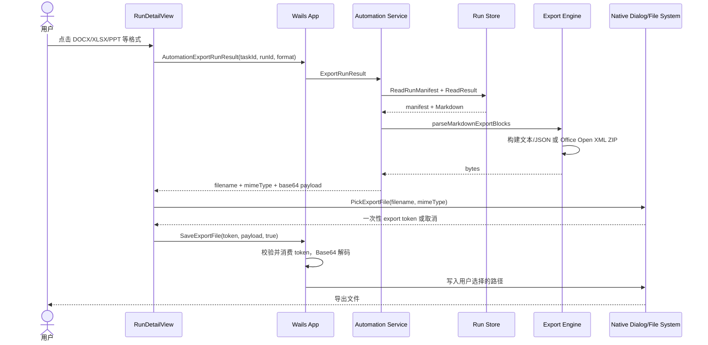

### 12.1 导出格式合同

| format | MIME | 生成方式 |
|---|---|---|
| `md` | `text/markdown;charset=utf-8` | 原始 Markdown |
| `txt` | `text/plain;charset=utf-8` | 去除 Markdown 标记后的纯文本 |
| `json` | `application/json;charset=utf-8` | `{ manifest, blocks }` |
| `docx` | Word Open XML MIME | 最小 DOCX ZIP 包 |
| `xlsx` | Excel Open XML MIME | 最小 XLSX ZIP 包，结果块按行输出 |
| `pptx` | PowerPoint Open XML MIME | 最小 PPTX ZIP 包，按标题切片 |

保存路径不是直接从前端传给任意写文件 API。`PickExportFile` 把用户选择的路径保存在进程内并返回短期一次性 token；`SaveExportFile` 只能消费这个 token，从而约束前端任意路径写入风险。

## 13. 持久化架构与数据库关系

### 13.1 混合持久化总览

默认根目录是 `config.KWUHomeDir()/automation`。`KWUHomeDir()` 会按当前产品配置、兼容变量和平台用户目录解析实际路径，不能简单假定环境中一定存在字面量 `${KWU_HOME}`：

```text
automation/
├── tasks.json                         # 全量任务定义
├── templates.sqlite                   # 用户模板、内置模板删除标记、迁移状态
├── leases/
│   └── <escaped-task-id>.json         # 跨进程任务租约
└── runs/
    └── <escaped-task-id>/
        └── <run-id>/
            ├── manifest.json          # 状态、路由、时间、路径、错误、用量
            ├── events.jsonl           # 状态与 Agent 事件流
            ├── session.jsonl          # CreateRun 声明的初始逻辑路径；不保证实际创建
            ├── session/               # BootRunner 的 SessionDir，实际文件名由 Controller 决定
            ├── result.md              # 最终 Markdown
            ├── assist.md              # 可选自动化辅助上下文
            └── business-diagnostics.json # 仅确定性诊断 Runner 生成
```

### 13.2 SQLite 表关系依赖图

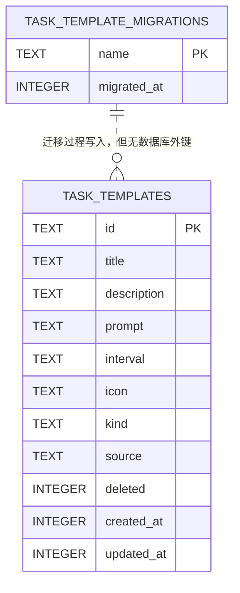

两个表之间 **没有实际外键约束**。`task_template_migrations` 仅记录旧 `templates.json` 是否已经迁移；`task_templates` 保存用户模板和内置模板的软删除 tombstone。

### 13.3 逻辑数据依赖图（包含非数据库文件）

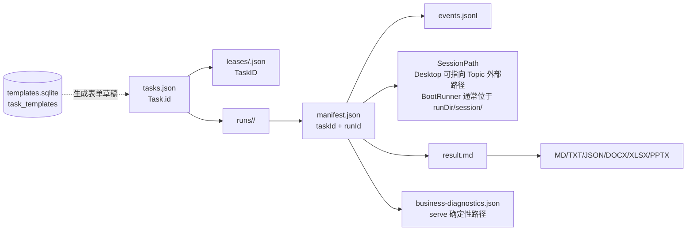

任务删除只是重写 `tasks.json`，不会级联删除历史运行目录。当前没有数据库级联关系和运行归档清理表。`manifest.SessionPath` 也不一定指向运行目录内文件：Desktop Runner 会用 `ctrl.SessionPath()` 覆盖初始值，通常指向既有 Topic 会话；BootRunner 则把 `runDir/session/` 交给 Controller。

## 14. 前后端接口文档：Desktop Wails

Desktop 前端调用的是 Wails 自动生成的 Promise 绑定，不是浏览器 HTTP。以下 Go 方法构成当前页面的后端接口。

### 14.1 任务与模板接口

| Wails 方法 | 输入 | 输出 | 作用/错误 |
|---|---|---|---|
| `AutomationReloadTasks()` | 无 | `Task[]` | 从 `tasks.json` 重载；读取/解码失败则 reject |
| `AutomationListTasks()` | 无 | `Task[]` | ReloadTasks 的兼容别名 |
| `AutomationSaveTasks(tasks)` | 全量 `Task[]` | void | 规范化、校验、保留服务端元数据、原子替换 |
| `AutomationGenerateID()` | 无 | string | 8 字节随机 ID；随机源失败时用纳秒时间 |
| `AutomationListTemplates()` | 无 | `TaskTemplate[]` | 合并未被 tombstone 的内置模板与用户模板 |
| `AutomationSaveTaskTemplate(task)` | Task | TaskTemplate | 转为 `user-<taskId>` 后 SQLite upsert |
| `AutomationDeleteTaskTemplate(id)` | string | void | 用户模板软删除；内置模板写 tombstone |
| `AutomationRestoreTaskTemplate(id)` | string，可为空 | void | 恢复指定模板；空值恢复全部 |
| `AutomationHeartbeatMigrationStatus()` | 无 | migration result | 返回旧 Heartbeat 任务迁移状态 |

### 14.2 运行接口

| Wails 方法 | 输入 | 输出 | 作用/限制 |
|---|---|---|---|
| `AutomationTriggerNow(id)` | task id | `{taskId, runId, status}` | Go/Wails 同步等待；当前 bridge 丢弃返回值。若租约未取得，不创建归档，但 Service 仍可返回预生成 runId 和空 status |
| `AutomationListRuns(taskId, limit)` | task id、非负 limit | `RunSummary[]` | 从运行目录扫描，按 startedAt/runId 倒序 |
| `AutomationReadRun(taskId, runId)` | 两个 ID | `RunDetail` | 返回 manifest、结果摘要、格式、事件摘要 |
| `AutomationCancelRun(taskId, runId)` | 两个 ID | CancelResponse | 只能取消当前 Desktop 进程注册的活跃运行 |
| `AutomationExportRunResult(taskId, runId, format)` | IDs + 格式 | Export payload | 读取归档结果并返回 Base64 |

### 14.3 本地文件交互接口

| Wails 方法 | 输入 | 输出 | 安全边界 |
|---|---|---|---|
| `PickAutomationSourceFile(type)` | csv/xlsx/其他 | 本地路径或空 | 原生打开对话框，按扩展名过滤 |
| `PickExportFile(filename, mime)` | 默认名、MIME | 一次性 token 或空 | 路径只保存在 Go 进程内，token 有过期时间 |
| `SaveExportFile(token, payload, base64)` | token、内容、编码标记 | void | token 一次消费；不能直接指定任意路径 |

### 14.4 编辑器依赖的辅助 Wails 接口

| 方法 | 用途 | 页面消费位置 |
|---|---|---|
| `ListWorkspaces()` | 提供 project scope 和经营数据默认工作区 | 面板初始化、经营诊断模板草稿 |
| `AutomationModels(workspaceRoot)` | 返回与工作区、登录状态和计费来源匹配的模型目录 | TaskEditor 模型选择器 |
| `SkillsSettings()` | 返回可选 Skill 及启用状态 | TaskEditor Skill 选择器 |
| `ListExperts()` | 返回专家目录，将专家名称/描述写入 role | TaskEditor 专家选择器 |
| `OpenGlobalTab/OpenProjectTab/ActivateTopic` 等 | 打开任务绑定的 Topic | 任务卡“打开话题”按钮经 `App.handleOpenTopic` 调用 |

### 14.5 主要 DTO 示例

```json
{
  "id": "task-1234",
  "name": "周度经营诊断 - 华东",
  "enabled": true,
  "scope": "project",
  "workspaceRoot": "D:/project/acme",
  "newConversationEachRun": false,
  "prompt": {
    "model": "provider/model",
    "billingSource": "newapi_byok",
    "skills": ["data-analysis"],
    "role": "business operations analyst",
    "prompt": "分析本周经营数据并生成可审计结论。"
  },
  "schedule": {
    "kind": "calendar",
    "timezone": "Asia/Shanghai",
    "calendar": {
      "frequency": "weekly",
      "timeOfDay": "03:30",
      "weekdays": ["monday"]
    }
  },
  "execution": {
    "approvalMode": "auto",
    "approvalTimeout": "2m"
  },
  "businessDiagnostics": {
    "targetStart": "2026-07-13T00:00:00Z",
    "targetEnd": "2026-07-20T00:00:00Z",
    "region": "east",
    "recipients": ["ops@example.com"],
    "sources": [
      {
        "id": "sales",
        "kind": "sales",
        "type": "csv",
        "path": "D:/data/sales.csv"
      }
    ]
  }
}
```

## 15. 前后端接口文档：HTTP JSON API

### 15.1 通用约定

- 路由由 `internal/serve` 提供，只在 `kwu serve` 启动并注入 Automation Service 后可用。
- 全部路由经过日志、认证和 CSRF guard。
- token 模式可用查询 token；password 模式先登录。
- 状态变更请求必须使用 `Content-Type: application/json`。
- Automation Service 未注入时返回 `503 automation disabled`。
- 错误映射是显式且较窄的：`ErrTaskNotFound` → 404；`ErrInvalidTask`、`ErrInvalidSchedule`、`ErrInvalidApprovalMode`、`ErrDuplicateTaskID` → 400；其余错误 → 500。当前 `ErrInvalidApprovalTimeout` 和读取不存在 run 时的文件错误也会落到 500，而不是 400/404。

### 15.2 已暴露端点

| Method | Path | 请求 | 成功响应 | 说明 |
|---|---|---|---|---|
| GET | `/automation/tasks` | 无 | `TaskView[]` | 列出任务 |
| POST | `/automation/tasks` | `{"tasks": [...]}` | 204 | 全量保存任务 |
| GET | `/automation/migration/heartbeat` | 无 | MigrationResult | 旧任务迁移状态 |
| POST | `/automation/tasks/{id}/trigger` | `{}` | TriggerNowResponse | 手动运行，reason 固定为 serve manual trigger |
| GET | `/automation/runs?taskId={id}&limit={n}` | query | RunSummary[] | limit 必须是非负整数 |
| GET | `/automation/runs/{taskID}/{runID}` | path | RunDetail | 读取运行详情 |
| POST | `/automation/runs/{taskID}/{runID}/cancel` | `{}` | CancelResponse | 取消当前 serve 进程拥有的运行 |

### 15.3 Service 已有但 HTTP 尚未暴露的接口

- 模板 list/save/delete/restore。
- 结果 `ExportRunResult`。
- 原生文件选择和保存只能属于 Desktop，HTTP 不应直接复用。

如果未来增加 HTTP 导出，应优先使用流式二进制响应或受限下载令牌，而不是把大文件 Base64 塞进 JSON。

## 16. 取消、并发与跨进程行为

- `Service.TriggerNow` 为每次运行创建 `context.WithCancel` 并放入进程内 registry。
- Cancel 只认识本进程 registry 中的运行；另一个 Desktop/serve 进程发起的运行会返回 `not_cancelable`。当前前端桥虽然取得 `CancelResponse`，页面处理器会丢弃它并静默刷新，因此用户不会直接看到 `not_cancelable` 原因。
- 文件租约提供有时限的跨进程互斥，默认 TTL 2 分钟；租约文件位于 `leases/`。
- 单次 Engine `Tick` 内任务串行；`Trigger` 没有全局执行锁，不同 task 的手动运行可以并发，也可与定时 Tick 重叠。Task 的 `maxConcurrentRuns` 只允许 0 或 1，但跨 task 不是全局串行。
- Desktop Controller 自身繁忙时，运行会被标记为 skipped，而不是强行并发复用同一话题。
- 运行结束时释放租约；租约过期后可以被新运行接管。由于当前 Engine 没有续租心跳，执行超过 2 分钟的正常任务也存在被另一宿主接管的窗口，不只发生在进程异常退出时。
- `tasks.json` 的全量保存没有跨进程文件锁、版本号或 compare-and-swap；Desktop 与 serve 并发编辑任务时具有最后写入者覆盖语义。

## 17. 安全与数据边界

1. `tasks.json`、manifest、events、result 和 SQLite 数据包含工作区路径、prompt、业务摘要等本地敏感信息；核心归档文件以 `0600` 创建。
2. 运行目录使用经过转义的 task/run ID，并检查最终路径仍在 automation 根目录下。
3. HTTP source 允许读取外部 URL；当前文档未发现专门的 SSRF allowlist，部署时应把 serve 的网络权限视为高风险能力。
4. MCP rows 在当前数据模型中是内嵌数据，不等于受信任的 MCP 工具输出；仍需业务字段校验。
5. `approvalMode=yolo` 会放宽无人值守工具执行，必须由用户显式选择；默认是 auto。
6. 导出保存通过原生路径选择 + 短期一次性 token，降低前端任意文件写风险。
7. 前端目前对若干刷新、取消、文件选择异常采取静默忽略；保存和导出错误会显示，排障体验并不完全一致。
8. 经营诊断“收件人”尚未连接邮件发送，不应把它当成交付授权或已发送证据。

## 18. 实现状态矩阵

| 能力 | 状态 | 证据/说明 |
|---|---|---|
| 桌面任务 CRUD | 已实现 | HeartbeatPanel → Wails → Service → tasks.json |
| 内置/用户模板 | 已实现 | 内置数组 + SQLite user template/tombstone |
| once/interval/calendar 调度 | 已实现 | Engine Tick + Due |
| 手动触发 | 已实现 | Desktop 和 HTTP 均有入口 |
| 跨进程防重复 | 部分实现 | 有 2 分钟文件租约，但 Engine 未调用 RefreshLease；长任务可能被接管 |
| 条件 prompt/冷却/模型门禁 | 已实现 | Checker + manifest condition |
| 桌面复用 Agent core | 已实现 | Topic/Tab → control.SessionAPI → RunTurnDisplay |
| Desktop 经营诊断 UI | 已实现 | 日期、区域、收件人、五类数据源 |
| Desktop 确定性指标引擎 | **未接入** | Desktop Runner 未包装 BusinessDiagnosticsRunner |
| serve 确定性经营诊断 | 已实现 | BusinessDiagnosticsRunner(BootRunner) |
| 诊断 JSON 可追溯产物 | 宿主差异 | serve 生成；Desktop Agent 路径不保证 |
| 运行详情摘要/事件 | 已实现 | RunDetail + RunDetailView |
| 完整结果页面渲染 | 部分实现 | 页面仅取最多 4096 rune 摘要 |
| 运行取消 | 部分实现 | 只能取消当前进程活跃运行 |
| MD/TXT/JSON 导出 | 已实现 | Markdown 转换 |
| DOCX/XLSX/PPTX 导出 | 已实现（基础格式） | 最小 Open XML，不是保真编辑器 |
| HTTP Automation 基础 API | 已实现 | task/run/trigger/cancel/migration |
| HTTP 模板与导出 API | 未实现 | Service 有能力，路由未暴露 |
| 邮件自动投递 | 未实现 | recipients 未连接邮件客户端 |
| Google Drive/SharePoint/Notion 协作交付 | 未实现 | 当前没有对应业务调用链 |
| Office 文档双向编辑 | 未实现 | 当前只从 Markdown 单向导出 |

## 19. 端到端验收场景

### 19.1 Desktop 普通自动化任务

1. 新建任务，选择可用模型、工作区和 prompt。
2. 保存后确认 `tasks.json` 出现规范化任务。
3. 点击立即运行，确认出现 runId。
4. 确认状态经历 queued/checking_condition/running/终态。
5. 确认 `manifest.json`、`events.jsonl`、`result.md` 存在。
6. 打开运行详情，核对摘要、事件、模型、计费来源、时间和用量。
7. 分别导出 DOCX/XLSX/PPTX，使用对应 Office 软件打开。

### 19.2 Desktop 经营诊断任务

1. 使用“经营诊断”模板，设置日期范围和三类必需数据源。
2. 保存并立即运行。
3. 核对编译 prompt 中包含诊断配置和数据源位置。
4. 核对 Agent 是否真实读取文件，而非只凭 prompt 猜测。
5. 核对 `result.md` 与事件中的工具调用证据。
6. 不应把缺少 `business-diagnostics.json` 判为归档故障；这是当前 Desktop Runner 的实现差异。

### 19.3 serve 确定性经营诊断

1. 通过 POST 保存包含 `businessDiagnostics` 的 Task。
2. 触发运行并读取 RunDetail。
3. 数据缺列时应得到 `blocked + data_quality_blocked`，仍生成质量报告。
4. 数据完整时应生成指标和 trace。
5. 核对 `business-diagnostics.json` 中记录数、问题、指标和源行追踪。

## 20. 维护建议与演进优先级

1. **统一经营诊断 Runner 语义**：明确产品期望是 Desktop 也先执行确定性诊断再交给 Agent 解读，还是保持两种宿主差异；这是当前最重要的架构决策。
2. **把结构化事实与生成式表达分层**：先生成可审计 JSON 指标，再让 Agent 基于该 JSON 生成管理层摘要，可降低幻觉风险。
3. **完善 HTTP 能力对称性**：按需增加模板与导出端点，但保持下载授权和大文件传输边界。
4. **增加交付适配层**：邮件、Google Drive、SharePoint、Notion 等应消费已归档 artifact，而不是耦合到 Runner 内部。
5. **增强 Office Artifact Engine**：逐步支持表格、图表、图片、主题、母版、公式和模板，而不是继续堆叠字符串 XML。
6. **结果详情分页/流式读取**：避免固定 4096 rune 摘要成为长报告查看瓶颈。
7. **统一前端错误呈现**：取消、刷新和文件选择不应一律静默吞错。
8. **增加归档保留执行器**：`ArchivePolicy.retention` 需要实际清理机制和可恢复策略。

## 21. 构建、运行与验证命令

### 21.1 根模块

```powershell
go build ./...
go test ./...
go vet ./...
go test ./internal/automation ./internal/serve
go run ./scripts/code_guard
```

### 21.2 Desktop Go module

```powershell
Set-Location desktop
go test .
go vet .
wails dev
wails build
```

Desktop 是嵌套 module，根目录的 `go test ./...` 不会覆盖它，因此相关变更必须在 `desktop/` 内单独验证。

### 21.3 React 前端

```powershell
Set-Location desktop/frontend
pnpm install
pnpm typecheck
pnpm test
pnpm build
```

自动化页面还有 Node/tsx 源码合同测试，重点覆盖 bridge DTO、页面交互、运行事件和下一次运行时间。

### 21.4 项目约定

- Go 错误按上下文使用 `fmt.Errorf("...: %w", err)` 包装。
- Library 层不调用 `os.Exit`，退出码和用户输出由 CLI/main 决定。
- 导出、任务和 manifest 写入优先使用原子写，避免半文件状态。
- 桌面只通过 Wails 门面访问 Automation Service；前端自定义组件优先使用 `heartbeat.bridge.ts`，避免散落 DTO 转换。
- 共享 Automation Core 不导入 Desktop/serve 宿主实现。
- 修改 prompt、skill/tool surface 或 Provider 可见前缀时，需要额外评估 prompt cache 影响。

## 22. 关键源码证据索引

| 结论 | 源码证据 |
|---|---|
| 页面有工作区和弹层入口 | `desktop/frontend/src/App.tsx:3268`、`:3476`、`:3558`、`:3891`、`:4350` |
| 页面初始化并行加载任务、工作区、模板 | `HeartbeatPanel.tsx:525` |
| 保存、运行与结果导出点击处理 | `HeartbeatPanel.tsx:699`、`:686`、`:1331` |
| 经营诊断编辑器 | `HeartbeatPanel.tsx:1821` |
| 前端新旧 DTO 转换与 Wails 调用 | `heartbeat.bridge.ts:18`、`:22`、`:26`、`:81`、`:85`、`:94` |
| Desktop Engine/Service 装配 | `desktop/automation.go:16`、`:32` |
| Wails Automation API | `desktop/automation.go:68-156` |
| Desktop Agent Runner | `desktop/automation_runner.go:24` |
| Service 保存、触发、详情、取消 | `internal/automation/service.go:181`、`:291`、`:331`、`:361` |
| Engine 扫描、触发、租约和派发 | `internal/automation/engine.go:70`、`:94`、`:170`、`:259` |
| 默认存储目录和 SQLite schema | `internal/automation/store.go:41`、`:449`、`:464` |
| 确定性诊断 Runner 与指标 | `internal/automation/business.go:157`、`:324`、`:665`、`:798` |
| 六种结果导出 | `internal/automation/export.go:20`、`:66`、`:113` |
| HTTP Automation 路由 | `internal/serve/serve.go:299-305` |
| serve 使用 BusinessDiagnosticsRunner | `internal/cli/cli.go:644` |

- 前端交互：`desktop/frontend/src/features/automation/heartbeat/HeartbeatPanel.tsx`
- 前端桥接：`desktop/frontend/src/features/automation/heartbeat/heartbeat.bridge.ts`
- 前端类型：`desktop/frontend/src/features/automation/heartbeat/heartbeat.types.ts`
- Wails Automation API：`desktop/automation.go`
- 桌面运行器：`desktop/automation_runner.go`
- 话题绑定：`desktop/automation_topic.go`
- 模型与计费路由：`desktop/automation_route.go`
- 原生文件选择与安全保存：`desktop/app.go`
- 共享 Service：`internal/automation/service.go`
- 调度引擎与状态机：`internal/automation/engine.go`、`model.go`
- 调度与条件：`internal/automation/schedule.go`、`condition.go`
- 任务/模板存储：`internal/automation/store.go`
- 文件租约：`internal/automation/lease.go`
- 运行归档：`internal/automation/archive.go`、`archive_sink.go`
- Prompt 编译：`internal/automation/prompt.go`
- 结果提取：`internal/automation/result.go`
- 经营诊断：`internal/automation/business.go`
- Office 格式导出：`internal/automation/export.go`
- HTTP handler：`internal/serve/automation.go`
- HTTP 路由与认证/CSRF：`internal/serve/serve.go`
- serve Runner 组装：`internal/cli/cli.go`

## 23. 已确认的易错点与未知项

- **已确认：** Desktop 和 serve 使用相同存储根目录时依赖 2 分钟文件租约；Engine 未续租，长任务并非全程互斥，且 Cancel registry 仍是进程内的。
- **已确认：** `taskHasRunningRun` 只识别当前新 `runId` 的 running 记录，不把旧 runId 的 stale running 当成全局任务锁。
- **已确认：** `business-diagnostics.json` 不是 Desktop Agent Runner 的保证产物。
- **已确认：** HTTP 路由尚未暴露模板和导出，而 Wails 已暴露。
- **已确认：** 任务保存是全量替换，不是单任务 PATCH；多窗口同时保存存在最后写入者覆盖的语义。
- **已确认：** 保存成功后页面采用本地 `next`，不会读取后端规范化后的 Task；`updatedAt`、保留的 `lastRun*` 等以随后 Reload 为准。
- **已确认：** `lastRunAt/lastRunId` 只在 succeeded，或 scheduled+skipped 时回写，并非所有 failed/blocked/canceled 运行都会更新。
- **已确认：** 页面只渲染结果摘要，导出会重新读取完整 `result.md`。
- **已确认：** XLSX 输入解析是 Open XML 子集，Office 输出也是最小 Open XML 包。
- **未知：** 生产环境是否对经营诊断 HTTP source 另有网络出口或代理层 allowlist；仓库内本业务路径未见专门配置。
- **未知：** `ArchivePolicy.retention`、`KeepEvents`、`KeepSession` 在未来版本的最终清理语义；当前核心运行链仍会创建归档文件。

## 24. 文档使用方式

- 需要理解整个 Reasonix/KWU 系统时，先读[项目总体业务与架构](../PROJECT_BUSINESS_ARCHITECTURE.md)。
- 需要开发或验收 Office Agent 自动化业务时，以本文的两条宿主执行路径和状态矩阵为准。
- 修改 Runner、Store、API 或导出格式后，应同步更新本文对应时序图、接口表和实现状态。
- 合并前必须再次以真实工作区源码验证，不能仅依据本文推断当前行为。
