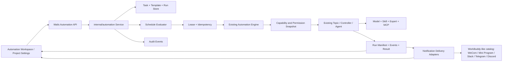

# WorkBuddy 自动化功能调研与 Reasonix 开发方案

> 日期：2026-08-01
>
> 基线分支：`codex/integration-main-v3-20260801`
>
> 当前集成基线：`a3b2f6550b733de9bdc0aabb0f7437d50a1056ef`
>
> Graph Engineering 执行契约：[2026-08-01-workbuddy-automation-task-dag.md](./2026-08-01-workbuddy-automation-task-dag.md)
>
> 文档性质：洁净室产品调研与增量开发设计，不是 WorkBuddy 源码分析

## 1. 结论先行

没有公开证据能够证明 WorkBuddy 的自动化功能直接复制或基于某个 GitHub 项目。本文只能回答“哪些公开项目适合作为实现参考”，不能把功能相似性写成源码来源。

推荐按以下方式参考：

| 参考项目 | 可参考能力 | 不应直接照搬的部分 | 许可证/使用提醒 |
| --- | --- | --- | --- |
| [Temporal](https://github.com/temporalio/temporal) | 持久执行、失败重试、幂等、租约/所有权、可观测运行历史 | 其分布式服务端架构远重于本地桌面 MVP | MIT；借鉴运行语义，不引入第二套引擎 |
| [Trigger.dev](https://github.com/triggerdotdev/trigger.dev) | 长任务、Cron、队列与并发、检查点、人工介入、运行追踪 | 云部署和弹性伸缩不是当前客户端目标 | Apache-2.0；适合参考运行生命周期与可观测性 |
| [Kestra](https://github.com/kestra-io/kestra) | 定时/事件触发、声明式定义、插件、重试/超时/回填、输出产物 | YAML 工作流编排器和通用 DAG 超出本期范围 | Apache-2.0；参考调度和运行详情信息架构 |
| [n8n](https://github.com/n8n-io/n8n) | 模板、连接器目录、审批、执行记录、可视化配置体验 | 节点画布、通用工作流市场和其服务端体系 | Sustainable Use License/Enterprise License；只作产品交互参考，不能默认按开源库复用 |
| [Windmill](https://github.com/windmill-labs/windmill) | 脚本/Flow/定时器、资源与密钥路径、自动生成表单、日志 | 多语言执行沙箱、完整低代码平台 | AGPLv3；若复用代码会带来强许可义务，本方案仅参考能力边界 |
| [LangGraph](https://github.com/langchain-ai/langgraph) | 有状态 Agent、持久恢复、人工介入、运行轨迹 | 不需要为了一个提示词自动化引入图编排核心 | MIT；仅在未来多节点 Agent 流程出现时评估 |

对 Reasonix 的建议是：以现有 `internal/automation` 为唯一自动化内核，吸收上述项目的调度语义、运行可观测性、授权快照和通知适配器设计；不要新增第二套通用工作流引擎，也不要在本期实现节点画布。

## 2. 证据等级与合规边界

本文使用四类证据：

- **O（Observed）**：通过用户正常可见的 WorkBuddy v5.3.5 桌面界面，只读点击与观察得到。
- **D（Documented）**：WorkBuddy 官方公开文档描述。
- **R（Reference）**：公开 GitHub 仓库 README 和许可证信息，仅作为实现参考。
- **C（Current）**：目标分支当前 Reasonix 源码、测试和设计文档。

调研未执行以下操作：

- 未反编译、解包或读取 WorkBuddy 安装目录内部资源；
- 未读取进程内存、私有 API、Cookie、Token 或账号凭据；
- 未保存、暂停、删除 WorkBuddy 自动化任务；
- 未打开或授权连接器，未开启“完全访问”，未触发消息推送；
- 未把 WorkBuddy 商标、图标、文案或专有素材纳入实现。

因此，本文描述的是可观察的产品行为与独立实现方案，不是对 WorkBuddy 内部架构的断言。

## 3. WorkBuddy 自动化总流程（实机观察）

### 3.1 个人自动化

观察路径：左侧“自动化” → “定时任务” → “添加自动化”或选择模板。

| 阶段 | 可见行为 | 证据 | Reasonix 对应能力 |
| --- | --- | --- | --- |
| 列表 | “定时任务 / 运行记录”双页签；空状态提供“添加自动化” | O | 已有自动化工作区和任务/运行列表 |
| 模板 | 新闻、英语单词、睡前故事、周报、电影、历史、提醒、壁纸等模板 | O | 已有内置与用户模板、软删除/恢复 |
| 基本信息 | 名称、可选工作区、提示词 | O/D | `Task.Name`、`WorkspaceRoot`、`PromptConfig.Prompt` |
| 执行能力 | 模型、Skills、专家、完全访问权限 | O | 已有模型路由、技能、专家、`ApprovalMode` |
| 连接器 | 可选择并授权连接器，减少后台任务运行时确认 | O | 连接器目录已存在；任务级授权快照缺失 |
| 调度 | 周期、间隔、一次；周期含日/周/双周/月/年；间隔可选星期 | O | 后端已支持 once/interval/calendar；前端已支持主要周期 |
| 有效期 | 可选生效日期，留空表示长期有效 | O | 尚无明确 `effectiveFrom/effectiveUntil` 字段 |
| 推送 | 可选 WorkBuddy 微信小程序、企业微信通知机器人 | O | 通知通道与投递记录尚未成为自动化一等模型 |
| 运行条件 | 客户端或电脑关闭可能导致任务无法执行 | O | 当前本地引擎同样依赖桌面进程，需显式表达 missed-run 策略 |
| 运行记录 | 独立运行记录页；本次测试账号为空 | O | 已有 run summary/detail/events/result/export |

模板“每日 AI 新闻推送”会预填名称和提示词，说明模板的核心是“可编辑任务草稿”，而不是不可变的特殊任务类型。Reasonix 应继续复用现有 `TaskTemplate -> Task` 转换，而不是给每个模板新增后端逻辑。

### 3.2 项目自动化

观察路径：项目列表 → 进入项目 → 右侧“项目配置” → “自动化”。

| 阶段 | 可见行为 | 证据 | 设计含义 |
| --- | --- | --- | --- |
| 项目入口 | 自动化位于项目配置内，并显示任务数量 | O | 项目自动化是项目资源，不是仅带工作区路径的个人任务 |
| 列表 | 任务显示名称、启用状态和下次/固定时间 | O | 需要项目级筛选和成员可见性 |
| 操作 | 添加；更多菜单含编辑、删除 | O | 删除需项目权限、确认和审计 |
| 编辑 | 名称、提示词、周期/间隔/一次、连接器 | O | 可复用个人任务编辑器，注入不可篡改的项目上下文 |
| 状态 | “运行中”并提供“暂停” | O | 启停是显式命令，不应以删除代替 |
| 当前限制 | 界面提示目前只支持定时执行触发 | O | 本期不扩展事件/Webhook 触发 |

重要边界：个人自动化与项目自动化是两个治理域。`scope=project + workspaceRoot` 只能表达本地工作目录，不能代替云项目身份、成员权限、项目资产访问策略和项目审计。

### 3.3 官方文档与客户端的版本差异

[WorkBuddy Automation Guide](https://www.workbuddy.ai/docs/workbuddy/From-Beginner-to-Expert-Guide/Function-Description/Automation-Guide) 公开说明了定时/一次性任务、模板、可选工作目录及消息平台通知。其示例调度和通知平台与当前中文客户端存在差异：

- 文档侧重 hourly/daily/weekly/one-time；v5.3.5 客户端显示周期/间隔/一次，周期扩展到双周/月/年。
- 文档列举 Slack/Telegram/Discord；当前中文客户端显示微信小程序和企业微信机器人。

实现不应把平台或周期写死在页面条件分支中。后端应提供调度目录和通知通道目录，前端按能力清单渲染。

## 4. Reasonix 当前基线

### 4.1 已有后端能力

| 位置 | 已有能力 |
| --- | --- |
| `internal/automation/model.go` | Task、Prompt、Schedule、Conditions、Execution、Archive、RunManifest 和状态迁移 |
| `internal/automation/schedule.go` | once/interval/calendar、时区、时间窗口、到期判断 |
| `internal/automation/engine.go` | Tick、手动触发、任务重载、条件检查、运行分发、状态归档 |
| `internal/automation/lease.go` | 任务租约，避免同一任务重复执行 |
| `internal/automation/store.go` | `tasks.json`、运行目录、模板 SQLite 和旧模板迁移 |
| `internal/automation/templates.go` | 内置模板和用户模板模型 |
| `internal/automation/export.go` | md/txt/json/docx/xlsx/pptx 结果导出目录 |
| `internal/automation/runner.go` | 批准模式、超时、控制器运行接口 |
| `desktop/automation.go` | Wails 任务、配额、触发、运行、导出、取消、模板绑定 |
| `desktop/automation_runner.go` | 复用现有 Topic/Controller/Agent 运行链路 |

当前任务模型已经有 `Scope`、`WorkspaceRoot`、`TopicID`、模型、计费来源、Skills、Role、条件、审批方式、归档策略。当前运行状态包含 queued/checking_condition/skipped/running/succeeded/failed/blocked/canceled。

### 4.2 已有前端能力

`desktop/frontend/src/features/automation/heartbeat/` 已经提供：

- 任务加载、保存、立即执行和配额；
- 全局/项目工作区筛选；
- 日/周/双周/月/年与固定间隔配置；
- 模型、技能、专家和 Ask/Auto/完全访问审批模式；
- 模板使用、保存、删除和恢复；
- 运行列表、运行详情、事件、取消和多格式导出；
- 错误可见性和关键交互测试。

因此，本项目不是从零开始。应对现有 Heartbeat 兼容层做渐进收敛，避免复制 `HeartbeatTask` 与 `automation.Task` 的长期双模型。

### 4.3 主要缺口

| 缺口 | 当前状态 | 目标 |
| --- | --- | --- |
| 项目身份 | 主要由 `scope/workspaceRoot` 表达 | 增加 `projectId` 与项目成员权限校验；本地工作区绑定独立保存 |
| 连接器 | 对话输入框可选择连接器，自动化任务未持久化可审计授权快照 | 保存 connector/tool allowlist、授权来源、版本、过期时间和风险摘要 |
| 通知推送 | 尚未形成自动化投递域模型 | 通道目录、目标引用、成功/失败状态、重试和审计 |
| 生效区间 | 后端有时间窗口，但不是任务生效日期范围 | 增加 `effectiveFrom/effectiveUntil` |
| 错过执行 | 桌面关闭后如何补跑未形成产品契约 | 明确 skip/latest/all 三种策略，本期默认 latest-once |
| 下次运行预览 | 前后端均有计算迹象，但契约未统一 | 后端返回权威 `nextRunAt` 与解释 |
| 权限安全 | `yolo` 可配置，连接器授权未按工具冻结 | 保存时给出风险预览；运行时按快照最小授权；高风险动作仍需门禁 |
| 项目审计 | 本地运行归档充分，项目成员操作审计不足 | 项目任务增删改停、授权变化、每次运行和投递写审计事件 |
| 平台差异 | 通知与周期容易写死 | 目录驱动、能力探测、不可用原因 |

## 5. 目标范围

### 5.1 本期目标

1. 在现有自动化内核上提供统一的个人/项目自动化编辑、启停、运行和记录体验。
2. 完整暴露周期、间隔、一次性、生效范围、时区、错过执行策略和下次运行预览。
3. 允许任务选择模型、技能、专家和连接器，但运行使用不可变能力快照。
4. 支持结果投递到已配置的通知通道，并可查看每次投递状态。
5. 项目自动化经过成员角色、项目资源 ACL 和审计约束。
6. 保持本地优先：客户端关闭时不伪装成云端已执行。

### 5.2 非目标

- 不实现 n8n/Kestra 式通用 DAG 画布。
- 不创建第二套 Agent、模型路由、Skills、Experts、MCP 或审批内核。
- 不实现任意脚本上传与多语言执行沙箱。
- 不绕过第三方 OAuth、连接器权限或高风险工具确认。
- 不把 WorkBuddy 的品牌、固定文案、图标和布局像素级复制进 Reasonix。
- 不在本期增加 Webhook、消息事件或文件变化触发器。

## 6. 目标架构



架构原则：

- `internal/automation` 是唯一任务调度和运行状态权威。
- `control.Controller` 是唯一 Agent 执行入口。
- 连接器配置仍由现有 MCP/Connector 模块管理；自动化只持有引用和授权快照。
- 通知发送由独立 Delivery Adapter 完成，任务成功不等于通知成功。
- 项目服务负责项目身份、成员权限和资源授权；本地 `WorkspaceRoot` 只表示执行目录。

## 7. 领域模型

### 7.1 Task 增量字段

```go
type AutomationScope struct {
    Kind          string `json:"kind"`          // personal | project
    ProjectID     string `json:"projectId,omitempty"`
    WorkspaceRoot string `json:"workspaceRoot,omitempty"`
}

type EffectiveRange struct {
    From  time.Time `json:"from,omitempty"`
    Until time.Time `json:"until,omitempty"`
}

type MissedRunPolicy string // skip | latest_once | catch_up

type CapabilitySelection struct {
    ModelRef      string   `json:"modelRef,omitempty"`
    SkillIDs      []string `json:"skillIds,omitempty"`
    ExpertID      string   `json:"expertId,omitempty"`
    ConnectorIDs []string `json:"connectorIds,omitempty"`
}

type DeliveryPolicy struct {
    Enabled bool             `json:"enabled"`
    Targets []DeliveryTarget `json:"targets,omitempty"`
}
```

兼容策略：第一阶段保留现有扁平字段，加载时升级为内存中的 v2 结构，保存时写 `schemaVersion: 2`。迁移必须可重复执行，未知字段不得静默丢失。

### 7.2 不可变运行快照

每次创建 Run 时保存：

- task revision、scope/project/workspace 绑定；
- 解析后的 schedule、timezone、effective range 和 trigger reason；
- 实际模型与计费路由；
- 技能/专家版本或内容哈希；
- connector server 与 tool allowlist、授权 grant ID、过期时间；
- approval mode、risk summary 和创建该快照的 principal；
- prompt 哈希，不在审计日志重复写敏感正文。

任务后续编辑不能改变历史 Run 的解释。运行前若连接器、专家或项目权限已失效，Run 进入 `blocked`，不得自动扩大权限。

### 7.3 通知投递

新增独立的 `DeliveryAttempt`：

```text
id, runId, targetType, targetRef, status,
attempt, queuedAt, sentAt, errorCode, errorSummary,
providerMessageRef, idempotencyKey
```

状态：`queued -> sending -> succeeded | failed | canceled`。运行结果生成后再排队投递；投递失败不会把已成功的 Agent Run 改成 failed，但会在 UI 显示“任务成功，通知失败”。

## 8. 调度语义

### 8.1 三种编辑模式

| UI 模式 | 后端表示 | 必填项 |
| --- | --- | --- |
| 周期 | `calendar` | frequency、timeOfDay；按类型增加 weekdays/monthDays/months |
| 间隔 | `interval` | duration；可选 weekdays 过滤 |
| 一次 | `once` | runAt |

周期目录初始支持 daily/weekly/biweekly/monthly/yearly。服务端返回可用目录，前端不得自行假设未来永远只有这五种。

### 8.2 时间规则

- Task 必须保存 IANA timezone；空值仅用于兼容旧任务，迁移时冻结为本机时区。
- `effectiveFrom` 之前和 `effectiveUntil` 之后不产生 Run。
- 日历调度遵循本地墙上时间；DST 跳过的时间按 missed-run policy 处理，重复时间只执行一次。
- `nextRunAt` 由后端计算，前端仅展示，避免双实现漂移。
- 默认 peak jitter 为 0；只有产品明确开启“避开高峰”时才保存可解释的 jitter 范围。
- `idempotencyKey = taskId + scheduledOccurrenceUTC + taskRevision`。

### 8.3 客户端离线

本地桌面模式无法保证关机时执行。恢复后：

- `skip`：记录 skipped，不补跑；
- `latest_once`：只补最近一次，默认值；
- `catch_up`：逐次补跑，必须设置上限，项目管理员才可启用。

UI 必须明确显示“依赖本机在线”，不能用通知成功或下次计划时间暗示云端托管。

## 9. 权限与安全

### 9.1 个人自动化

- 创建者可以管理自己的任务。
- 选择“完全访问”必须显示工具风险摘要；禁止只用一个模糊开关掩盖实际授权范围。
- 已授权连接器仍按 server/tool allowlist 执行，不等于所有工具免确认。
- 文件访问必须受 workspace root/path validation 约束。

### 9.2 项目自动化

建议角色矩阵：

| 操作 | Viewer | Member | Maintainer | Owner |
| --- | ---: | ---: | ---: | ---: |
| 查看任务和脱敏运行摘要 | 是 | 是 | 是 | 是 |
| 查看完整结果 | 按项目资产 ACL | 按项目资产 ACL | 是 | 是 |
| 手动触发 | 否 | 可配置 | 是 | 是 |
| 新建/编辑/暂停 | 否 | 否 | 是 | 是 |
| 删除/修改授权/启用 catch-up | 否 | 否 | 可配置 | 是 |

项目成员资格不自动授予私人 Topic、私人文件或个人连接器凭据的读取权限。项目任务只能引用项目级 Grant，或由用户明确委托的可撤销 RunToolGrant。

### 9.3 审计事件

至少记录：task.created/updated/enabled/paused/deleted、grant.changed、run.queued/started/blocked/finished/canceled、delivery.started/finished。审计内容包含 actor、project、task revision、run、结果码和时间，不记录 Token、Cookie、提示词敏感正文或工具原始秘密输出。

## 10. API 与事件契约

在现有 Wails 绑定上增量扩展：

```text
AutomationGetCatalog() -> schedule kinds, frequencies, delivery channels
AutomationValidateDraft(draft) -> normalized draft, errors, warnings, nextRuns[]
AutomationSaveTaskV2(request) -> task, revision
AutomationSetTaskEnabled(taskId, enabled, expectedRevision)
AutomationDeleteTask(taskId, expectedRevision)
AutomationResolveCapabilities(selection, scope) -> availability + risk summary
AutomationListRunsV2(filter, cursor)
AutomationRetryDelivery(runId, deliveryId)
AutomationListDeliveries(runId)
```

事件：

```text
automation:task_changed
automation:run_changed
automation:run_event
automation:delivery_changed
automation:catalog_changed
```

所有写接口使用 optimistic revision；手动触发继续走现有 Engine，不能绕过租约、配额、条件或权限快照。

## 11. 前端信息架构

### 11.1 自动化工作区

- 顶部页签：任务、运行记录。
- 范围筛选：个人、项目，以及具体项目。
- 列表卡片：名称、范围、状态、调度摘要、下次运行、最近结果、通知状态。
- 操作：编辑、立即运行、暂停/启用、复制为模板、删除。
- 空状态展示模板入口，但模板使用始终先进入可编辑草稿。

### 11.2 编辑器

按以下顺序组织，减少权限被隐藏在底部的风险：

1. 名称与范围；
2. 提示词；
3. 模型、技能、专家；
4. 连接器和权限摘要；
5. 周期/间隔/一次、时区、生效范围、错过执行策略；
6. 结果通知；
7. 下三次运行预览、风险和在线依赖提示；
8. 保存/取消。

项目设置内复用同一编辑器，但范围固定为当前项目，项目上下文由后端注入，不能靠前端传入任意 `projectId`。

### 11.3 运行详情

分为：概要、事件时间线、结果/产物、使用量、通知投递、权限快照。敏感工具输入默认折叠和脱敏。提供“打开关联会话”“导出结果”“取消运行”；只有可重试的通知失败显示“重试通知”。

## 12. 存储与迁移

### 12.1 本地权威数据

当前 `tasks.json` 与 run archive 可继续作为桌面 MVP 权威；模板保持 `templates.sqlite`。不要仅为了功能对齐而把所有数据迁入 SQLite。

建议目录：

```text
<KWU_HOME>/automation/
  tasks.json
  templates.sqlite
  runs/<taskId>/<runId>/
    manifest.json
    capability-snapshot.json
    events.jsonl
    result.*
    deliveries.jsonl
```

写入使用临时文件 + 原子替换；事件/投递日志追加写。迁移前备份旧 `tasks.json`，迁移成功后写 marker，失败时保留旧文件并阻止危险的部分加载。

### 12.2 云项目数据（后续阶段）

项目自动化需要云端权威表时，最小实体为：

- `project_automation_tasks`
- `project_automation_revisions`
- `project_automation_grants`
- `project_automation_runs`
- `project_automation_deliveries`

复用现有 principals、project memberships、audit events 和 idempotency records。客户端只保留可重建 cache/outbox，不能把本地 SQLite 当作项目协作权威。

## 13. 分阶段实施

### P0：契约收敛与回归保护

目标：不改变外部行为，先消除前后端调度解释漂移。

- 为 `Task` 增加 schema version 和规范化迁移入口。
- 把 next-run/validation 收敛到后端，前端删除重复权威计算，仅保留展示辅助。
- 增加 once 调度编辑入口和现有旧任务兼容测试。
- 固化任务/运行状态迁移、租约和配额回归测试。

主要文件：`internal/automation/model.go`、`schedule.go`、`service.go`、`desktop/automation.go`、heartbeat bridge/types/panel。

### P1：完整调度体验

- 增加 effective range、timezone、missed-run policy。
- 提供保存前校验、下三次运行预览和离线依赖说明。
- 增加 DST、月末、闰年、双周锚点、跨日窗口、恢复补跑测试。

### P2：能力与授权快照

- Task 保存 connector IDs；保存时解析可用工具和风险。
- Run 创建时冻结模型/技能/专家/连接器/授权快照。
- 能力失效时进入 blocked，并给出可操作的修复原因。
- 禁止任务编辑自动扩大历史或下一次 Run 的授权。

### P3：通知投递

- 新增 delivery domain/service/store/adapter 接口。
- 首个无秘密样例优先使用本地/测试通知适配器，验证 run → enqueue → send → UI 可见闭环。
- 再接企业微信机器人等真实通道；凭据由现有安全配置持有，任务只存目标引用。
- 增加幂等、退避重试、永久失败、部分成功和手动重试测试。

### P4：项目自动化治理

- 引入真实 projectId、成员角色、项目 Grant 和审计。
- 项目配置页复用编辑器，增加并发编辑 revision 冲突处理。
- 云端不可用时可以浏览缓存，但禁止假装写入成功。

### P5：可观测性与发布门禁

- 分页/游标运行记录、结构化错误码、任务成功率和投递成功率。
- 验证桌面重启、单实例、多工作区、长运行取消、进程退出恢复。
- 完成可访问性、键盘操作、窄窗口和中英文检查。

## 14. 测试矩阵

| 层级 | 必测内容 |
| --- | --- |
| 单元 | schedule、effective range、DST、missed-run、状态迁移、revision、授权快照、投递幂等 |
| Store | 旧任务迁移、原子写、损坏文件、模板 SQLite、run/delivery append、并发读取 |
| Service | 创建/编辑/启停/删除、配额、项目权限、能力失效、next-run 预览 |
| Runner | 租约防重、模型不可用、workspace 缺失、approval timeout、取消、归档失败 |
| Delivery | 成功、可重试失败、永久失败、重复回调、目标撤销、敏感信息脱敏 |
| Wails | 所有新增绑定的输入校验、错误码和事件顺序 |
| 前端 | 三种调度、模板草稿、范围切换、连接器风险、通知状态、保存失败不丢草稿 |
| E2E | 创建个人任务、创建项目任务、暂停/恢复、立即运行、查看详情、通知失败重试 |
| 桌面实机 | 进程在线执行、离线跨过计划点、重启补跑、关闭时取消、窄窗口和键盘导航 |

最低验收场景：

1. 创建一次性个人任务，后端返回唯一 nextRunAt，运行后不再重复。
2. 创建每周项目任务，非 Maintainer 无法编辑，成员只能看到符合资产 ACL 的结果。
3. 连接器在保存后被撤销，下一次 Run 显示 blocked，不静默改用其他连接器。
4. 客户端离线错过三次计划，`latest_once` 恢复后只补一次并记录原因。
5. Agent Run 成功但企业微信投递失败，运行保持 succeeded，投递显示 failed 并可幂等重试。
6. 同一 occurrence 被两个 Tick 观察到，只生成一个 Run。
7. 历史 Run 显示创建时的能力/权限快照，不受任务后续编辑影响。

## 15. 风险与决策

| 风险 | 决策 |
| --- | --- |
| 把“相似项目”误写成 WorkBuddy 源码来源 | 始终标注 Reference，不作来源归因 |
| n8n/Windmill 许可证污染 | 不复制其源码；若未来复用必须单独法务审查 |
| `scope=project` 被误当项目权限 | 引入真实 projectId 和服务器端成员校验 |
| 完全访问导致后台越权 | 能力快照、工具 allowlist、风险预览、不可自动扩权 |
| 本机离线任务丢失或重复 | missed-run policy + occurrence idempotency + lease |
| 运行成功但通知失败语义混乱 | Run 与 Delivery 独立状态机 |
| 前后端分别计算下次时间 | 后端成为唯一权威 |
| 为对标产品过度设计 | 不做 DAG、事件触发和通用脚本平台；按 P0-P5 增量交付 |

## 16. 开发完成定义

功能只有同时满足以下条件才可标记完成：

- 个人与项目自动化的权限和数据权威清晰分离；
- 三种调度、生效范围、时区、错过执行和 next-run 契约有后端测试；
- 运行使用不可变能力/授权快照，失效时安全阻断；
- 运行与通知状态独立且均可审计；
- UI 可完成创建、编辑、启停、立即运行、查看记录和失败恢复；
- 未引入第二套 Agent/调度内核，未复制受限项目源码或 WorkBuddy 专有素材；
- 相关 Go/前端测试、类型检查、Lint、构建和桌面实机验收均有真实结果；
- 发布前按仓库规则同步最新 `main-v3` 并通过全部 PR 门禁。

## 17. 资料来源

- [WorkBuddy Automation Guide](https://www.workbuddy.ai/docs/workbuddy/From-Beginner-to-Expert-Guide/Function-Description/Automation-Guide)
- [Temporal GitHub](https://github.com/temporalio/temporal)
- [Trigger.dev GitHub](https://github.com/triggerdotdev/trigger.dev)
- [Kestra GitHub](https://github.com/kestra-io/kestra)
- [n8n GitHub](https://github.com/n8n-io/n8n)
- [Windmill GitHub](https://github.com/windmill-labs/windmill)
- [LangGraph GitHub](https://github.com/langchain-ai/langgraph)

以上 GitHub 仓库均为公开参考实现；引用日期为 2026-08-01。许可证和功能会变化，实际引入依赖前必须在目标提交上重新核验。
