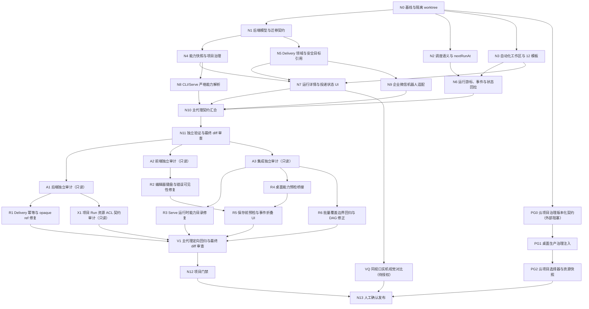

# WorkBuddy 自动化 Graph Engineering 任务 DAG

> 日期：2026-08-01
> 集成分支：`codex/integration-main-v3-20260801`
> 开发起始基线：`origin/main-v3@a3b2f6550b733de9bdc0aabb0f7437d50a1056ef`
> 最终刷新基线：`origin/main-v3@931a7fa6de987b112867069a1c220e2d758f659a`（2026-08-01 以 `--ff-only` 同步，无文件冲突）
> 集成规则：子代理只修改其节点声明的文件；主代理是唯一集成、冲突处理、最终审查和门禁负责人；提交、推送和 PR 必须等待人工确认。

## 1. 拓扑图



## 2. 节点契约

| 节点 | 输入 | 输出 | 依赖 | 文件所有权 | 验收条件 | 验证命令 |
| --- | --- | --- | --- | --- | --- | --- |
| N0 | 裸仓库、全部 worktree、`origin/main-v3` | 独立日期 worktree 和无冲突集成分支 | 无 | 只读 Git 元数据 | 裸仓库已确认；HEAD 与最新远端基线一致；用户修改未丢失 | `git worktree list --porcelain`; `git rev-parse HEAD`; `git rev-parse origin/main-v3`; `git status --short` |
| N1 | 旧 Task/Run JSON、现有迁移入口 | schema version、兼容迁移、Run/Delivery/Capability 数据契约 | N0 | `internal/automation/model*.go`, `archive*.go`, `store*.go` 及同名测试 | 旧任务可读；新字段往返不丢失；损坏输入 fail closed | `go test ./internal/automation -run 'Model|Archive|Store|Migration' -count=1` |
| N2 | once/interval/calendar 现有调度 | effective range、timezone、missed policy、后端权威预览和 `nextRunAt` | N0 | `internal/automation/schedule*.go`, `condition.go`, `engine.go` 及定向测试 | 三种调度、边界、错过执行、幂等 occurrence 均由后端决定 | `go test ./internal/automation -run 'Schedule|Missed|Occurrence|NextRun' -count=1` |
| N3 | WorkBuddy 截图、Reasonix 设计系统、现有 Heartbeat UI | 双页签、内部滚动、12 个固定模板和自动化工作区壳层 | N0 | `desktop/frontend/src/features/automation/workspace/**`, `automation-workspace-layout*.test.tsx` | 默认定时任务；12 模板可滚动；模板进入工作区草稿；响应式和键盘可用 | `cd desktop/frontend && pnpm run typecheck`; `pnpm exec tsx src/__tests__/automation-workspace-layout.test.tsx` |
| N4 | Task、Run、connector grant、项目身份 | 不可变能力快照、授权重检、本地治理契约和生产 fail-closed 边界 | N1 | `internal/automation/capability.go`, `capability_test.go`, `governance.go`, `governance_test.go`, `service_governance.go` | 历史快照不被任务编辑改变；撤权后新 Run blocked；缺少生产治理时显式 `projectId` 安全拒绝 | `go test ./internal/automation -run 'Capability|Governance|Project' -count=1` |
| N5 | 运行结果、通知配置、profile/workspace 身份 | Delivery 独立状态机、持久化、重试、opaque target ref、安全错误 | N1 | 仅 `internal/automation/delivery*.go`、`delivery_store*.go` 及同目录 Delivery 测试 | Run 与 Delivery 状态分离；重试幂等；凭据/远端 ID 不进入 Task 或错误文本 | `go test ./internal/automation -run 'Delivery' -count=1` |
| N6 | Run archive、Wails runtime events、前端分页请求 | 可见集合上的稳定 cursor、事件合并回拉、无隐藏记录元数据泄漏 | N2,N3 | `internal/automation/service_run_helpers.go`, `desktop/automation.go`, `heartbeat/heartbeat.bridge.ts`, automation bridge/pagination/subscription 测试 | cursor 与筛选绑定；授权过滤先于分页；事件只触发后端权威回拉 | 后端 pagination 测试；automation bridge/pagination/subscription 测试 |
| N7 | Run detail/events/result/delivery/capability DTO，以及 N3 已稳定的工作区壳层 | 完整任务编辑器、概要、时间线、结果/产物、使用量、投递、权限快照 UI | N3,N4,N5 | `heartbeat/HeartbeatPanel.tsx`, `heartbeat/heartbeat.css`, `heartbeat/heartbeat.types.ts`, `automation-run-details*.test.tsx`, `automation-panel-contract*.test.ts` | 只展示真实字段；仅可重试失败提供重试；导出和取消保持可用 | `cd desktop/frontend && pnpm run typecheck`; 运行 run-details 与 panel contract 的 `pnpm exec tsx` 测试 |
| N8 | Serve Engine、CLI actor/config、CapabilityResolver 契约 | CLI/Serve 严格能力快照解析 | N4 | `internal/cli/cli.go`, `internal/cli/*automation*_test.go` | Serve 不再走缺字段 fallback；解析失败产生 blocked 而非降级快照 | `go test ./internal/cli -run 'ServeAutomation|Capability' -count=1` |
| N9 | 已有企业微信配置和安全凭据解析能力 | 企业微信机器人真实 Delivery adapter 与安全目录项 | N5 | `desktop/automation_delivery*.go`, `desktop/bot_connection_app.go`, `desktop/settings_app.go`, `internal/bot/wecom/**` 及对应测试 | 非 iLink 冒充；任务只存 opaque ref；撤销/跨 profile/workspace fail closed | `go test ./internal/bot/wecom -count=1`; 在 `desktop` 执行 `go test . -run 'WeCom|AutomationDelivery' -count=1` |
| N10 | N1-N9 的代码和独立测试结果 | 一致的 API、事件、状态、错误码、持久化和 UI 契约 | N6,N7,N8,N9 | 主代理拥有全仓集成权；不做无关重构 | Go/TS 字段和枚举完全对应；无重复权威计算；无同名不同义状态 | 定向 Go/前端测试；`git diff --check`; 生成/构建 Wails bindings |
| N11 | 汇合后完整 diff | 标准、规格、安全、契约四轴独立审查结论 | N10 | 只读；修复只能由主代理实施 | 验证代理不引用实现代理主观结论；所有 High/Blocker 已解决或明确未完成 | `git diff origin/main-v3 --`; 定向回归；独立只读复核 |
| A1 | N11 后端 diff 与节点验收条件 | 后端独立问题清单和定向测试证据 | N11 | 只读：`internal/automation/**`, `internal/bot/**` | 不引用实现代理结论；区分可修复缺口与外部契约 | 后端节点定向测试；`git diff origin/main-v3 -- internal/automation internal/bot` |
| A2 | N11 前端 diff、参考截图与 UI 验收条件 | 前端独立问题清单和定向测试证据 | N11 | 只读：`desktop/frontend/src/features/automation/**` 及相关测试 | 核对双页签、12 模板、编辑器、运行详情、键盘与错误路径；不得把静态截图当作实机 1:1 证明 | 在 `desktop/frontend` 运行 automation 定向测试、`pnpm run typecheck`、`pnpm run test:typecheck` |
| A3 | N11 桥接、CLI、治理 wiring 和分支状态 | 集成独立问题清单、Go/TS 契约与发布状态证据 | N11 | 只读：`desktop/automation*`, `internal/cli/**`, 治理 wiring、Git 元数据 | 核对事件、状态、DTO、Serve 能力来源、生产治理注入、staged/commit/PR 状态 | desktop/CLI 定向测试；`git status --short`; `git diff --cached --name-only` |
| R1 | A1 的 Delivery High | 同一父 attempt 重试幂等；所有生产 target ref 默认 opaque | A1 | `internal/automation/engine.go`, `engine_test.go`, `model_v2.go`, `model_test.go` | 重复重试不重复发送；失败子 attempt 可产生下一代；未知生产类型 fail closed；仅封闭测试类型允许明文 ref | `go test ./internal/automation -run 'Delivery|Model' -count=1` |
| R2 | A2 的键盘与错误可见性 High/Medium | 可操作的自定义选择器；加载/取消/部分保存错误可见且草稿保留 | A2 | `heartbeat/HeartbeatPanel.tsx`, `automation-editor-accessibility.test.tsx`, `automation-error-visibility.test.tsx` | Arrow/Home/End/Enter/Escape 可用；初始加载、取消运行、模板部分失败均不静默 | 运行 accessibility/error visibility/panel contract 测试；两套 TypeScript 类型检查 |
| R3 | A3 的 Serve 目录缺口 | 使用当前 Serve runtime 的 skill/expert/MCP 权威目录和严格快照 | A3 | `internal/cli/cli.go`, `internal/cli/automation_capability_test.go` | 同工作区成功解析；跨工作区、缺失或断开能力 blocked；不信任 MCP `ReadOnlyHint` | `go test ./internal/cli -run 'TestServeAutomation|TestServeAutomationModelRefPriorityAndFailClosed' -count=1` |
| R4 | A3 的保存前能力预检缺口 | `AutomationResolveCapabilities` Go 绑定与 typed 前端桥接 | A3 | `desktop/automation_capabilities.go`, `automation_capabilities_test.go`, `frontend/src/lib/bridge.ts`, `heartbeat/heartbeat.bridge.ts`, `automation-bridge.test.ts` | 先按真实运行顺序解析默认模型/计费路由，再严格冻结能力；错误不降级 | 在 `desktop` 运行 capability 定向测试；运行 automation bridge 测试和两套类型检查 |
| R5 | R2 已稳定的编辑器、R4 typed 预检 | 保存前 fail-closed 预检、风险摘要和默认折叠事件时间线 | R2,R4 | `heartbeat/HeartbeatPanel.tsx`, `automation-capability-preflight.test.tsx`, `automation-run-details.test.tsx` | 预检失败保留草稿且不持久化；成功使用权威风险摘要；已脱敏事件默认折叠但可展开 | 运行 capability preflight/run details 测试；两套 TypeScript 类型检查 |
| R6 | A3 对批量覆盖和 DAG 所有权的审计结论 | 省略任务 fail-closed 回归保护；真实拓扑和并行所有权 | A3 | `internal/automation/service_governance_test.go`, `docs/ai01/2026-08-01-workbuddy-automation-task-dag.md` | `SaveTasks` 省略项目任务返回 revision conflict、存储不变且无虚假审计；并行节点不共享写文件 | `go test ./internal/automation -run 'TestServiceSaveTasksRejectsOmittedProjectTaskBeforeOverwrite' -count=1`; 审查 DAG |
| X1 | A1 的项目 Run ACL High | 资源身份来源审计和安全边界结论 | A1 | 只读：Task/CapabilitySnapshot/RunManifest/治理授权路径 | 不从 workspace、工具名、connector 或 delivery ref 猜资源；缺少权威资源快照时明确归入 PG0/PG2 | 项目治理、Run fail-closed、Export fail-closed 定向测试 |
| V1 | R1、R3、R5、R6、X1 结果 | 主代理整合后的定向回归、契约审查和最终工作区状态 | R1,R3,R5,R6,X1 | 主代理只读验证；修复必须重新分配独占文件范围 | `internal/automation`、CLI、desktop、前端定向测试通过；`git diff --check` 通过；无 staged/commit/push/PR | 见第 6 节真实结果 |
| PG0 | 云平台接口冻结 | `ProjectGovernanceClient` 与云端契约测试 | N0，外部服务先决条件 | 仅 `internal/cloud/project_governance*.go` | 跨项目 IDOR、撤权、过期 grant、private resource、审计幂等和事务失败由真实服务证明 | `go test ./internal/cloud -run 'Project|Membership|ACL|Audit' -count=1` |
| PG1 | PG0 客户端 | 桌面生产 `ProjectAuthorizer`/`AuditSink` 注入 | PG0 | 待 PG0 后单独分配，不能与 automation/frontend 并行写 | 真实 `projectId` 任务通过权威服务授权；服务不可用时 fail closed | desktop 项目治理集成测试 |
| PG2 | PG1、云项目/资源 API | 云项目选择器与不可变 Run resource snapshot | PG1 | 待接口冻结后拆分为互斥 backend/frontend 节点 | UI 保存权威 `projectId`/资源引用；Read/Export/Delivery 使用冻结资源 ACL | 云项目选择、资源 ACL、撤权与 IDOR E2E |
| VQ | N7 UI 与 WorkBuddy 参考图 | 相同视口、相同状态的参考/实机组合对比 | N7，需用户指定浏览器 | 只读运行与截图证据；修复另建 UI 节点 | 两页签、12 模板、编辑器关键层级和交互经实机验证；控制台无相关错误 | 用户授权后运行 Reasonix 实机 UI/浏览器验收并生成组合对比 |
| N12 | 最新 `origin/main-v3` 和最终 diff | 可审计门禁结果 | V1 | 主代理，只执行验证 | 六条命令严格按序执行；任何失败、超时、用户中止或跳过均记为未通过 | 见第 4 节；本轮按用户要求为“跳过/未通过” |
| N13 | N12、PG2、VQ 和人工明确授权 | commit/push/PR（如获授权） | N12,PG2,VQ | 仅主代理 | 所有依赖真实完成且获授权前保持本地分支，不产生发布副作用 | 发布前再次核对 remote、SHA、target、worktree、门禁和 PR 状态 |

## 3. 执行批次与并行边界

1. 批次 A：N0 串行。任何实现都不得早于基线确认。
2. 批次 B：N1、N2、N3 可并行；三者文件所有权不重叠。
3. 批次 C：N4、N5 可并行；N6 必须等待 N2、N3 的 DTO 和事件契约稳定。
4. 批次 D：N7 必须等待 N3、N4、N5；N8 等待 N4；N9 等待 N5。满足各自依赖后，N7、N8、N9 可并行，且分别只拥有 Heartbeat 编辑/详情、CLI、桌面投递文件。
5. 批次 E：N10、N11 串行；随后 A1、A2、A3 三个调查代理只读并行审计。
6. 批次 F：R1、R2、R3、R4、R6 和只读 X1 可并行；这些节点写文件互不重叠。R5 必须等待 R2 与 R4，串行接入保存前预检。
7. 批次 G：V1、N12 串行且仅由主代理执行；本轮 N12 按用户要求跳过，不得描述为通过。
8. 外部批次：PG0 → PG1 → PG2 严格串行；没有版本化云端契约时不得启动 PG1/PG2。VQ 等待用户指定浏览器与实机验收授权。
9. 发布批次：N13 同时依赖 N12、PG2、VQ 和人工确认，不能自动执行。

删除的虚假依赖：N8 不依赖 UI；N9 不依赖运行详情渲染；N7 不依赖 CLI。保留的真实依赖：N7 必须等待 N3 的工作区壳层，且 N9 必须等待 N5 的 Delivery 领域契约。N10 之前不得让多个代理同时修改同一个共享桥接文件或同一个 `internal/automation/service*.go` 文件；N4 的 `service_governance.go` 与 N6 的 `service_run_helpers.go` 是互不重叠的文件所有权，可在各自前置依赖满足后并行。

文件所有权校正：N3 只拥有 `workspace/**`，N7 独占初始 `HeartbeatPanel.tsx`、`heartbeat.css` 和 `heartbeat.types.ts`；N5 只拥有 `internal/automation` 的 Delivery 领域文件，N9 独占桌面 Delivery adapter 与企业微信文件。审计后的 R2 与 R5 虽依次修改同一个 Panel，但存在明确 `R2 → R5` 串行依赖，绝不并发写。R1、R3、R4、R6 的写范围彼此不重叠。

所有实现节点统一采用：**调查 → 回归测试 → 最小实现 → 定向测试 → diff 审查**。

## 4. PR 前固定门禁

必须先同步最新 `main-v3`。用户指定的发布前硬性命令仍为：

```sh
go run ./scripts/code_guard
git ls-files --error-unmatch scripts/code_guard_baseline.json
git diff --exit-code -- scripts/code_guard_baseline.json
git diff --cached --exit-code -- scripts/code_guard_baseline.json
go vet ./...
go test ./...
```

当前仓库 `AGENTS.md` 在远端基线 `931a7fa6` 又增加了以下共同检查和可执行门禁；发布前同样必须满足：

```sh
git diff --exit-code origin/main-v3...HEAD -- scripts/code_guard_baseline.json
git diff --check origin/main-v3...HEAD
node ./scripts/pr-gate.mjs --base origin/main-v3 --run all
```

`make pr-ready` 是最后一条命令的等价入口，不是额外成功证据。`pr-gate.mjs` 的分类摘要决定当前 diff 需要运行的受影响包测试和前端生产构建；用户明确指定的 `go vet ./...`、`go test ./...` 仍不能被比例门禁替代。

失败、超时、跳过或没有最终结果均不得描述为通过；任一用户硬性命令、仓库共同检查或可执行门禁未通过时不得创建或更新 PR。

## 5. 已证实的外部前置依赖

生产项目自动化不能由本地 `workspaceRoot` 推导。当前仓库没有 CloudProject、项目成员 RBAC、项目资源 ACL 或项目审计/事务 outbox 的权威云端契约；本地项目树只有绝对路径。因此显式 `projectId` 任务继续 fail closed 是安全边界，不得用本地路径或测试用内存 grant 冒充完成。

在 N4 的生产 wiring 前必须新增 PG0：

- 输入：服务端已批准的版本化 OpenAPI、DTO/错误码/ETag、Principal/RBAC/Object ACL 和审计幂等/事务语义，以及可验证 fixture 或测试环境；
- 输出：`ProjectGovernanceClient` 及云端契约测试；
- 依赖：云平台接口先冻结；
- 文件所有权：仅 `internal/cloud/project_governance*.go`，不得同时修改 automation、desktop 或 frontend；
- 验收：跨项目 IDOR、撤权、过期 grant、private resource、审计幂等和事务失败均由真实服务契约证明；
- 验证：`go test ./internal/cloud -run 'Project|Membership|ACL|Audit' -count=1`。

PG0 未具备前，PG1 桌面治理注入和 PG2 云项目选择器均不得开始；这不是本地实现可以安全猜测的字段或 API。

项目 Run 的资源级 ACL 同样归入 PG2：当前 Task、CapabilitySnapshot 和 RunManifest 没有权威资源引用。`workspaceRoot`、工具名、connector ID、grant ID 或 Delivery target ref 均不能替代资源身份；现有代码继续 fail closed 是安全结果，不代表资源 ACL 已完成。

## 6. 当前执行状态与真实验证

- 本地已完成：N0-N11、A1-A3、R1-R6、X1、V1；其中 X1 的输出是“依赖 PG0/PG2，禁止猜测实现”。
- 外部未完成：PG0、PG1、PG2。
- 视觉未完成：VQ；已有截图只能作为静态参考，尚无用户指定浏览器下的相同视口实机组合对比。
- 门禁未通过：N12 按用户明确要求跳过。此前 `go test ./...` 两次 20 分钟超时，后续运行被用户要求中止；均不得写成通过。
- 发布未执行：N13 未获授权；当前无 staged 文件、未创建任务提交、无 push、无 PR。分支仅快进包含远端 `main-v3` 已有的 4 个提交。

主代理在最后一次本地汇合后执行并通过的定向验证：

```sh
go test ./internal/automation -count=1
go test ./internal/cli -run 'TestServeAutomation|TestServeAutomationModelRefPriorityAndFailClosed' -count=1
cd desktop && go test . -run 'TestAutomation|TestDesktopAutomation|TestWeCom' -count=1
cd desktop/frontend && pnpm exec tsx src/__tests__/automation-capability-preflight.test.tsx
cd desktop/frontend && pnpm exec tsx src/__tests__/automation-error-visibility.test.tsx
cd desktop/frontend && pnpm exec tsx src/__tests__/automation-run-details.test.tsx
cd desktop/frontend && pnpm exec tsx src/__tests__/automation-editor-accessibility.test.tsx
cd desktop/frontend && pnpm exec tsx src/__tests__/automation-bridge.test.ts
cd desktop/frontend && pnpm run typecheck
cd desktop/frontend && pnpm run test:typecheck
git diff --check
```

这些定向结果只证明对应本地节点，不替代 N12 的全仓门禁、PG0-PG2 的云端契约或 VQ 的实机视觉验收。
