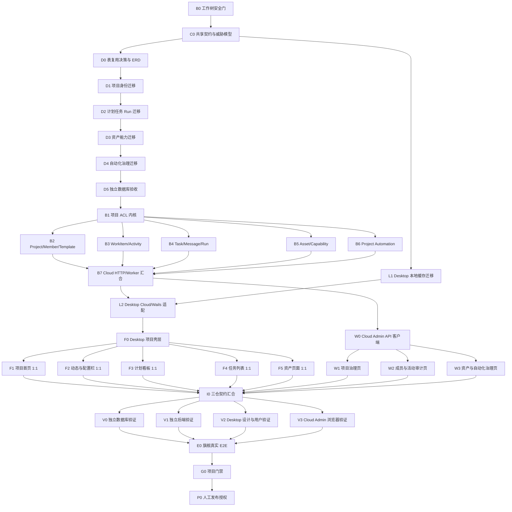

# Reasonix 模仿实现 WorkBuddy 项目功能：Graph Engineering 全栈任务图

> 日期：2026-08-01
>
> 状态：等待人工确认，禁止开始实现
>
> 桌面端固定工作树：`D:\project\Reasonix-worktrees\integration-main-v3-20260801`
>
> 桌面端固定分支：`codex/integration-main-v3-20260801`
>
> 云管理端：`D:\project\reasonix-cloud-platform\naive-ui-admin`，目标分支 `main`
>
> 云后端：`D:\project\reasonix-cloud-platform\Reasonix-Cloud`，目标分支 `main`
>
> 发布约束：未经用户明确授权，不 commit、不 push、不创建或更新 PR。

## 1. 结论与当前阻塞

本需求不是单纯的页面换皮，而是三个仓库共同完成的项目协作系统：

1. Reasonix Desktop 负责复刻截图中的普通用户项目体验，并继续负责本地工作区、
   本地文件、Controller、Agent、MCP、工具执行和审批。
2. Reasonix Cloud 负责 CloudProject、成员权限、计划、任务、Run、资产、能力授权、
   项目自动化、活动与审计的 PostgreSQL 权威事实和 `/api/v1` REST/SSE 契约。
3. `naive-ui-admin` 是管理员控制台，只实现项目治理、成员治理、审计、资产与自动化
   运行管理；不把 WorkBuddy 普通用户桌面页面复制到管理员控制台。

实施目前被 **B0 工作树安全门** 阻塞：指定桌面分支共有 84 个未提交状态项，其中
47 个已跟踪文件被修改、37 个文件未跟踪；已跟踪 diff 约为 `+5719/-858`，主要是
尚未提交的自动化实现。该分支 HEAD 为 `931a7fa6`，最新 `origin/main-v3` 为
`06307e38`，落后 6 个提交。不得在用户确认这些现有改动属于本次集成基线之前同步、
覆盖或分配实现代理。

## 2. 已核验的仓库基线

| 项目 | 仓库性质 | 当前分支/HEAD | 远端状态 | 工作区状态 | 结论 |
| --- | --- | --- | --- | --- | --- |
| Reasonix | bare repository | bare HEAD `f70cd430` | 已 fetch，`origin/main-v3=06307e38` | 33 个 worktree | 已确认是 worktree 管理仓库 |
| Desktop 目标 worktree | 普通 worktree | `codex/integration-main-v3-20260801@931a7fa6` | 相对最新 `origin/main-v3` 为 `0 ahead / 6 behind` | dirty：47 tracked + 37 untracked | 必须保留现有自动化改动 |
| Cloud Admin | 普通 Git 仓库 | `main@87ffe728` | 已 fetch，与 `origin/main` 一致 | clean | 用户指定直接以 `main` 为目标分支 |
| Cloud Backend | 普通 Git 仓库 | `main@365c9625` | 已 fetch，与 `origin/main` 一致 | clean | 用户指定直接以 `main` 为目标分支 |

全部 33 个 Reasonix worktree 已逐一读取分支、SHA 和 dirty 状态。除目标 worktree
外，另有多个历史 dirty worktree；本任务不修改、清理、移动或删除任何历史 worktree。

## 3. 规格优先级与不可变边界

### 3.1 规格优先级

1. `2026-07-29-workbuddy-project-development-spec-optimized-review.md`
2. `2026-07-29-workbuddy-project-implementation-breakdown.md`
3. `2026-07-29-workbuddy-project-implementation-checklist.md`
4. `2026-08-01-workbuddy-automation-development-plan.md`
5. `2026-07-20-workbuddy-ui-interaction-style-analysis.md`
6. `WORKBUDDY_DEVELOPMENT_BLUEPRINT.md`
7. 两份 2026-07-20 实施/修复记录只作为历史证据，不当作当前实现事实。

### 3.2 必须保持的领域边界

- `CloudProject != LocalWorkspace`。
- `LocalSession != ProjectTask`，当前侧栏会话主题不能冒充云项目任务。
- `WorkItem != ProjectTask != AgentRun`。
- `Artifact != AssetVersion`；Artifact 只能经人工确认提升为项目资产版本。
- 本地文件不自动上传，云资产不自动覆盖本地文件。
- 现有 `desktop-projects.json` 继续作为本地工作区注册表；不得无迁移替换。
- 云项目数据由 PostgreSQL 权威保存；客户端只保存可重建缓存和待发送队列。
- 所有资源查询必须先限定 `project_id`，再应用对象 ACL。
- 项目级角色不能复用系统级 `admin/user` 角色。
- Owner/Admin 不能旁路读取自己未参与的 private Task。
- 同一 ProjectTask 只能有一个活跃顶层 Run；ChildRun 可并行但不能并发写主消息流。
- Connector 授权分为 CapabilityBinding、长期 ConnectorGrant 和单次 RunToolGrant。
- PersonalAutomation 与 ProjectAutomation 是两个治理域。
- 凭据只存 `credential_ref`；不得进入 Task、Run、事件、日志或客户端缓存。
- Cloud 不托管桌面 workspace、MCP 运行、本地插件、本地工具或本地文件系统。
- Cloud Backend 新表禁止数据库外键；关系完整性由索引、事务、service 校验和测试保证。

### 3.3 必须在 C0 冻结的文档冲突

1. 自动化表名：38 表规格使用 `automation_rules/automation_executions`，自动化专项另提
   `project_automation_*` 五表。默认以 38 表口径为主；新增 revision/delivery 表必须先有 ADR。
2. 项目角色：项目规格使用 Owner/Admin/Member/AgentContributor/ServicePrincipal，
   自动化专项使用 Viewer/Member/Maintainer/Owner。必须形成唯一角色/能力矩阵。
3. 事件传输：项目规格要求 Run SSE 支持 `Last-Event-ID`；Cloud 当前规范禁止页面把
   WebSocket、Redis Streams 或 outbox 当隐式状态源。决定为 REST 权威恢复 + Run SSE，
   outbox 仅用于事务后异步派发，不作为页面事实源。
4. “1:1”仅指布局、尺寸、层级、状态与交互。WorkBuddy 商标、专有插画、固定品牌文案
   和未授权资产不得复制；使用 Reasonix 自有品牌与原创等价素材。

## 4. 七张截图的验收状态矩阵

| 参考图 | 原始尺寸 | 目标状态 | 必须可操作的核心控件 | Desktop 输出 |
| --- | --- | --- | --- | --- |
| 图 1 | 1142×601 | 项目首页顶部 | 新建项目、搜索、已有项目、模板入口 | ProjectDirectory 顶部态 |
| 图 2 | 1142×601 | 项目首页滚动态 | 模板卡、滚动、搜索保持 | ProjectDirectory 滚动态 |
| 图 3 | 1918×921 | 项目动态默认态 | Tab、发布留言、相关/成员动态、邀请、右侧配置、Composer | ProjectWorkspace/ActivityTab |
| 图 4 | 1920×917 | 计划看板 | 筛选、搜索、添加、四列、卡片、横向滚动 | PlanBoard |
| 图 5 | 1918×918 | 项目任务列表 | 状态/来源筛选、搜索、行操作、成员头像 | ProjectTaskList |
| 图 6 | 1915×916 | 项目资产 | 新建文件夹、上传、类型筛选、搜索、表格、容量 | ProjectAssetBrowser |
| 图 7 | 1918×917 | 动态成员筛选展开态 | 搜索成员、多选、重置、确定、弹层定位与键盘 | ActivityMemberFilter |

视觉验收必须在相同 viewport、相同数据和相同交互状态下，将参考图和运行截图放入
同一个对比输入。截图存在不等于通过；Product Design `design-qa` 必须生成报告并达到
`final result: passed`，同时 Reasonix user-testing 的真实 runtime console 和 axe 检查无阻塞问题。

## 5. 共享数据、接口、事件和状态契约

### 5.1 38 张云端逻辑表

项目与身份 10 张：`principals`、`projects`、`project_members`、`project_invites`、
`object_acl_entries`、`devices`、`local_workspace_bindings`、`project_templates`、
`project_template_versions`、`project_instruction_versions`。

计划、任务与 Run 13 张：`work_items`、`external_work_item_links`、`project_tasks`、
`task_work_item_links`、`task_participants`、`messages`、`context_references`、
`agent_runs`、`run_relationships`、`device_run_leases`、`run_events`、`artifacts`、
`run_approvals`。

资产与能力 7 张：`upload_sessions`、`assets`、`asset_versions`、`asset_chunks`、
`project_capability_bindings`、`connector_grants`、`run_tool_grants`。

自动化与治理 8 张：`automation_rules`、`automation_executions`、
`project_policy_versions`、`activity_events`、`outbox_events`、`audit_events`、
`purge_jobs`、`idempotency_records`。

是否复用 `principals/devices/audit_events/idempotency_records` 必须由 Cloud 当前 migration
和字段语义证明。当前仅确认已有 `outbox_events`，不能因表名相同就认定可直接复用。

### 5.2 客户端可重建数据

- `cloud_project_cache`
- `workspace_binding_cache`
- `runner_event_outbox`

建议落在新的 `internal/project/**` SQLite 包；不替换 `desktop-projects.json`，不保存云端
权威业务表，不复制资产正文或凭据。

### 5.3 API 与恢复

- 用户项目 API：`/api/v1/projects/**`，只有明确管理需求才新增 `/api/v1/admin/projects/**`。
- 写请求使用 `X-Idempotency-Key`；更新使用 version/ETag。
- 响应使用现有 `data/error/request_id` envelope，客户端自然语言错误为中文。
- 写后由 REST GET 回读 PostgreSQL 权威状态。
- Run 事件 SSE 支持 `Last-Event-ID`；HTTP 超时不能被解释为异步操作失败。

### 5.4 事件与状态

核心 Activity 事件：`project.created/updated/archived`、`member.invited/joined/role_changed`、
`work_item.created/assigned/status_changed`、`task.created/shared`、`run.started/completed`、
`artifact.created`、`asset.version_created`、`automation.triggered/failed`。

核心状态机：

- Project：`draft -> initializing -> active|degraded|failed -> archived|deletion_pending`。
- WorkItem：`todo -> in_progress -> paused -> done`，允许 `done -> todo`。
- Run：`queued -> waiting_for_device -> running -> completed|failed|canceled|device_unavailable|approval_expired`。
- AssetVersion：`uploading -> uploaded -> scanning -> parsing -> indexing -> ready`，失败为
  `rejected|failed_retryable`。
- Delivery：`queued -> sending -> succeeded|failed|canceled`；Run 成功与通知成功相互独立。

## 6. 总任务 DAG



## 7. 节点契约

### B0：工作树安全门

- 输入：33 个 worktree 状态、目标分支 84 个未提交状态项、最新 `origin/main-v3`。
- 输出：用户确认的现有改动归属、可同步基线和文件所有权清单。
- 依赖节点：无。
- 允许修改：无；只读 Git 元数据。
- 验收：用户明确现有自动化改动是否作为本次输入；确认同步策略；没有丢失或覆盖用户改动。
- 验证命令：`git status --short --branch`、`git diff --stat`、
  `git rev-list --left-right --count HEAD...origin/main-v3`。

### C0：共享契约、测试 seam 与威胁模型冻结

- 输入：8 份规格、7 张截图、三个仓库当前代码、38 表口径。
- 输出：OpenAPI、ID/DTO/错误码、角色矩阵、对象 ACL、状态机、事件字典、TDD seam、STRIDE/IDOR 用例。
- 依赖节点：B0。
- 允许修改：Cloud 权威 API/架构文档和独立契约测试文件；不修改业务代码。
- 验收：Desktop/Cloud/Admin 对分页、幂等、ETag、SSE、private Task、资产引用、自动化授权解释一致。
- 验证命令：OpenAPI lint/contract test；Markdown 链接检查；权限矩阵人工审查。

### D0：表复用决策、ERD 与 migration 切片

- 输入：C0、Cloud 现有 00001–00069 migrations。
- 输出：确认新增 34 或 38 张表、无外键 ERD、索引/唯一约束/保留期、00070 起的迁移编号计划。
- 依赖节点：C0。
- 允许修改：`Reasonix-Cloud/docs/architecture/**`、migration 设计测试；不建表。
- 验收：每张表有 owner、生命周期、project 隔离键、幂等/版本约束；同名旧表复用有字段级证据。
- 验证命令：migration inventory 测试、SQL 静态审查、`rg -n "FOREIGN KEY|REFERENCES"`。

### D1：项目与身份 schema

- 输入：D0 的前 10 表定义。
- 输出：项目、成员、邀请、ACL、设备、workspace binding、模板和指令版本 migrations 及 schema 测试。
- 依赖节点：D0。
- 允许修改：`Reasonix-Cloud/migrations/00070_*.sql`、对应 `project_*_schema_test.go`。
- 验收：up/down/up 可重复；项目级唯一约束和分页索引完整；无数据库外键。
- 验证命令：`go test ./migrations -run 'ProjectIdentity|MigrationInventory'`；隔离 PostgreSQL migrate up/down/up。

### D2：计划、任务与 Run schema

- 输入：D1、13 张计划/任务/Run 表定义。
- 输出：WorkItem、Task、Message、Run、Lease、Event、Artifact、Approval migrations 和 schema 测试。
- 依赖节点：D1（migration 编号和共享列是真实依赖）。
- 允许修改：下一段连续 migration、对应 schema 测试。
- 验收：`(task_id,message_seq)`、`(run_id,event_seq)` 唯一；单活顶层 Run 和租约可由约束/事务实现；无外键。
- 验证命令：`go test ./migrations -run 'ProjectTask|AgentRun|MigrationInventory'`；隔离库 SQL 断言。

### D3：资产与能力 schema

- 输入：D2、7 张资产/能力表定义。
- 输出：UploadSession、AssetVersion、Chunk、CapabilityBinding、Grant migrations 和测试。
- 依赖节点：D2。
- 允许修改：下一段连续 migration、对应 schema 测试。
- 验收：checksum、版本、项目/对象 ACL 索引完整；只保存 `credential_ref`；无外键。
- 验证命令：`go test ./migrations -run 'ProjectAsset|ProjectCapability|MigrationInventory'`。

### D4：自动化与治理 schema

- 输入：D3、自动化命名 ADR、8 张治理表定义。
- 输出：AutomationRule/Execution、PolicyVersion、Activity、Outbox、Audit、Purge、Idempotency migrations 和测试。
- 依赖节点：D3。
- 允许修改：下一段连续 migration、对应 schema 测试。
- 验收：`(automation_id,scheduled_instance_id)` 唯一；活动/审计区分；既有 outbox 复用或迁移理由明确。
- 验证命令：`go test ./migrations -run 'ProjectAutomation|ProjectGovernance|MigrationInventory'`。

### D5：独立数据库验收

- 输入：D1–D4 实际 SQL，不参考数据库实现代理结论。
- 输出：schema 差异报告、真实 PostgreSQL up/down/up 证据、约束/索引/无外键查询结果。
- 依赖节点：D4。
- 允许修改：只读；失败修复退回 D1–D4。
- 验收：实际库包含批准表和索引；无 `FOREIGN KEY/REFERENCES`；回滚与重放成功；没有 skip 被写成通过。
- 验证命令：`go run ./cmd/migrate up/down/up`、`go test ./migrations ...`、`pg_catalog` 查询。

### B1：项目访问控制内核

- 输入：C0 权限矩阵、D5 schema。
- 输出：Principal、项目角色、ObjectACL、资源归属、稳定错误和授权测试。
- 依赖节点：D5。
- 允许修改：`Reasonix-Cloud/internal/projectaccess/**`。
- 验收：跨项目 IDOR、private Task、撤权、过期 grant、伪造 user_id 全部 fail closed。
- 验证命令：`go test ./internal/projectaccess`。

### B2：Project、Member、Invite、Template、Instruction

- 输入：B1、项目身份表。
- 输出：项目生命周期、模板版本、指令版本、成员和邀请 service/handler/repository 测试。
- 依赖节点：B1。
- 允许修改：`Reasonix-Cloud/internal/projects/**`。
- 验收：幂等创建、邀请登录边界、版本冲突、归档/恢复、写后 GET、两项目隔离通过。
- 验证命令：`go test ./internal/projects`。

### B3：WorkItem 与 Activity

- 输入：B1、计划/活动表。
- 输出：计划项 CRUD、排序/拖拽版本控制、活动 REST 游标分页和事务写入。
- 依赖节点：B1。
- 允许修改：`Reasonix-Cloud/internal/projectwork/**`。
- 验收：非法状态迁移被拒；工作项变化与 Activity 同事务；私密事件不投影给无权成员。
- 验证命令：`go test ./internal/projectwork`。

### B4：ProjectTask、Message、AgentRun 与 Device Runner 云端

- 输入：B1、Task/Run schema、Run 状态机。
- 输出：Task/Message/Run API、单活顶层 Run、Lease、Event、Approval、SSE 续传。
- 依赖节点：B1。
- 允许修改：`Reasonix-Cloud/internal/projectrun/**`。
- 验收：事件严格有序；过期/撤销设备不能提交；`Last-Event-ID` 恢复；private Task 无数量/时间侧信道。
- 验证命令：`go test ./internal/projectrun`，并发/租约/SSE/IDOR 聚焦集成测试。

### B5：Asset、Upload、Artifact Promote 与 Capability Grant

- 输入：B1、资产/能力 schema。
- 输出：上传会话、资产版本、扫描/解析/索引状态、Artifact 提升、三层授权服务。
- 依赖节点：B1。
- 允许修改：`Reasonix-Cloud/internal/projectassets/**`、`internal/projectcapabilities/**`，分配给不同代理时目录不得交叉。
- 验收：MIME/大小/checksum/路径校验；失败补偿；ACL 扩大需确认；撤权阻断；无凭据泄漏。
- 验证命令：`go test ./internal/projectassets ./internal/projectcapabilities`。

### B6：Project Automation 云端治理

- 输入：B1、D4、现有未提交 Desktop PersonalAutomation 契约。
- 输出：项目自动化定义、revision、授权快照、运行/Delivery 投影、审计和 purge。
- 依赖节点：B1；项目 Run/Grant 联调依赖 B4、B5。
- 允许修改：`Reasonix-Cloud/internal/projectautomation/**`；不得修改 Desktop `internal/automation/**`。
- 验收：重复 occurrence 不重复执行；撤权立即阻断；Run/Delivery 独立；高风险动作逐次审批。
- 验证命令：`go test ./internal/projectautomation`。

### B7：Cloud HTTP、server 与 worker 汇合

- 输入：B2–B6 已通过的 package 公共接口。
- 输出：真实 `/api/v1/projects/**` 路由、依赖注入、worker 恢复任务、OpenAPI/API 文档。
- 依赖节点：B2、B3、B4、B5、B6。
- 允许修改：仅主代理修改 `internal/http/router.go`、`cmd/server/main.go`、`cmd/worker/main.go` 和共享 API 文档。
- 验收：鉴权、envelope、中文错误、request_id、幂等、REST 回读和 SSE 契约一致。
- 验证命令：`go test ./internal/http ./cmd/server ./cmd/worker`；API contract/curl 样例。

### L1：Desktop 本地项目缓存与兼容迁移

- 输入：C0、本地 `desktop-projects.json`、3 类可重建缓存。
- 输出：SQLite schema/repository/migration/sync cursor/outbox；JSON 注册表兼容读取。
- 依赖节点：C0；不依赖 Cloud 业务实现。
- 允许修改：新建 `Reasonix/internal/project/**` 及其测试；不得修改 `internal/automation/**`。
- 验收：未登录/离线仍可打开本地工作区；不隐式上传；损坏/中断迁移可恢复；缓存可全部重建。
- 验证命令：`go test ./internal/project/... -run 'Schema|Migration|Repository|Sync|Outbox'`。

### L2：Desktop Cloud API、Wails 与 Device Runner 适配

- 输入：B7 OpenAPI、L1 repository、现有 Controller/Tab/Topic。
- 输出：项目 API client、Wails bindings、本地 binding/cache、claim/heartbeat/event/complete。
- 依赖节点：B7、L1。
- 允许修改：新建 `desktop/project_*.go` 及测试；共享 `App.tsx/lib/bridge.ts/app.go` 只由主代理最后接线。
- 验收：不隐式切换执行目标；撤销设备不能领取；过期 lease 不能写；错误后可 REST 恢复。
- 验证命令：在 `desktop` 运行 `go test . -run 'TestProject|TestDeviceRun'`；Wails binding 漂移检查。

### W0：Cloud Admin API 客户端

- 输入：B7 明确注册的 admin API；没有 admin API 时只做用户项目只读治理契约或暂停。
- 输出：项目治理 TypeScript 类型、API 封装和 contract tests。
- 依赖节点：B7。
- 允许修改：`naive-ui-admin/src/api/reasonix/project-*.ts`、独立测试；共享 index 由主代理汇合。
- 验收：页面不重复解析 envelope；审计字段只读；写操作有幂等并写后重新 GET。
- 验证命令：`pnpm test` 中的 project contract tests。

### W1：管理员项目治理页

- 输入：W0。
- 输出：独立一级路由的项目查询、状态、归档/恢复和策略治理页。
- 依赖节点：W0。
- 允许修改：`src/views/reasonix/project-management/**`、`src/router/modules/projectManagement.ts`、独立测试。
- 验收：加载/空/错/分页/搜索/越权状态完整；不伪造后端写接口。
- 验证命令：`pnpm test`、`pnpm build`、真实浏览器网络/console 检查。

### W2：管理员成员与活动审计页

- 输入：W0。
- 输出：成员角色治理、邀请记录和活动/审计查询页。
- 依赖节点：W0。
- 允许修改：`src/views/reasonix/project-members/**`、`project-audit/**`、各自一级路由和测试。
- 验收：项目角色不等于系统 admin；private Task 内容不出现在审计列表；写后回读。
- 验证命令：`pnpm test`、`pnpm build`、浏览器权限场景。

### W3：管理员资产与自动化治理页

- 输入：W0。
- 输出：资产状态/配额/隔离治理和自动化运行/失败/审计治理页。
- 依赖节点：W0。
- 允许修改：`src/views/reasonix/project-assets/**`、`project-automations/**`、各自一级路由和测试。
- 验收：不读取资产私密正文；不暴露 credential_ref；Run/Delivery 状态分开显示。
- 验证命令：`pnpm test`、`pnpm build`、浏览器网络/console 检查。

### F0：Desktop 项目详情壳与共享状态

- 输入：L2、截图布局矩阵、Reasonix 现有设计 token。
- 输出：ProjectWorkspace、面包屑、四 Tab、右侧配置、Composer、共享查询/错误/离线状态。
- 依赖节点：L2。
- 允许修改：新建 `desktop/frontend/src/features/projects/{model,data,ui}/**` 中的壳层文件和独立 CSS；共享 App/bridge 不在此节点修改。
- 验收：1918×921 结构、Tab、右栏和底部 Composer 几何稳定；加载/错误/离线/权限态可测试。
- 验证命令：`pnpm exec tsx src/__tests__/project-workspace.test.tsx`、`pnpm test:typecheck`、`pnpm build`。

### F1：项目首页 1:1

- 输入：F0 数据 contract、图 1–2。
- 输出：新建项目、搜索、我的项目、模板卡片和滚动态。
- 依赖节点：F0。
- 允许修改：`ProjectDirectory.tsx`、独立 `ProjectDirectory.css`、data adapter 和对应测试。
- 验收：1142×601 两个状态匹配；搜索/模板/打开项目真实可用；本地与云项目有清晰语义。
- 验证命令：project-directory、workbuddy-primary-navigation 测试，Product Design 同视口对比。

### F2：动态、成员筛选与项目配置 1:1

- 输入：F0、图 3/7、Activity/Member/Binding API。
- 输出：活动流、发布留言、相关/成员动态、成员多选弹层、邀请、指令/连接器/专家/技能/自动化右栏。
- 依赖节点：F0。
- 允许修改：`ActivityTab.tsx`、`ActivityMemberFilter.tsx`、`ProjectConfigRail.tsx` 及独立 CSS/test。
- 验收：成员筛选键盘可用；private 事件不泄漏；右栏不复制凭据；弹层滚动/resize 定位正确。
- 验证命令：对应组件测试、axe、runtime console、同视口图 3/7 设计 QA。

### F3：计划看板 1:1

- 输入：F0、图 4、WorkItem API/ETag。
- 输出：四列看板、筛选、搜索、添加、横向滚动、版本冲突回滚。
- 依赖节点：F0。
- 允许修改：`PlanBoard.tsx`、`PlanBoard.css`、对应测试；不修改共享壳。
- 验收：todo/in_progress/paused/done 状态真实；拖拽冲突回读服务端；键盘可操作。
- 验证命令：`project-plan-board.test.tsx`、浏览器拖拽/冲突 E2E、图 4 设计 QA。

### F4：项目任务列表 1:1

- 输入：F0、图 5、ProjectTask/Run API。
- 输出：状态/来源筛选、搜索、成员、时间、行操作和 Run 状态。
- 依赖节点：F0。
- 允许修改：`ProjectTaskList.tsx`、独立 CSS/test；不修改共享壳。
- 验收：private Task 完全隐藏；分页/筛选不泄漏总数；状态来自后端而非 UI 猜测。
- 验证命令：`project-task-list.test.tsx`、两用户权限 E2E、图 5 设计 QA。

### F5：项目资产页面 1:1

- 输入：F0、图 6、Asset API。
- 输出：文件夹、上传、容量、类型筛选、搜索、表格、版本状态和 Artifact 提升确认。
- 依赖节点：F0。
- 允许修改：`ProjectAssetBrowser.tsx`、独立 CSS/test；不修改共享壳。
- 验收：上传失败可恢复；MIME/大小错误可见；删除后立即退出列表/RAG；不自动同步本地文件。
- 验证命令：`project-assets.test.tsx`、上传/补偿 E2E、图 6 设计 QA。

### I0：三仓接口、事件、状态和数据契约汇合

- 输入：B7、L2、W1–W3、F1–F5 的实际 diff 与测试证据。
- 输出：一致的字段/枚举/错误/分页/事件/缓存映射，以及共享接线。
- 依赖节点：所有实现节点。
- 允许修改：仅主代理修改 Desktop `App.tsx/lib/bridge.ts/lib/types.ts/locales/zh.ts`、Cloud router/server/worker、Admin API/router index。
- 验收：没有同名不同义状态；没有重复权威计算；自动化使用真实 projectId/ACL；无生成绑定漂移。
- 验证命令：跨仓 contract tests、`git diff --check`、Wails binding 检查、OpenAPI/TS 类型比对。

### V0：独立数据库验证

- 输入：汇合后的 migration 和隔离 PostgreSQL。
- 输出：真实 up/down/up、schema、索引、无外键、隔离与幂等报告。
- 依赖节点：I0。
- 允许修改：只读；失败退回数据库节点。
- 验收：没有 skip/超时被描述为通过。
- 验证命令：D5 全部命令和跨项目隔离 SQL。

### V1：独立后端验证

- 输入：实际后端代码和 C0 验收条件，不读取实现代理主观结论。
- 输出：权限、并发、恢复、SSE、上传、自动化和中文错误报告。
- 依赖节点：I0。
- 允许修改：只读；修复重新分配独占文件范围。
- 验收：所有 Blocker/High 解决；定向 package 测试有最终退出结果。
- 验证命令：B1–B7、L1–L2 的定向测试，Cloud/Desktop `go vet`。

### V2：Desktop 独立视觉与用户验收

- 输入：七张原图、实际 Wails/Vite runtime、F1–F5 页面。
- 输出：`design-qa.md`、同视口组合对比、Playwright trace、axe、console、Windows UIA 证据。
- 依赖节点：I0。
- 允许修改：只读验证；视觉修复退回 F1–F5。
- 验收：Product Design `final result: passed`；核心交互、键盘、响应式和控制台无阻塞问题。
- 验证命令：`reasonix-user-testing` 的 browser/runtime/audit/desktop 套件及项目确定性 Playwright tests。

### V3：Cloud Admin 独立浏览器验收

- 输入：W1–W3 和真实 Cloud API。
- 输出：网络、权限、分页、写后回读、console、响应式证据。
- 依赖节点：I0。
- 允许修改：只读；修复退回 W1–W3。
- 验收：管理员页不冒充普通用户桌面页；未授权操作不可见且服务端拒绝。
- 验证命令：`pnpm test`、`pnpm build`、浏览器交互/网络/console 检查。

### E0：旗舰真实 E2E

- 输入：V0–V3。
- 输出：一个无秘密真实闭环：创建项目 → 邀请第二用户 → 计划项 → private/shared Task → 本地 Device Run → Artifact → AssetVersion → 项目自动化 → Activity/Audit。
- 依赖节点：V0、V1、V2、V3。
- 允许修改：只读验收数据/fixture；不得使用生产账号或真实敏感数据。
- 验收：重连后 REST 恢复；撤权立即生效；private Task 不泄漏；运行/投递/审计可追溯。
- 验证命令：跨仓 E2E 脚本、API 响应、数据库记录、浏览器截图和 runtime trace。

### G0：项目门禁

- 输入：最新 `origin/main-v3`、最终三仓 diff、全部独立验证证据。
- 输出：逐条真实门禁结果与未执行项。
- 依赖节点：E0。
- 允许修改：只读验证；不得为了通过门禁修改 baseline 或弱化测试。
- 验收：用户指定命令和仓库可执行门禁均有最终结果；失败/超时/跳过不记为通过。
- 验证命令：见第 10 节。

### P0：人工发布授权

- 输入：G0 全部通过、最新远端同步结果、用户明确授权。
- 输出：仅在获授权后进行 commit/push/PR。
- 依赖节点：G0。
- 允许修改：仅主代理执行 Git/PR 外部操作。
- 验收：remote、仓库、目标分支、SHA、dirty/staged 状态和 PR 状态回读一致。
- 验证命令：`git remote -v`、`gh repo view`、`git status`、PR 回读。

## 8. 实现节点统一循环

每个实现节点必须执行以下顺序，不得合并或跳步：

1. 调查：定位公共 seam、相似实现、生成文件、适用 AGENTS 和当前 dirty diff。
2. 回归测试：先写一个通过公共接口观察行为的失败测试，记录真实 red 结果。
3. 最小实现：只写足够让当前测试转绿的最小代码，不预建后续抽象。
4. 定向测试：运行本节点 package/component/contract/integration 命令。
5. diff 审查：只审查节点允许文件，检查越界、敏感数据、注释、编码和格式噪声。

TDD seam 在 C0 统一确认：HTTP API、Wails bound method、repository 公共接口、用户可见 DOM
和真实数据库 migration；不测试私有函数调用次数，不用 mock 复算实现结果。用户未授权 commit，
因此增量实现技能中的“每片 commit”在本任务中替换为“每片独立 diff 检查点”。

## 9. 执行批次、子代理与真实并行

### 批次 A：只读调查（已完成）

- 规格调查代理：只读 8 份文档。
- Desktop 调查代理：只读项目/自动化/测试和 dirty diff。
- Cloud 调查代理：只读数据库、后端、管理员前端和测试。
- 主代理：Git fetch/worktree 核对、截图矩阵、契约汇合。

### 批次 B：安全门与契约（严格串行）

`B0 -> C0 -> D0`。主代理唯一裁决角色、表名、API、状态、事件和权限。

### 批次 C：数据库（严格串行）

`D1 -> D2 -> D3 -> D4 -> D5`。只允许一个数据库实现代理，避免 migration 编号、
共享表和 rollback 相互覆盖。这里主动删除“4 组表可并行”的虚假并行。

### 批次 D：后端领域（B1 后真实并行）

1. B1 访问控制内核先串行。
2. B2、B3、B4、B5、B6 可并行，但每个代理只拥有自己的 package。
3. B7 由主代理串行汇合 router/server/worker。
4. L1 可在 C0 后与 Cloud 后端并行；L2 等待 B7 和 L1。

### 批次 E：前端（真实 API/adapter 稳定后）

1. W0 与 F0 可并行，分别位于不同仓库。
2. W1、W2、W3 可并行，拥有独立一级页面与路由。
3. F1–F5 只有在 F0 冻结 props/state/CSS 边界后才可并行；每个节点使用独立组件和 CSS。
4. App、bridge、locale、共享 router/index 由主代理在 I0 单线程修改。

### 批次 F：独立验证

V0、V1、V2、V3 可并行。验证代理只接受命令输出、数据库查询、HTTP 响应、trace 和截图，
不引用实现代理的“已通过”描述。修复不由验证代理直接写入，而是退回原文件所有者。

### 批次 G：真实闭环与门禁

`E0 -> G0 -> P0` 严格串行。P0 还必须等待用户新的明确发布授权。

## 10. 验证技能与固定门禁

实施阶段使用：

- `tdd`：公共 seam 的 red → green。
- `incremental-implementation`：小切片与每片 diff 检查点。
- `security-and-hardening`：STRIDE、IDOR、上传、凭据、LLM/工具授权边界。
- Product Design `image-to-code` + `design-qa`：同视口 1:1 视觉复刻和阻塞式比较。
- `reasonix-user-testing`：browser/runtime/audit/desktop 四层证据。
- `playwright`：确定性浏览器 E2E；探索结果必须固化为测试。
- `code-review-and-quality`：汇合后独立多轴审查。

UI Skills 路由已选择 `image-to-code`，但其远端详情端点当前返回 404；后续使用本地已安装的
Product Design image-to-code 工作流替代，不影响测试与验收边界。无需安装推荐插件；Product Design
插件及现有本地技能已经覆盖规划、视觉复刻、浏览器验证和 Reasonix 用户测试。

### 10.1 用户指定的 Reasonix PR 前命令

PR 前先重新 fetch/sync 最新 `main-v3`，然后按顺序运行：

```powershell
go run ./scripts/code_guard
git ls-files --error-unmatch scripts/code_guard_baseline.json
git diff --exit-code -- scripts/code_guard_baseline.json
git diff --cached --exit-code -- scripts/code_guard_baseline.json
go vet ./...
```

按用户要求，不运行 `go test ./...`。这不取消实现过程中的受影响 package 定向测试；所有定向
测试必须通过相应技能和固定命令产生可审计输出。

当前仓库 `AGENTS.md` 还要求执行：

```powershell
git diff --exit-code origin/main-v3...HEAD -- scripts/code_guard_baseline.json
git diff --check origin/main-v3...HEAD
node ./scripts/pr-gate.mjs --base origin/main-v3 --run all
```

`pr-gate.mjs` 的分类摘要决定受影响 package 和前端 production build。任何失败、超时、skip、
用户中止或没有最终退出结果均不得描述为通过。

### 10.2 Cloud Backend

- 每个领域运行对应 `go test ./internal/<package>`，schema 在隔离 PostgreSQL 验证。
- 汇合后运行 `go vet ./...` 和受影响 package 测试。
- integration test 因缺少 `TEST_DATABASE_URL` skip 时，只能报告“数据库集成未验证”。

### 10.3 Cloud Admin

- `pnpm test`
- `pnpm build`
- 直接以不写文件模式运行 ESLint/Stylelint，避免验收命令自动 `--fix` 用户文件。
- 真实浏览器检查页面交互、网络请求、响应式和 console。

## 11. 关键风险

| 等级 | 风险 | 影响 | 缓解/门禁 |
| --- | --- | --- | --- |
| Blocker | Desktop 指定分支已有 84 个未提交状态项且落后 6 提交 | 同步或并行写入可能覆盖现有自动化工作 | B0 用户确认；主代理独占冲突文件 |
| Blocker | 云前端是管理员控制台，不是普通用户端 | 把截图塞进 admin 会破坏产品边界和认证语义 | Desktop 做 1:1；admin 只做治理页 |
| Blocker | 角色和自动化表名文档冲突 | 三端出现同名不同义权限/数据 | C0/D0 先 ADR 冻结 |
| High | 38 表一次迁移规模大，Cloud 禁止 FK | 关系完整性、回滚、索引遗漏 | 单一 migration 代理、分段迁移、真实 up/down/up |
| High | private Task/Activity/Asset 跨项目泄漏 | 严重隐私与越权 | Project-first query + ObjectACL + IDOR/侧信道测试 |
| High | 当前本地“项目”只是 JSON workspace | 误迁移会丢本地工作区或隐式上传 | JSON 保留；SQLite 只做可重建云缓存 |
| High | Desktop automation 正在未提交开发 | projectId/bridge/App 文件冲突 | 自动化作为现有输入；最后由主代理串行接线 |
| High | Run/Delivery/Activity/outbox 状态混用 | UI 误报成功、重复执行、无法恢复 | 独立状态机、幂等键、REST 权威回读 |
| High | 文件上传和 Artifact 提升 | 恶意文件、路径、配额、凭据和补偿风险 | MIME/magic/大小/checksum、隔离、补偿、ACL 扩大确认 |
| Medium | 1:1 与 clean-room/版权边界 | 复制商标和专有素材 | 只匹配结构/状态/交互，使用 Reasonix 自有素材 |
| Medium | 静态 fixture 被误写成完整功能 | 页面看似完成但无真实 Wails/Cloud 契约 | V2、E0 必须真实 runtime/E2E |
| Medium | 全仓 `go test ./...` 被用户明确跳过 | 残余跨包回归风险 | 定向 package tests + pr-gate；最终明确披露未执行 |
| Medium | 直接在两个 Cloud `main` 上开发 | 缺少隔离分支回退点 | 严格文件所有权和 diff 检查；任何 commit/push 另行授权 |

## 12. 开始实施前需要的唯一确认

用户确认“开始实施”时，同时视为：

1. 接受本任务图的数据库 → 后端 → 前端批次；
2. 确认指定 Desktop worktree 中现有 84 个未提交状态项属于必须保留的输入；
3. 授权在三个已指定工作目录内修改本任务声明的文件，但仍不授权 commit、push 或 PR；
4. 接受 Cloud Admin 只实现管理员治理页面，1:1 WorkBuddy 普通用户页面只落在 Desktop；
5. 接受全仓 `go test ./...` 不运行，但受影响 package 的定向测试仍必须执行。

如果以上任一项不同，应先调整任务图，不开始实现。
