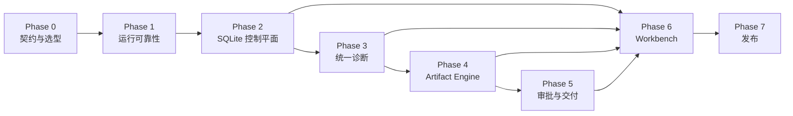

# Office Agent 分阶段执行文档索引

> 状态：Proposed
>
> 基线日期：2026-07-21
>
> 现状说明：[Office Agent 自动化与经营诊断业务实现全景](../2026-07-21-office-agent-business-flow-and-api.md)
>
> 调研报告：[GitHub 高质量办公 Agent 调研与 Reasonix 验证方案](../2026-07-21-github-office-agent-research-plan.md)

## 1. 如何使用

1. 先阅读本索引与[项目借鉴地图](./reference-projects.md)。
2. 进入当前阶段文件，只领取依赖已满足的任务。
3. 每个任务按“目标、前端、后端、数据库/文件、测试、验收、参考项目”实施。
4. 每完成 2～3 个任务执行阶段 Checkpoint。
5. Proposed 决策只有在评审后才能写成 Accepted ADR。
6. 许可证未确认的项目只能做黑盒研究，不能复制实现。

## 2. 文档拆分

| 文件 | 阶段/主题 | 主要交付 |
|---|---|---|
| [00-baseline-and-adrs.md](./00-baseline-and-adrs.md) | Phase 0 | 契约、样本、ADR、Runtime PoC |
| [01-runtime-reliability.md](./01-runtime-reliability.md) | Phase 1 | 租约、幂等触发、取消恢复、归档 |
| [02-sqlite-control-plane.md](./02-sqlite-control-plane.md) | Phase 2 | SQLite 元数据、CRUD、索引、迁移 |
| [03-business-diagnostics-pipeline.md](./03-business-diagnostics-pipeline.md) | Phase 3 | 统一确定性诊断、数据源安全、trace |
| [04-artifact-engine.md](./04-artifact-engine.md) | Phase 4 | Artifact Runtime、IR、DOCX/XLSX/PPTX |
| [05-approval-and-delivery.md](./05-approval-and-delivery.md) | Phase 5 | 审批策略、可靠交付、多渠道 |
| [06-office-workbench.md](./06-office-workbench.md) | Phase 6 | 任务向导、运行中心、Artifact 工作台 |
| [07-security-observability-release.md](./07-security-observability-release.md) | Phase 7 | 安全、观测、性能、灰度发布 |
| [reference-projects.md](./reference-projects.md) | 项目地图 | 功能对应的参考项目与限制 |
| [cross-cutting-contracts.md](./cross-cutting-contracts.md) | 横向规范 | 数据库、Wails/HTTP、测试、DoD |
| [todo.md](./todo.md) | 执行清单 | 可勾选任务和 Checkpoint |

## 3. 阶段依赖

## 4. 里程碑

| 里程碑 | 完成条件 |
|---|---|
| M0 | 领域合同、固定样本、许可证矩阵和 ADR 已评审 |
| M1 | 长任务不因租约过期双写；运行异步、幂等、可取消 |
| M2 | 任务/运行/Artifact 元数据可事务查询，迁移可回滚 |
| M3 | Desktop 与 serve 产生一致的确定性事实和质量门禁 |
| M4 | Artifact 可导入、验证、预览、版本化、回滚并输出 Office 文件 |
| M5 | 外部交付受审批、幂等和审计保护 |
| M6 | 用户可在 Workbench 完成端到端业务闭环 |
| M7 | 安全、性能、迁移、灰度和发布门全部通过 |

## 5. 推荐首个垂直切片

“受控 Excel 月报 Artifact”：

1. 选择现有 XLSX 模板并创建工作副本。
2. 导入 CSV/XLSX/HTTP/受控 MCP 数据。
3. 生成确定性指标和结构化 Edit Plan。
4. 用户审批后更新工作表、公式和图表。
5. 页面展示网格、指标、质量问题和单元格 diff。
6. 原子提交新版本，验证并支持一键回滚。
7. 只保存到本地；远程交付留到 Phase 5。

优先参考：`REF-UNIVER`、`REF-OFFICE-AI-AGENT`、`REF-OPENADAPT` 和本地 `REF-REASONIX`。具体边界见[项目借鉴地图](./reference-projects.md)。

## 6. 当前不变的边界

- 不新建第二套 Agent runtime；复用 Reasonix Controller、Tools、Skills、MCP 和 Automation。
- 结构化 API 优先于 GUI；GUI 只作为受控兜底。
- 事实计算先于 Agent 叙述。
- SQLite 保存元数据，大型事件、会话和 Office 文件继续放受控文件目录。
- 外部发送、删除、覆盖原件、宏和外链启用必须独立审批。
- 任何失败都不得覆盖原始 Office 文件。
