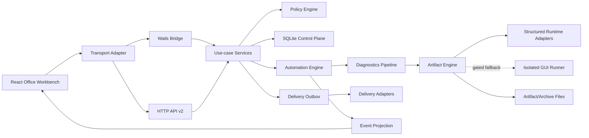
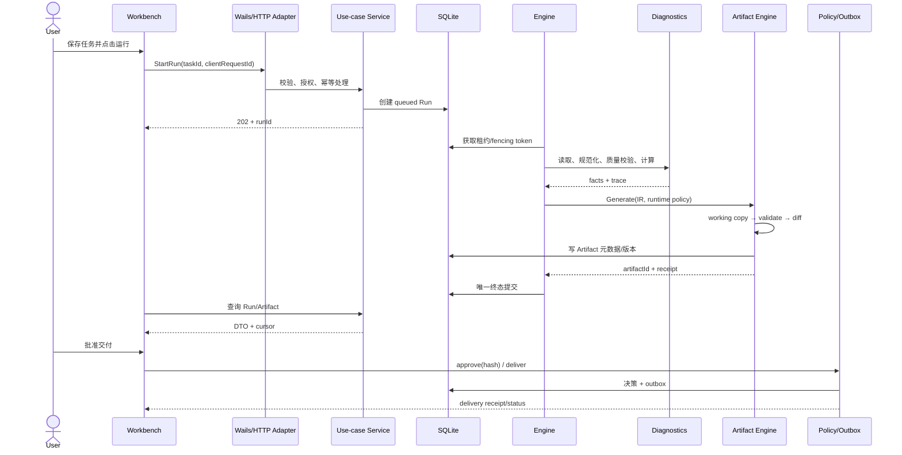
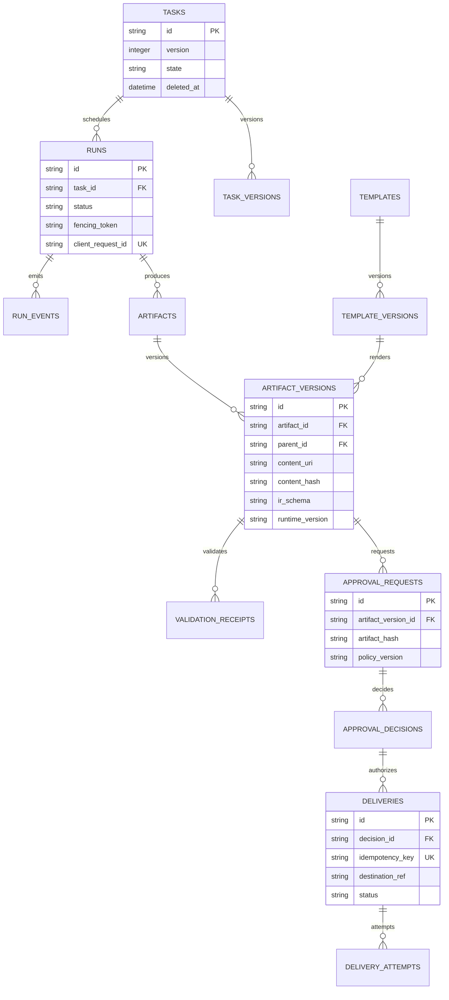
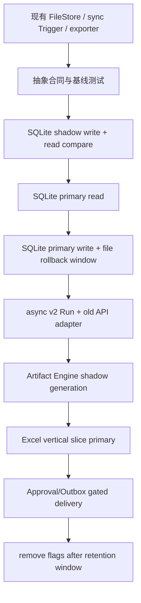

# 跨阶段合同、数据模型与完成定义

本文集中定义所有阶段共同遵守的目标架构、状态机、接口、数据关系、测试矩阵与完成标准。具体实现任务见各阶段文档。

## 1. 目标架构

必须保持：`boot.Build → control.Controller → agent.Agent` 是唯一 Agent 主链；不得新增第二套 scheduler、approval、credential store 或 Agent core。

## 2. 业务主时序

## 3. 数据库关系依赖

以下为目标逻辑模型；字段和迁移版本以阶段 2/5 的 ADR 为准。

约束：SQLite 保存控制面元数据；JSONL/Office/预览等大内容保留在受限文件根目录；数据库路径只能保存经过规范化的相对内容地址。

## 4. API v2 最小合同

| 能力 | HTTP | Wails | 关键响应/错误 |
|---|---|---|---|
| 查询任务 | `GET /api/v2/automation/tasks` | `ListAutomationTasksV2` | cursor、version；`INVALID_CURSOR` |
| 新建任务 | `POST /api/v2/automation/tasks` | `CreateAutomationTaskV2` | task DTO；`VALIDATION_FAILED` |
| 修改任务 | `PATCH /api/v2/automation/tasks/{id}` | `PatchAutomationTaskV2` | `If-Match/version`；`VERSION_CONFLICT` |
| 删除任务 | `DELETE /api/v2/automation/tasks/{id}` | `DeleteAutomationTaskV2` | 软删除；`TASK_RUNNING` |
| 启动运行 | `POST /api/v2/automation/tasks/{id}/runs` | `StartAutomationRunV2` | `202 runId`；幂等 `clientRequestId` |
| 查询运行 | `GET /api/v2/automation/runs/{id}` | `GetAutomationRunV2` | status/stage/result refs |
| 取消运行 | `POST /api/v2/automation/runs/{id}:cancel` | `CancelAutomationRunV2` | request state；`TERMINAL_RUN` |
| 查询事件 | `GET /api/v2/automation/runs/{id}/events` | `ListAutomationRunEventsV2` | sequence/cursor |
| 查询 Artifact | `GET /api/v2/artifacts/{id}` | `GetArtifactV2` | versions/validation/capabilities |
| 对比版本 | `GET /api/v2/artifacts/{id}/diff` | `DiffArtifactVersionsV2` | semantic/visual diff |
| 请求审批 | `POST /api/v2/approvals` | `RequestApprovalV2` | artifact hash/policy |
| 审批决策 | `POST /api/v2/approvals/{id}:decide` | `DecideApprovalV2` | decision/expiry |
| 创建交付 | `POST /api/v2/deliveries` | `CreateDeliveryV2` | idempotency key/status |

统一错误体：`{ code, message, details, retryable, correlationId }`。页面只依赖稳定 `code`，不解析自然语言消息。v1/旧 Wails 方法在迁移期调用相同 use-case adapter，并明确弃用窗口。

## 5. 核心状态机与并发不变量

- Run：`queued → running → succeeded|failed|cancelled|skipped`；终态不可逆且只能提交一次。
- Delivery：`queued → sending → delivered|failed|cancelled|dead_letter`；每个逻辑交付有唯一幂等键。
- 租约：执行者必须持续 heartbeat；每次状态/Artifact 最终写入都校验 fencing token。
- 取消：`cancel_requested` 是请求，不等于 `cancelled`；Runner 确认停止后才能提交终态。
- Artifact：历史版本不可覆写；restore 创建新版本；Approval 必须绑定确切 version/hash。
- 事件：sequence 在单 Run 内单调；实时事件可丢失，终态必须通过查询回源确认。

## 6. 测试金字塔和 E2E 矩阵

| 层级 | 必测内容 |
|---|---|
| 单元 | 状态机、公式、质量规则、策略、路径、IR upgrade、Renderer helpers |
| 合同 | File/SQLite Repository、Runtime Adapter、Renderer、Delivery Adapter、Wails/HTTP 等价性 |
| 集成 | SQLite+Engine、诊断+Artifact、Approval+Outbox、重启恢复、迁移读写比较 |
| 文件 Golden | 12 个业务样本、DOCX/XLSX/PPTX 结构、diff、视觉 QA、损坏文件 |
| 安全 | prompt injection、宏/外链、路径穿越、公式注入、SSRF、跨租户、敏感日志 |
| E2E | 新建任务→运行→诊断→Artifact→审批→交付；断线、取消、失败、恢复、冲突 |
| 性能 | 1k tasks、100k runs、大文件、SQLite contention、Runtime 冷启动/峰值内存 |

每个阶段至少覆盖正常、边界、错误、并发/重启（适用时）四类路径。

## 7. 分阶段迁移流

任何差异、迁移崩溃或回滚演练失败都停止扩大灰度；不得自动删除旧数据。

## 8. 每个任务的 Definition of Done

- [ ] 目标行为、范围外事项、依赖和借鉴项目已写明。
- [ ] 前端、后端、数据库/迁移、接口和安全影响已评审。
- [ ] 外部项目仅借鉴已列明的设计点；许可证与成熟度门已通过。
- [ ] 正常、边界、错误、并发/恢复测试已按风险完成。
- [ ] 公共 DTO/API/配置变化有兼容策略和文档。
- [ ] 相关小测试、模块测试、lint/typecheck/build 已真实执行并记录。
- [ ] 最终 diff 无无关修改、生成噪声、调试代码或秘密信息。
- [ ] 观测、回滚、迁移和残余风险可操作且有 owner。
- [ ] 阶段检查点评审通过，下一阶段进入条件满足。

## 9. 借鉴项目使用规则

所有项目 ID、链接、许可证、成熟度和禁止项见 [参考项目与功能借鉴矩阵](reference-projects.md)。若 PoC、许可证或维护状态变化，先更新 ADR 与矩阵，再修改实现计划。
