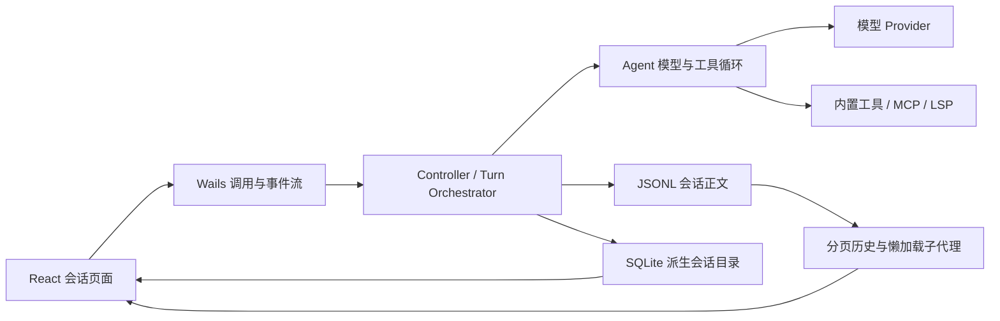

# 会话与全链路性能优化实施总览

> 状态：实施中（2026-07-29 已落地有界目录引导与可取消后台修复、dirty generation、带 generation 的磁盘历史分页/子代理分页懒加载、重试总预算和 SQLite 长连接；真实 UI profiler、生产链路 P95 与完整发布验收仍待阶段 6）
>
> 基线：`main-v3`，2026-07-22 工作树审计结果
>
> 性质：执行计划，不代表功能已经实现或性能目标已经达成

## 1. 业务目标

在不改变现有会话语义、工具权限、模型计费和多入口兼容性的前提下，降低以下用户可感知延迟：

1. 打开项目及会话列表的等待时间。
2. 长会话自动保存造成的磁盘和 CPU 开销。
3. 恢复历史、展开子代理记录和流式输出时的页面卡顿。
4. 模型重试、工具轮次、上下文压缩和启动初始化造成的长尾延迟。

## 2. 当前事实与边界

### 2.1 已确认架构

- 桌面端为 Wails + React，前端通过 Wails binding 调用 Go `App`。
- CLI、Desktop、HTTP、ACP、Bot 共用 `boot.Build -> control.Controller -> agent.Agent` 主链路。
- 会话正文以本地 JSONL 存储；`.meta`、`.goal-state.json`、`.expert.json`、`.ckpt`、`.jobs` 等为旁路状态。
- SQLite 用于专家、自动化模板和模型计费，不是会话正文的当前权威存储。
- 会话保存当前会重写整个 JSONL；运行期间存在周期性自动保存。

### 2.2 已测性能基线

| 场景 | 结果 | 结论 |
| --- | ---: | --- |
| 100 会话，约 31.9 MB，冷列表 | 5.19 s | 文件级回退解析成本高 |
| 100 会话，sidecar 热列表 | 1.07 s | sidecar 有效，但仍有线性开销 |
| 300 会话，约 143.5 MB，冷列表 | 16.90 s | 随会话数和体积增长明显 |
| 300 会话，sidecar 热列表 | 3.02 s | 仍不足以支持即时交互 |
| 500 会话，约 318.9 MB，冷列表 | 24.51 s | 当前首开体验不可接受 |
| 500 会话，sidecar 热列表 | 5.07 s | 多小文件访问是核心瓶颈 |
| 1000 条 × 10 KB 历史投影 | 7.70 ms | Go 投影本身不是首要瓶颈 |
| 1000 条 × 10 KB 序列化 | 9.87 ms | 应优先处理 I/O、传输与渲染 |

上述单次基准用于确认量级；阶段 1 必须补充多轮、P50/P95 和真实 UI 数据。

## 3. 目标全链路

目标架构坚持两条边界：JSONL 在迁移期和首轮优化后仍是会话正文的权威来源；会话目录数据库只保存可重建元数据，不保存完整推理、工具结果或图片正文。

## 4. 阶段拆分

| 阶段 | 文档 | 核心交付 | 依赖 |
| --- | --- | --- | --- |
| 0 | [基线与架构决策](00-baseline-and-decisions.md) | 指标口径、决策登记、兼容与回滚边界 | 无 |
| 1 | [可观测性与性能基准](01-observability-and-benchmarks.md) | 端到端耗时分段、可重复基准、CI 预算 | 阶段 0 |
| 2 | [会话目录与列表优化](02-session-catalog-and-listing.md) | 派生目录表、懒回填、增量失效、列表 API | 阶段 1 |
| 3 | [会话持久化优化](03-session-persistence.md) | dirty generation、单快照保存、增量方案验证 | 阶段 1，可与阶段 2 后半并行 |
| 4 | [历史加载与流式前端](04-history-and-streaming-ui.md) | 分页历史、子代理懒加载、delta 合并 | 阶段 1、2 |
| 5 | [Agent、启动与数据库运行时](05-agent-runtime-startup-and-database.md) | 模型长尾治理、启动缓存、连接生命周期 | 阶段 1 |
| 6 | [集成、迁移与发布验收](06-integration-migration-and-release.md) | 全链路压测、故障演练、灰度与回滚 | 阶段 2～5 |

## 5. 实施原则

1. **先量化再优化**：没有阶段 1 数据，不批准 WAL、增量日志或重试策略变更。
2. **垂直切片**：每次只交付一条可验证路径，例如“目录表写入 + 列表读取 + UI 回退 + 测试”。
3. **兼容优先**：旧 JSONL、旧 sidecar、非默认 profile、项目会话和全局会话都必须继续可读。
4. **安全默认**：索引损坏时回退到 JSONL；新增优化默认可关闭；不得绕过工具审批和用户隔离。
5. **不混淆证据**：单元测试、基准、真实运行和产品验收分别记录，不以构建通过替代性能验收。

## 6. 总体验收指标

最终阈值由阶段 1 在固定基准机上冻结；当前建议门槛如下：

- 500 会话热列表 P95 不高于 500 ms，且相对当前基线至少改善 80%。
- 索引缺失时后台回填不阻塞首屏超过 500 ms；回填可中断、可恢复。
- 未发生会话变化的自动保存周期产生 0 次正文重写。
- 长会话首次恢复只传输首屏所需窗口；子代理正文未展开时不读取完整文件。
- 同一逻辑消息的文本/推理 delta 每动画帧最多触发一次 reducer 更新。
- 模型重试有总预算、可取消，并向 UI 暴露等待原因；不得降低成功率或吞掉最终错误。
- 崩溃、磁盘满、索引损坏、旧版本回退和多标签并发均不得导致会话正文丢失。

## 7. 非目标

- 不把完整聊天正文迁移进 SQLite。
- 不更换 Wails、React、Provider 或 Agent 核心架构。
- 不通过截断用户可见历史、关闭自动保存或减少错误检查制造虚假提速。
- 不在缺乏查询计划和写竞争证据时盲目增加索引或开启 WAL。
- 不把模型服务端耗时算作本地代码已经优化完成的证据。

## 8. 完成定义

每个阶段只有在其文档中的任务、测试和验收证据全部关闭后才能标记完成。最终发布前必须执行项目规定的 Code Guard、基线文件保护、`go vet ./...`、`go test ./...`，并完成前端 `test:all` 与生产构建。任何失败都必须先归因，不得通过放宽断言、跳过测试或 ratchet 基线绕过。
