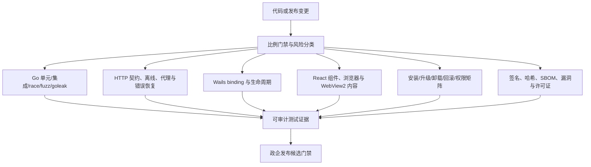

# Reasonix 政企桌面端测试体系分阶段实施计划

> 状态：Proposed
>
> 调研日期：2026-07-23
>
> 适用基线：Reasonix `main-v3`，Go 根模块、Wails Desktop 独立模块、React 前端与 Windows 发布链路
>
> 性质：实施提案，不表示候选依赖已批准、安装或进入 CI

## 1. 调整结论

原方案需要调整，而且不是简单增加几个工具。Reasonix 是以 Go 为核心、Wails 为桌面外壳、面向政企交付的软件，测试优先级应由以下风险决定：

1. 核心业务、状态机、持久化、并发和网络失败是否可靠。
2. Windows 安装、升级、卸载、回滚和不同权限环境是否可控。
3. 离线、代理、自定义 CA、受限目录和终端安全软件下是否可运行。
4. 发布制品是否可追溯、可验证、可生成 SBOM，并具备正式系统签名。
5. 长时间运行后是否出现 goroutine、内存、句柄、临时文件或 SQLite 资源泄漏。
6. Wails binding、WebView2 内容和原生系统交互是否分别得到验证。
7. React 组件与浏览器链路是否稳定，但它们不应主导整体路线。

因此，Go 可靠性、政企交付矩阵和发布信任链前移；Vitest、Playwright 和 Windows UI 自动化作为分层能力逐步接入。

## 2. 当前项目事实

| 范围 | 已有能力 | 主要缺口 |
|---|---|---|
| 根 Go module | 约 492 个 `*_test.go`；多平台 `go test`；full-change `race`；coverage | 无原生 fuzz target；race/长稳基线仍不完整 |
| Desktop Go module | 约 74 个 `*_test.go`；Wails binding、生命周期、更新器和签名测试 | Windows 真机长稳、UIA、安装升级矩阵仍需扩展 |
| Frontend | 约 115 个 `*.test.ts(x)`；自定义 `tsx` + JSDOM runner | 缺少统一过滤、coverage、reporter 和真实浏览器链路 |
| Windows 发布 | NSIS；amd64/arm64 构建与架构校验；Draft/Publish 分离；Minisign 更新制品校验 | 正式 Authenticode 尚未落地；安装/升级/卸载场景覆盖不足 |
| CI | 比例门禁、多平台 Go、nightly、Wails 构建、`govulncheck` | `govulncheck` 仍为非阻断；无 SBOM/gosec/制品扫描门 |
| 运行环境 | Wails v2 + WebView2；本地 SQLite；外部云服务适配 | 离线、代理、自定义 CA、无管理员权限和 EDR 场景需形成验收矩阵 |

权威现场入口：

- `.github/workflows/ci.yml`
- `.github/workflows/nightly-go-regression.yml`
- `.github/workflows/desktop-build-draft.yml`
- `.github/workflows/desktop-publish.yml`
- `desktop/internal/update`
- `desktop/build/windows/installer/project.nsi`
- `scripts/pr-gate.mjs`

## 3. 目标架构

关键边界：

- 浏览器测试不能证明 Wails 原生窗口、托盘、文件对话框、注册表或安装器正确。
- WebView2 CDP 只允许测试构建使用独立端口和独立用户数据目录，生产构建不得开放远程调试。
- `httptest` 和本地 fixture 优先；Pact、go-vcr、Testcontainers 只有在真实依赖和团队协作模型需要时才进入 PoC。
- AI/skills 可生成测试草案、整理日志和辅助探索，但发布结论只能由确定性命令、断言和人工审批产生。

## 4. 分阶段文档

| 阶段 | 文档 | Goal | 主要交付 |
|---|---|---|---|
| Phase 0 | [基线、范围与 Proposed 决策](00-baseline-and-decisions.md) | 冻结事实、风险矩阵和决策门 | 基线、政企场景、D-TEST 决策 |
| Phase 1 | [Go 核心与客户端契约](01-go-core-and-client-contracts.md) | 优先保护核心逻辑、持久化和网络边界 | 标准库测试、`httptest`、错误/离线契约 |
| Phase 2 | [Wails UI 与原生自动化](02-wails-ui-and-native-automation.md) | 分层验证 React、WebView2 和 Windows 原生能力 | Vitest PoC、Playwright、CDP/UIA smoke |
| Phase 3 | [可靠性、性能与长稳](03-reliability-performance-and-soak.md) | 发现并发、泄漏、退化和长时间运行问题 | race/fuzz/goleak、benchmark、8/24/72h soak |
| Phase 4 | [安装、升级与兼容性](04-installer-upgrade-and-compatibility.md) | 证明政企终端环境中的可安装、可升级、可恢复 | Windows/权限/网络/路径/回滚矩阵 |
| Phase 5 | [安全、供应链与发布门禁](05-security-supply-chain-and-release-gates.md) | 建立制品信任链和可审计发布证据 | Authenticode、SBOM、扫描、CI gate |
| Phase 6 | [Skills 与质量治理](06-skills-and-audit-governance.md) | 约束 Agent 辅助测试的输入、输出和权限 | skill 路由、证据模板、数据边界 |
| 横向 | [政企验收矩阵](enterprise-acceptance-matrix.md) | 固化交付环境与证据要求 | 场景、责任人、证据和阻断级别 |
| 横向 | [参考项目与采用边界](reference-projects.md) | 保存包、项目和 skills 调研结论 | 采用/试点/暂缓/排除清单 |
| 基线 | [测试与发布资产清单](test-asset-inventory.md) | 固化当前自动化资产与缺口 | 可重现数量、入口、Owner 和证据边界 |
| 基线 | [测试执行基线](execution-baseline.md) | 记录连续运行、资源与首次失败 | 脱敏汇总、失败分类和复核命令 |
| Phase 1 | [P0 风险登记](phase-01-p0-risk-register.md) | 把数据损坏、越权、不可恢复和现场不可用路径映射到证据 | 正常/错误/恢复测试与剩余缺口 |
| Phase 1 | [测试发现](phase-01-test-findings.md) | 记录仅由测试审计发现、尚未修改生产实现的问题 | 复现、影响、建议与状态 |
| Phase 1 | [工具采用决定](phase-01-tool-decisions.md) | 防止为工具而迁移 | testify/mockery/Pact/go-vcr/Testcontainers 决定 |
| Phase 2 | [分层测试执行报告](phase-02-layered-test-report.md) | 分别归档 React、browser、WebView2 与 native 证据 | 通过项、阻塞项与生产隔离守卫 |
| Phase 0 | [D-TEST-01～07 工程评审](phase-00-decision-review.md) | 逐项评审 Proposed 测试决策 | 工程结论、证据和正式批准边界 |
| Phase 3 | [可靠性、性能与长稳基线](phase-03-reliability-baseline.md) | 审计 race/owner 并建立 fuzz、benchmark 与采集入口 | 缺口、单轮基线和长稳触发条件 |
| Phase 4 | [安装、升级与兼容性执行状态](phase-04-installer-compatibility-status.md) | 固化支持矩阵并复核现有安装/更新契约 | 静态证据、环境阻塞和真机缺口 |
| Phase 5 | [安全、供应链与发布门禁执行状态](phase-05-trust-gate-status.md) | 盘点签名、依赖、扫描和许可证证据 | 发布阻断项与候选信任顺序 |
| Phase 5 | [Frontend 许可证策略](frontend-license-policy.md) | 固化生产依赖许可证分类 | allow/deny/review 与 release 阻断 |
| Phase 5 | [Go 漏洞扫描与例外策略](vulnerability-triage-policy.md) | 固定扫描器与发现治理 | SLA、例外、诊断到阻断条件 |
| Phase 5 | [固定版本 Go 漏洞扫描发现](phase-05-vulnerability-findings.md) | 分离 Root/Desktop 实际扫描结果 | 可达漏洞与发布阻断项 |
| Phase 5 | [gosec 报告模式 PoC](phase-05-gosec-poc.md) | 固定版本静态安全扫描与分流 | 候选问题、误报及工具局限 |
| Phase 6 | [Skills 与质量治理执行状态](phase-06-governance-status.md) | 固化能力路由、权限边界和确定性复现 | AI 边界与未关闭治理问题 |
| Phase 6 | [Skill 供应链与权限审查](skill-supply-chain-audit.md) | 逐项审查本任务实际使用的 skill | 来源快照、权限、风险、决策与回滚 |
| 治理 | [测试证据记录模板](testing-evidence-template.md) | 统一首次失败、重试、制品和人工审批记录 | 可复制的审计模板 |
| 执行 | [任务清单](todo.md) | 提供可勾选 Task/Checkpoint | 阶段任务、依赖和验收状态 |

## 5. 里程碑

| 里程碑 | 完成条件 |
|---|---|
| M0 | 基线、客户环境矩阵和 D-TEST 决策均有 owner |
| M1 | 高风险 Go/HTTP/持久化边界具有确定性回归测试 |
| M2 | React、WebView2 内容和 Windows 原生交互分别报告 |
| M3 | race/fuzz/goleak、性能基线和至少 8 小时长稳可重复 |
| M4 | 安装、升级、卸载、回滚、离线与权限矩阵具备自动或人工证据 |
| M5 | 系统签名、Minisign、哈希、SBOM、漏洞与许可证证据进入发布候选 |
| M6 | Agent/skills 不接触生产凭据或客户数据，所有结论可由固定工具复核 |

## 6. 实施原则

1. **标准库与现有模式优先**：不因工具清单强制引入 `testify` 或 `mockery`。
2. **交付风险优先于框架迁移**：先解决安装、升级、离线、安全和长稳，再扩大 UI runner 迁移。
3. **客户承诺决定平台矩阵**：Windows、ARM64、服务器版或国产系统是否成为阻断项，以合同和支持策略为准。
4. **测试构建与生产构建隔离**：CDP、pprof、诊断端口和测试后门不得进入生产制品。
5. **真实边界、受控外部依赖**：优先临时目录、真实 SQLite、`httptest` 和本地 fixture，不让普通 PR 访问生产服务。
6. **比例门禁**：昂贵的长稳、全量 race 和完整安装矩阵进入 nightly/release；PR 保持有界。
7. **证据可审计**：记录源码 SHA、工具版本、OS/架构、制品哈希、签名、命令、耗时和失败分类。

## 7. 非目标

- 不为统一风格重写现有数百个 Go 测试。
- 不把 Fyne 测试方案应用到当前 Wails 项目。
- 不把 Testcontainers、Pact、go-vcr、winappCli 或 AI Agent 直接设为 P0 必选依赖。
- 不用浏览器 smoke 替代安装器、更新器、Wails binding 或 Windows 原生验证。
- 不把代码覆盖率、AI 判断或单次绿色构建当作政企发布充分证据。
- 不在没有真实客户承诺和硬件环境时声称已支持国产操作系统。

## 8. 总体完成定义

只有当对应阶段的 Task、失败复现、回滚路径、环境矩阵和证据归档全部关闭，才可称为完成。涉及 PR 或发布时仍须执行仓库规定的 `code_guard`、baseline 保护、`go vet ./...`、`go test ./...` 及变更触发的 Desktop/Frontend/发布检查；未运行、超时和环境失败必须明确披露。
