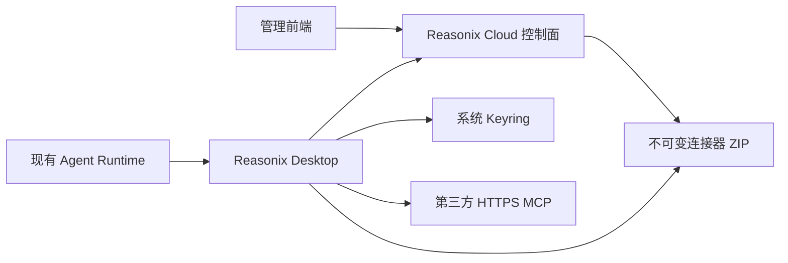

# 总体架构与信任边界

## 1. 当前架构



Cloud 分发声明和版本，Desktop 下载并执行 HTTPS 请求，第三方服务处理业务。第一版没有连接器本地子进程，也没有 Reasonix Cloud MCP 代理。

## 2. 责任边界

| 组件 | 负责 | 不负责 |
| --- | --- | --- |
| Cloud | Catalog、包校验、不可变对象、current、上架/下架 | 第三方 Token、MCP 业务转发、本地运行时 |
| 管理前端 | 通用发布、升级、下架和权威重查 | 理解厂商 OAuth、收集用户凭据 |
| Desktop | 下载校验、OAuth/Token、HTTPS MCP、状态、Agent 注册 | Node/CLI/stdio/SSE、本地代理 |
| Agent | 选择并调用已注册 MCP 工具，沿用审批与审计 | 绕过连接器直接保存凭据 |

## 3. 凭据信任边界

- OAuth Access/Refresh Token 和 Token/API Key 只进入当前 Reasonix owner 的系统 Keyring。
- OAuth Header 和 token-schema Header 仅在发送第三方 HTTPS 请求时动态生成。
- Cloud、OSS、连接器包、Catalog、SQLite、前端状态和普通日志不得包含第三方秘密。
- `mcp.json.static_headers` 只允许非秘密固定协议 Header。
- Token/API Key 不允许进入 URL、query、path、Cookie、CLI 参数或环境变量。

## 4. Owner 隔离

沿用现有 actor/profile/Cloud binding 派生 connector owner，不新增 Profile 创建、切换或管理 UI。

不同 owner 的状态、Keyring slot、OAuth flow 和解绑必须隔离；切换回原 owner 后可恢复其连接器能力。连接器包和非秘密安装缓存可以共享，凭据不能共享。

## 5. 包执行边界

当前生产可执行子集只允许：

```text
connector.json
mcp.json
token-schema.json       # 仅 token 认证时
skills/<name>/SKILL.md  # 可选
```

必须拒绝 `cli.json`、stdio command、脚本、二进制、动态库、额外 Skill 文件和未引用根文件。Skills-only 不合法；Skills 必须依附同包 MCP。

历史 schema 2 对象保持不可变，但不代表新 Desktop 必须继续执行。被 Cloud 下架或不满足 HTTPS-only 子集的 active 包不得恢复运行能力。

## 6. 缓存与下架

- 在线 Catalog 是安装和升级权威。
- 当前只保留进程内已验证 Catalog；不把它写成跨重启持久缓存能力。
- 离线不首装、不升级、不降级；持久化 Catalog、同 Hash ZIP 缓存和 active 自动修复作为后置可靠性项，不属于本次 RC 已交付能力。
- Cloud 下架阻止新安装/升级，但不远程删除本地凭据；用户通过 Desktop 本地解绑。

## 7. 失败关闭

- 失效 tab、下载、校验、OAuth、Token 或 MCP 初始化失败必须显示连接器局部状态，不得进入全局崩溃页。
- 授权状态不能由 UI 布尔值、包存在或历史 state 冒充。
- OAuth `invalid_grant` 删除精确凭据、回到需要授权并撤销工具。
- 遇到需要 App Secret、厂商本地代理或协议无法由当前 wire 表达的连接器时停止并报告，不增加厂商 ID 特判。

## 8. 生产边界

历史 18080/5173 专用测试库只证明早期开发闭环。当前统一发布控制面已在 `192.168.10.243:5173/8080`、`reasonix_cloud` 数据库和固定 OSS 配置下通过三个 `0.1.0` 连接器联调；该环境证明服务器部署前接缝，但服务器部署、正式版本和正式 Desktop 仍按 [08-生产发布交接与上线验收.md](./08-生产发布交接与上线验收.md) 关闭。
