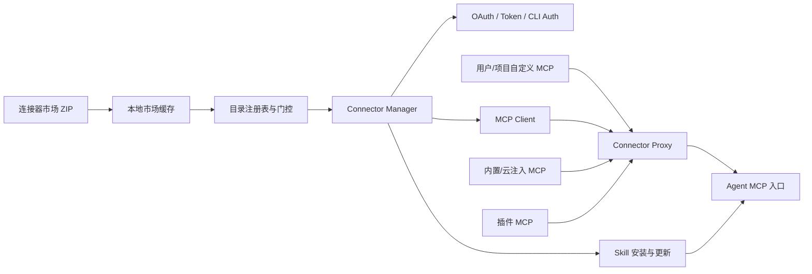

# 总体架构与模块边界

## 1. 架构总览



## 2. 市场层

连接器市场由一个 ZIP 包发布。解压后的中央索引和连接器子目录共同描述：

- 名称、描述、图标和中英文示例。
- `visible_in`、套餐和最低客户端版本。
- MCP、CLI、Token Schema 和 Skill。
- 跨连接器授权注入规则。

市场层不包含用户是否已连接、用户 Token 或当前 MCP 进程状态。

## 3. 目录注册表

目录注册表把市场文件转换成运行时连接器对象：

1. 读取中央 `connectors.json`。
2. 按客户端版本过滤 `minWorkbuddyVersion`。
3. 按账号环境、部署形态和套餐过滤 `visible_in`。
4. 加载对应包目录中的 `mcp.json`、`cli.json`、`token-schema.json`、元数据和 Skill。
5. 归一化字段并交给渲染器。

WorkBuddy 5.3.5 的市场索引为 74 条；版本过滤后进入运行时的定义为 73 条。

## 4. Connector Manager

Connector Manager 是连接器生命周期的编排层，静态实现包含：

- 单连接器互斥操作。
- 全局串行的连接/授权操作。
- 安装、配置、授权、连接、重连、禁用和解绑。
- MCP、CLI、Token、OAuth 和 Skill 分支。
- 连接器状态持久化和状态事件。
- 市场更新后的已启用 Skill 刷新。

渲染器发起连接时，单次 IPC 的超时上限为 360 秒；OAuth 状态轮询间隔约 1.5 秒，上限约 300 秒。

## 5. MCP Runtime

MCP Runtime 负责：

- stdio、SSE、Streamable HTTP transport。
- initialize 和 tools/prompts/resources/resourceTemplates 发现。
- header、env、OAuth Token 和请求级授权注入。
- 工具加服务短名称前缀。
- 连接状态、重连和 backoff。

WorkBuddy 5.3.5 使用 MCP SDK 1.24.3。

## 6. CLI Runtime

CLI Runtime 读取 `cli.json` 并执行：

- Node、Python 或 Shell 运行时检查。
- init 和包安装。
- 版本命令与最低版本比较。
- auth、status 和 unAuth。
- 浏览器、二维码、Device Flow 和等待命令退出等授权模式。

Node CLI 使用 WorkBuddy 私有目录：

```text
%USERPROFILE%\.workbuddy\binaries\node\cli-connector-packages
%USERPROFILE%\.workbuddy\binaries\node\cli-connector-cache
```

## 7. Skill Runtime

Skill 与连接器包一起发布，在连接器启用后物化到用户连接器 Skill 目录。Skill 内容描述：

- 连接器适用场景。
- 工具或 CLI 的调用方式。
- 参数、分页、错误和业务规则。
- 多步骤业务流程。
- references、scripts 和 assets 的使用入口。

一个连接器可以同时包含 MCP、CLI 和多个 Skill。

## 8. Connector Proxy

WorkBuddy 将多个来源聚合到本机 Connector Proxy：

| 来源 | 静态优先级 |
|---|---:|
| 官方连接器 | 100 |
| 插件 MCP | 50 |
| 自定义 MCP | 10 |

官方连接器断开时，同名自定义配置存在回退逻辑。代理将聚合结果写入 `.mcp.json`，其中只包含一个本机入口：

```json
{
  "mcpServers": {
    "connector-proxy": {
      "url": "http://127.0.0.1:<port>/mcp"
    }
  }
}
```

## 9. 自定义 MCP

自定义 MCP 与官方连接器使用不同配置来源：

- 用户配置：`~/.workbuddy/mcp.json`
- 项目配置：`<project>/.workbuddy/mcp.json`
- 官方连接器生成配置：`<configDir>/connectors/<profile>/mcp.json`
- Agent 聚合入口：`<configDir>/.mcp.json`

服务管理结果包含 status、disabled、configSource、tools、prompts、resources、resourceTemplates、needsAuth、error、trustLevel、configHash 和 lastApprovedAt。

## 10. 本地服务关系

正式版运行时观察到以下本地服务：

| 角色 | 观察端口 |
|---|---:|
| WorkBuddy 主进程本地服务 | 18488 |
| 腾讯文档 editor SDK | 39099 |
| 内置 Ardot MCP | 50551 |
| CLI/Agent 服务 | 55445 |
| ConnectorService | 56496 |
| Connector Proxy | 56504 |

端口为本次运行实例的动态结果，不是固定协议常量。
