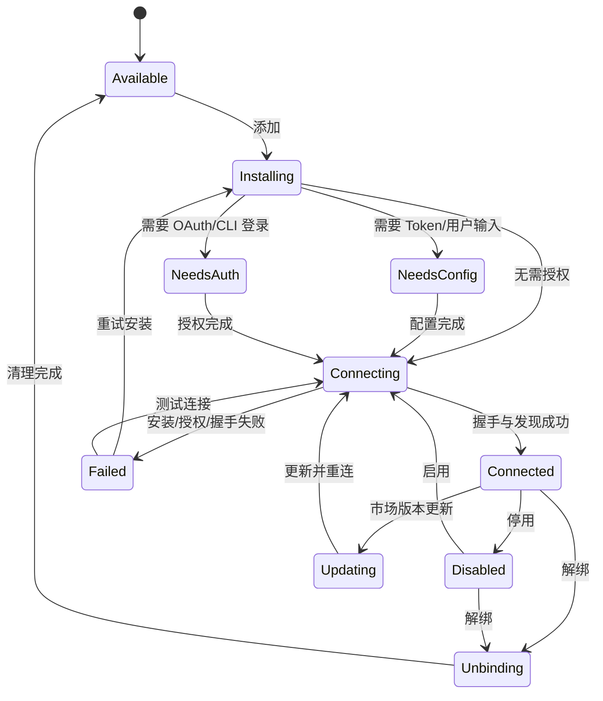

# 安装、授权、连接与解绑生命周期

## 1. 状态机



## 2. 连接算法

WorkBuddy 的连接流程可以归纳为：

```text
1. 读取市场定义并检查 minVersion、visible_in。
2. 获取该 connector 的互斥锁。
3. 检查运行时和依赖版本。
4. 根据能力分支：
   a. CLI：init/versionCheck/auth/status
   b. Token：读取 schema，保存凭据引用
   c. server-side：启动云端授权并轮询
   d. skill-only：跳过 MCP 握手
5. 读取并归一化 mcp.json。
6. 注入凭据引用、静态 header/env 和用户覆盖。
7. 调用 MCP Host 连接并发现 tools/prompts/resources。
8. 安装或更新 Skill。
9. 持久化 installed/enabled/everConnected/version。
10. 发布状态事件，刷新卡片和任务选择器。
```

## 3. 并发规则

- 渲染器为每个连接器维护 mutex，同一连接器操作串行。
- 连接器操作的全局并发限制为 1。
- 重复连接请求进入同一状态管理流程。
- CLI 安装和授权共用托管运行时目录。

## 4. 失败阶段

连接流程按阶段返回错误，UI 据此显示对应提示：

| 阶段 | 典型错误 | 用户动作 |
|---|---|---|
| `dependency` | Node/Python/命令缺失 | 安装或修复依赖 |
| `version` | CLI 低于最低版本 | 升级 |
| `credentials` | 必填 Token 为空 | 补全配置 |
| `authorization` | OAuth/CLI 未完成 | 重新授权 |
| `handshake` | MCP initialize 超时 | 检查进程或 URL |
| `discovery` | tools/list 为空 | 检查服务实现和账号权限 |
| `skill` | Skill 解包或注册失败 | 重装 Skill |

## 5. 重连与会话挂接

连接器“已配置”和“当前会话已连接”是两个状态：

- 应用启动后根据连接器状态恢复已启用连接器。
- 任务调用前可以触发尚未在线服务的重连。
- MCP 握手成功后继续执行工具发现和状态刷新。
- 重连失败会保留已保存配置和错误状态。

## 6. 断开与解绑

静态实现中的 `disconnect` 负责断开 MCP 连接。`unbind` 执行更完整的账号清理：

1. 执行 CLI `unAuth`。
2. 清除本地凭据、header/env 覆盖和工具禁用覆盖。
3. 清除 `everConnected` 和用户禁用状态。
4. 撤销 server-side Token。
5. 断开 MCP Proxy。
6. 发布连接器状态变化事件。

界面详情面板对已连接的飞书显示“解绑”和“去试试”。

## 7. 重复操作处理

- 连接前检查已安装 CLI 版本和 status。
- MCP Proxy 管理同名 Server，避免重复注册 Client。
- 解绑按当前状态清理存在的授权和覆盖项。
- 市场替换在锁内执行，更新失败时原缓存不会被不完整目录替换。
