# “项目”全功能用户体验测试报告

> 测试日期：2026-08-14
> 测试对象：云智企办桌面端“项目”工作台
> 桌面分支：`codex/integration-main-v3-20260814`
> 基准提交：`7211aded940938421b37734abd907f0ffdba1a42`（测试时工作树包含尚未提交的项目交互修复）
> 云端分支：`codex/integration-20260814`，提交 `fbe20267a7aff5376c060ecb2ef91cf78a47f00a`
> 管理端分支：`codex/integration-20260814`，提交 `faddc7b955e151f664fad38e0204d6d897dc1553`
> 环境：Windows，桌面前端 `http://127.0.0.1:5175/`，Cloud `http://127.0.0.1:9090/`，`team-integration`
> 实测视口：1132 × 800
> 测试账号：`185****7918`

## 1. 结论

本轮结论为：**核心闭环可用，但仅可有条件通过，不能宣称“项目所有功能全面通过”。**

- 项目目录、模板创建、项目编辑、归档/恢复、动态留言、五种计划视图、待办创建/编辑、任务菜单与详情、资产文件夹、成员抽屉、项目指令、四类能力入口均能在真实桌面端打开并完成预期的低风险或专用测试数据操作。
- 项目输入框的关键闭环最终成功：选择 `compute-clone` → 发送 → 跳转普通聊天页 → 左侧工作空间出现任务 → 模型回复“收到”。第一次发送曾出现通用失败提示，草稿完整保留，同一草稿第二次重试成功。
- 1132 × 800 下，计划看板、表格、月历和资产表被常驻“项目配置”栏挤压，需要横向滚动；月历只能直接看到周一至周五。此问题影响信息可发现性，应在正式验收前处理。
- Vitest、项目 Go 测试、前端构建、`go vet`、项目无障碍 fixture 套件均通过；完整 Playwright 套件为 24/36，通过率 66.7%，12 个失败集中在过期视觉基线和已经失效的 fixture 选择器/流程契约。
- Cloud 项目包的 62 个非 PostgreSQL 集成测试通过；完整 PostgreSQL 集成测试因当前进程未提供 `TEST_DATABASE_URL` 而未执行，不能据此声明云端数据库闭环通过。

发布建议：先修复 P1 响应式布局，并定位首次发送失败的具体错误来源；同步更新 Playwright fixture 与视觉基线后再做正式全量验收。

## 2. 测试方法与证据边界

本轮采用三类证据，结论中严格区分：

1. **真实桌面端浏览器实测**：连接当前 Wails/Cloud 集成环境，使用真实账号和专用测试项目操作。
2. **组件及后端自动化**：Vitest、Go、Playwright fixture、axe 扫描；fixture 结果不能替代真实 Wails/Cloud 闭环。
3. **源码与测试覆盖盘点**：用于确认功能入口、权限边界和当前自动化缺口，不把“存在测试文件”当作“本轮测试通过”。

高风险操作遵循最小影响原则：未永久删除真实项目，未停用成员，未创建或撤销邀请，未运行/新建真实自动化计划，未删除真实运行记录。需要写入的流程均使用专用测试项目。

## 3. 真实浏览器测试流程

### 3.1 项目目录、搜索、模板和创建

状态：**通过**

- 打开项目目录，验证项目搜索、刷新、项目卡片、快速模板和“新建项目”入口。
- 使用“产品需求全流程”模板创建专用项目 `UX验收0814`。
- 创建弹窗可编辑项目名、模板指令，并预选连接器、专家和技能。
- 项目名 15 字上限、按钮禁用态和弹窗初始焦点表现正常。

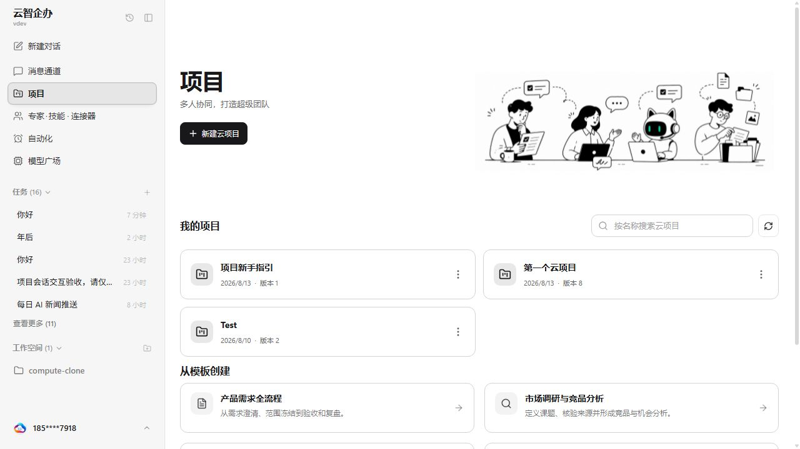

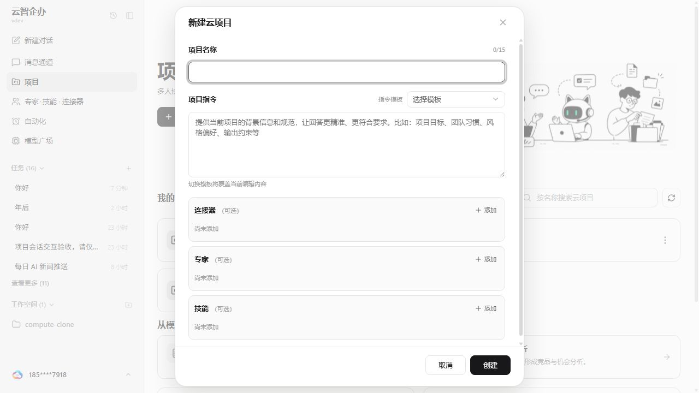

体验观察：创建弹窗高度接近整个视口，并使用内部滚动；首次使用时，指令正文与三类能力同时展开，完成成本偏高。

### 3.2 项目工作区与生命周期

状态：**通过**

- 创建后进入三栏工作区：项目页签、主体内容、右侧项目配置，底部为项目任务输入框。
- 将项目重命名为 `UX验收0814完成`，补充说明“专用于项目全功能用户体验验收。”，保存后完成云端权威回读。
- 归档后项目进入只读态，发布和输入能力受限，项目菜单变为“恢复云项目 / 永久删除”。
- 执行恢复后重新回到可编辑状态。
- 永久删除入口已检查，但未执行。

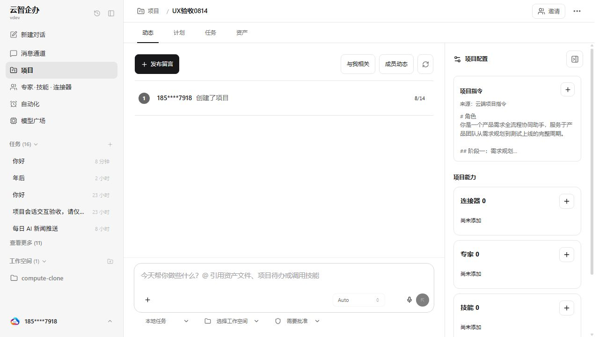

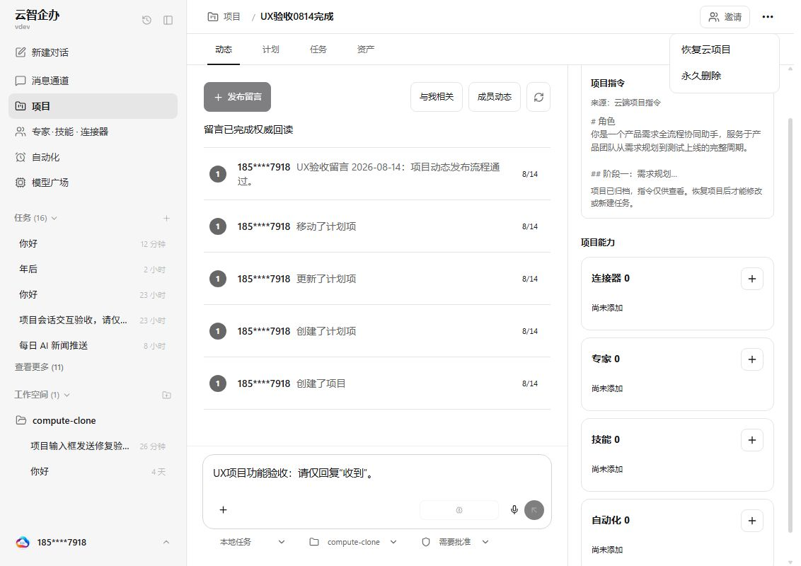

### 3.3 项目动态

状态：**通过**

- 验证“与我相关”“成员动态”、刷新和发布留言入口。
- 发布专用留言：`UX验收留言 2026-08-14：项目动态发布流程通过。`
- 发布后通过云端权威回读出现在动态列表中；项目创建、计划项创建/更新/移动事件同步展示。
- `@` 成员键盘选择、附件发布已由 Vitest 覆盖，本轮未向真实项目上传附件。

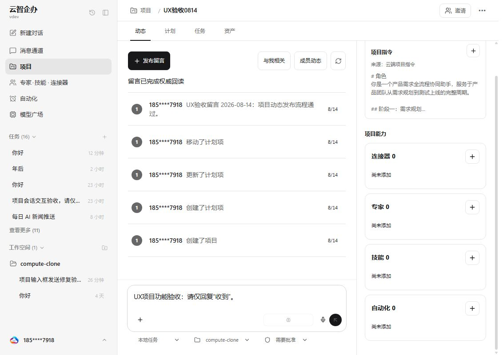

### 3.4 计划：看板、表格、列表、甘特、月历

状态：**功能通过，布局需改进**

- 验证五种视图均可切换：看板、表格、列表、甘特、月历。
- 创建计划项并编辑为：`UX验收计划项-已编辑`，状态 `已完成`；保存后移动到完成列。
- 验证搜索、筛选、标签设置和“添加”入口可用。
- 表格展示复选框、标题、负责人、日期、优先级、标签、状态等字段，并支持内联操作入口。
- 月历显示连续月份、上月/今天/下月导航，以及无日期记录计数。
- 日期逆序错误、真实附件关联和编辑时删除未在真实云端数据上执行；这些是现有自动化的缺口。

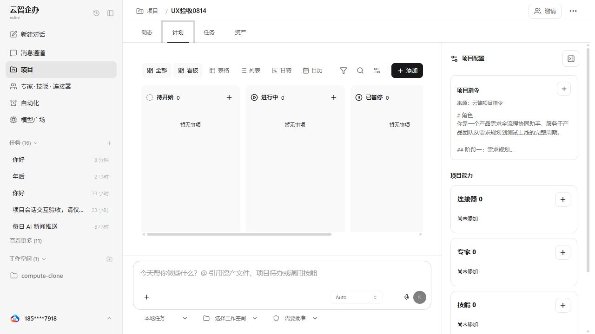

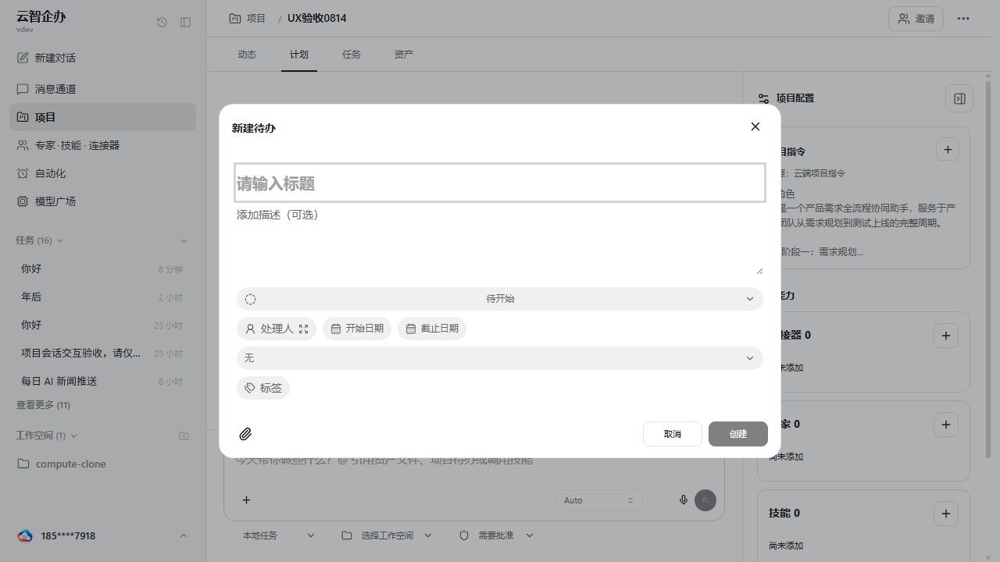

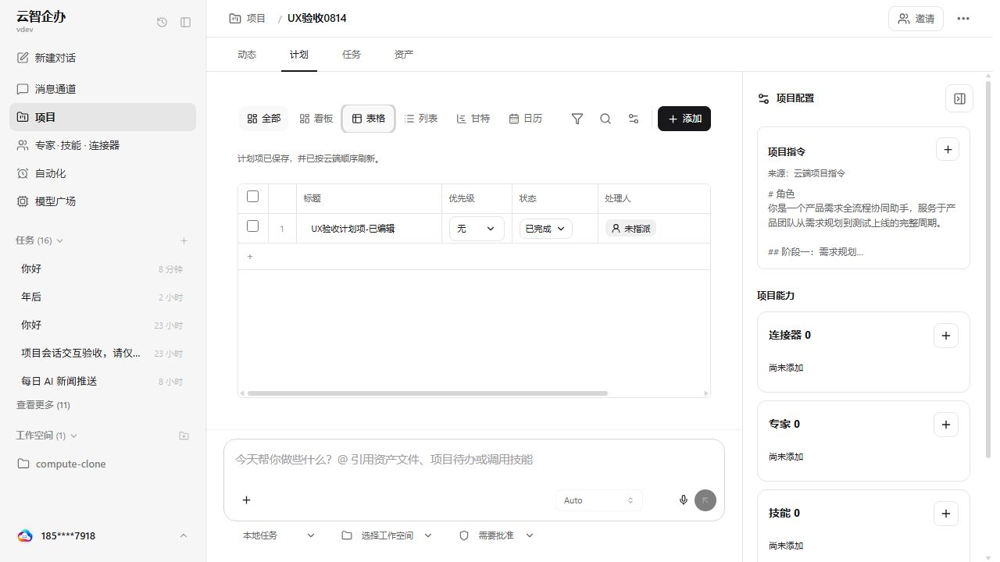

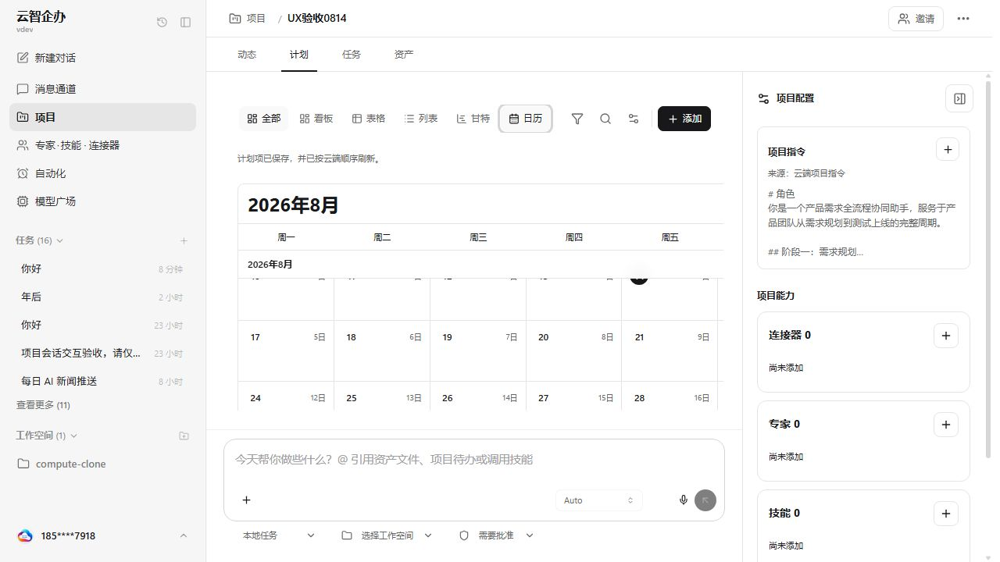

体验观察：右侧项目配置栏常驻时，四列看板无法同时看到，表格右侧字段和月历周末列需要横向滚动。横向滚动条位于内容底部，用户在上方操作时难以发现。

### 3.5 任务运行记录

状态：**浏览与菜单通过；生命周期矩阵未全面实测**

- 当前项目页可看到有权限的个人自动化运行记录。
- 验证任务来源筛选、标题搜索、成功/失败状态、运行详情。
- 所有可管理条目均显示紧凑纯文本菜单“重命名 / 删除”，删除为红色，符合参考图的信息层级。
- 运行详情显示状态、触发来源、开始时间、结果摘要或错误。
- 未对真实运行记录执行重命名、取消、删除和撤销；当前自动化仅覆盖完成态项目运行和运行中个人任务的部分 happy path，不能证明排队、检查中、运行中、失败、阻塞、取消等全状态生命周期。

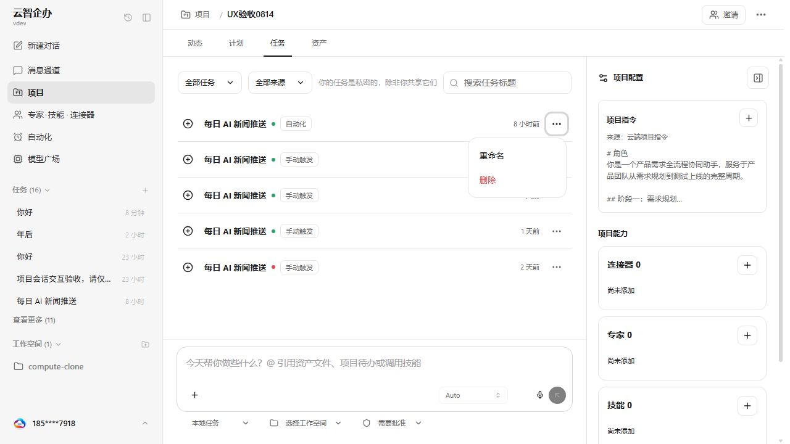

### 3.6 项目资产

状态：**基础 CRUD 入口通过；文件完整生命周期未实测**

- 验证存储配额、文件类型筛选、搜索、表格列、全选和排序入口。
- 在专用项目中创建文件夹 `UX验收资产`，云端回读成功。
- 上传、下载、重命名、移动、删除和批量失败处理未操作真实文件；这些路径需要专用文件 fixture 与可回收的数据策略后补测。

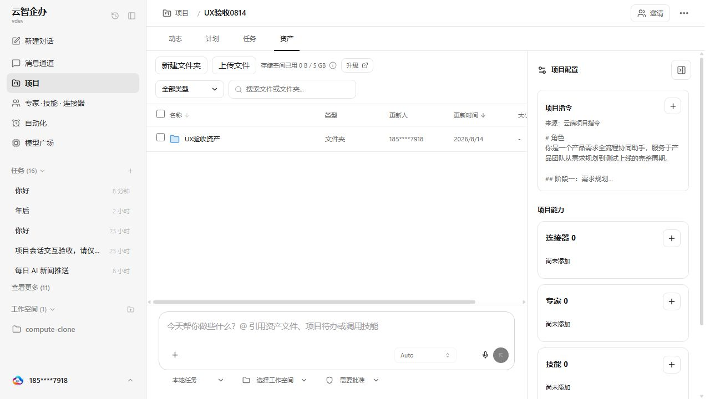

体验观察：资产表右侧字段同样受到项目配置栏挤压，必须在底部横向滚动；表格信息密度和右侧配置栏同时存在时，主任务区过窄。

### 3.7 成员与邀请

状态：**只读流程通过；权限 mutation 未实测**

- 成员抽屉正确显示项目所有者、成员数量、待处理邀请数量、刷新和关闭入口。
- 抽屉打开后焦点进入关闭按钮，背景内容不可操作。
- 未点击“复制新邀请链接”，未撤销邀请、停用成员或使用邀请 token，避免对真实授权关系产生副作用。

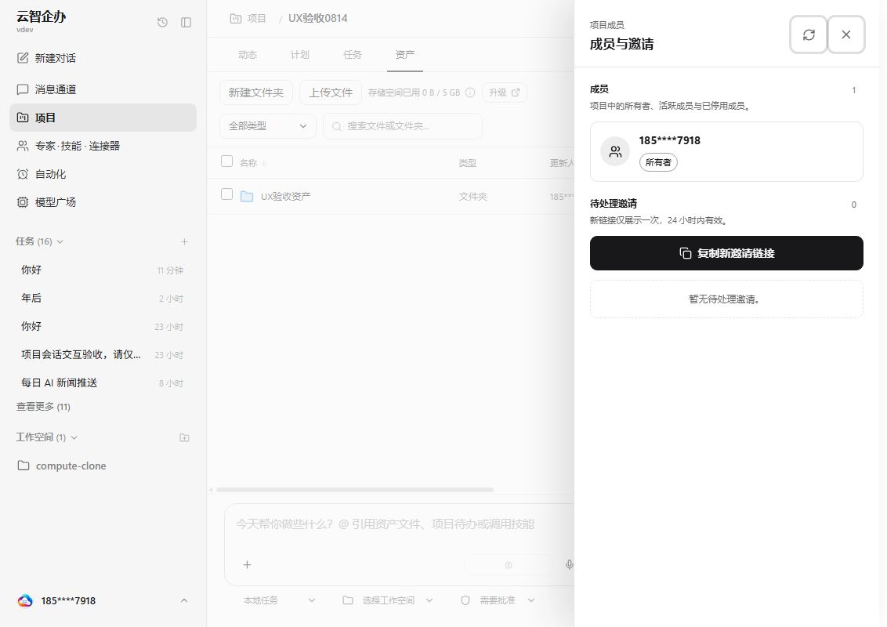

体验观察：单成员、无邀请时抽屉下半部分存在大面积空白，信息密度偏低；可以使用更紧凑的空状态或在较窄宽度下呈现。

### 3.8 项目指令

状态：**通过**

- 紧凑弹窗正确显示项目说明、项目指令字段和 `1,689 / 10,000` 计数器。
- 用户此前指出的弹窗头部无关引导和“来源：云端项目指令”已从弹窗中移除。
- `Escape` 可关闭弹窗，关闭后焦点恢复到“编辑项目指令”按钮。
- 清空、取消、保存分组清晰；本轮未覆盖 9,999/10,000/10,001 字边界和保存失败。

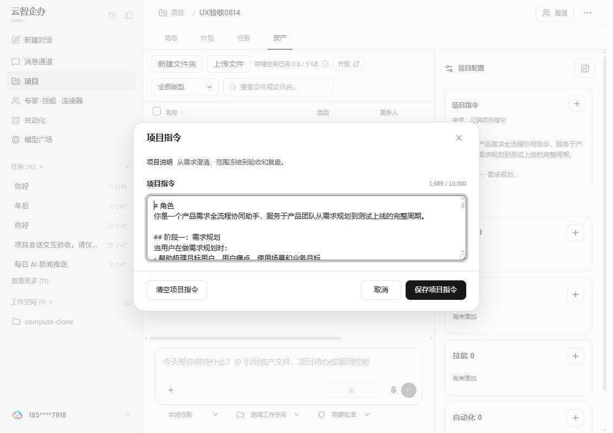

注意：右侧项目配置卡片仍显示“来源：云端项目指令”，与已精简的弹窗存在文案不一致。

### 3.9 连接器、专家、技能、自动化

状态：**入口和只读浏览通过；保存/执行未实测**

- 依次打开“选择连接器”“选择专家”“选择技能”“选择自动化”弹窗。
- 验证来源切换、搜索、已选择数量、取消、保存等基本结构。
- 未绑定真实能力，未创建或运行自动化，避免启动真实任务或修改个人配置。
- 现有 Vitest 对连接器、技能、自动化来源和失败恢复覆盖较强；专家保存、多能力回读和后端通用绑定功能测试仍不足。

### 3.10 项目输入框 → 普通任务闭环

状态：**重试后通过，首次失败需要调查**

操作步骤：

1. 保持“本地任务”，不选工作空间时发送按钮禁用，并提供“请选择工作空间后再发送”的可访问说明。
2. 选择工作空间 `compute-clone`，发送按钮变为可用。
3. 输入 `UX项目功能验收：请仅回复“收到”。`。
4. 第一次点击发送后仍停留项目页，显示“发送消息失败，请稍后重试。”；草稿完整保留，左侧任务数量未增加。
5. 保持同一草稿重试，成功跳转到普通聊天页。
6. 左侧 `compute-clone` 下出现同名普通任务，页面显示用户消息和模型回复“收到”。

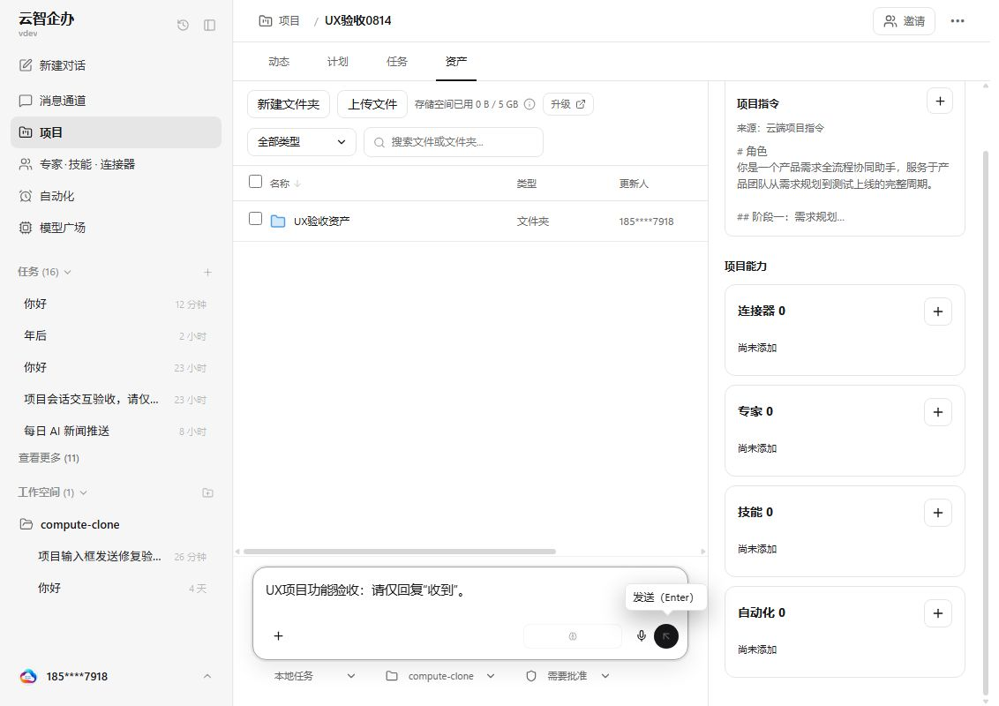

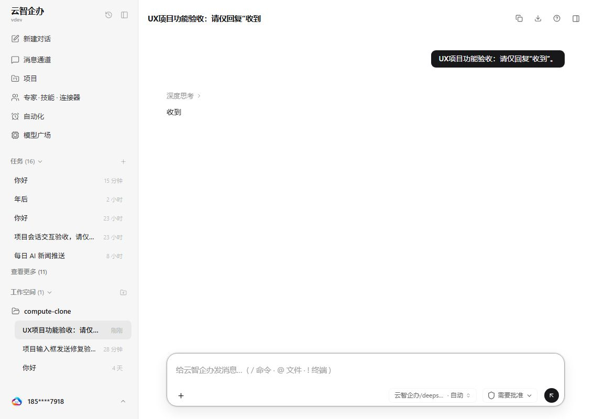

结论：这条路径符合“项目内不暴露执行会话、成功后进入普通任务”的产品方向；失败后的草稿保护也有效。但通用错误没有说明是网络、云端快照、Wails 会话创建还是模型执行阶段失败，用户只能盲目重试。

## 4. 功能覆盖矩阵

| 功能域 | 真实浏览器 | 自动化证据 | 本轮结论 |
|---|---|---|---|
| 项目目录、搜索、刷新、模板 | 已操作 | Vitest 强 | 通过 |
| 创建、编辑、重命名 | 使用专用项目完成 | Vitest/Go 强 | 通过 |
| 归档、恢复 | 完成 | Vitest/Go 强 | 通过 |
| 永久删除 | 仅检查入口 | 自动化有覆盖 | 未做真实删除 |
| 动态筛选、刷新、留言 | 完成 | Vitest 强 | 通过 |
| 动态提及和附件 | 未写入真实附件 | Vitest 覆盖 | 自动化通过，真实闭环未验证 |
| 计划五种视图 | 完成 | Vitest/Playwright fixture | 功能通过，响应式不佳 |
| 待办创建、编辑、状态移动 | 完成 | Vitest/Go 中强 | 通过 |
| 待办日期/成员/标签/附件/删除 | 部分入口 | 覆盖不完整 | 需补测 |
| 任务筛选、搜索、详情、菜单 | 完成 | Vitest 中等 | 通过 |
| 任务全状态取消后删除/恢复 | 未修改真实运行 | 覆盖不足 | 需补测 |
| 资产筛选、搜索、表格、文件夹创建 | 完成 | Vitest/Go 部分覆盖 | 基础流程通过 |
| 资产上传/下载/移动/删除/批量失败 | 未执行 | 覆盖不足 | 需补测 |
| 成员抽屉、列表、刷新 | 完成 | UI 覆盖弱 | 通过 |
| 邀请创建/接受/撤销、成员停用 | 未执行 | P0 覆盖缺口 | 未验证 |
| 项目指令编辑器、计数、Escape、焦点恢复 | 完成 | Vitest/Go 强 | 通过 |
| 能力弹窗与来源浏览 | 四类均打开 | Vitest 较强 | 通过 |
| 能力保存、自动化运行/计划 | 未执行 | 部分覆盖 | 未做真实副作用验证 |
| 本地项目任务发送与普通聊天跳转 | 完成，首发失败后重试成功 | 编排测试强，真实 E2E 原先缺失 | 主路径通过，稳定性需改进 |
| 云端任务目标无需工作空间 | 未实测 | Vitest 覆盖 | 自动化通过，真实闭环未验证 |
| 归档只读策略 | 完成 | Vitest/Go 强 | 通过 |
| 键盘/焦点 | 指令 Escape 与焦点恢复、弹窗初始焦点 | axe/Modal fixture | 部分通过 |
| 窄屏响应式 | 当前真实视口 1132×800 | 旧视觉 fixture 失败 | 不通过/需修复 |

## 5. 主要问题

### P1-01：常驻项目配置栏造成主体内容横向裁切

- 证据：看板、表格、月历和资产截图。
- 表现：1132 × 800 下，看板第四列、月历周六/周日、表格和资产右侧字段不在首屏，需要使用底部横向滚动条。
- 影响：用户容易误以为数据或状态列缺失；触控板、键盘和低视力放大场景下更难发现。
- 建议：在中等宽度自动收起项目配置栏，或改为抽屉；主内容区应优先保留完整工作视图，并把横向滚动提示放到工具栏附近。

### P1-02：项目输入框首次发送失败只有通用错误

- 证据：第一次发送失败、草稿保留；第二次同草稿成功。
- 表现：仅提示“发送消息失败，请稍后重试。”，没有阶段、错误码或恢复建议。
- 影响：用户无法判断是否已创建任务、是否会重复提交、应更换模型还是只需重试。
- 建议：按“任务尚未创建 / 任务已创建但跳转失败 / 模型执行失败”区分反馈；在错误提示中显示可复制的诊断标识，同时保持当前草稿保护和幂等语义。

### P1-03：项目 Playwright fixture 和视觉基线已失效

- 证据：`pnpm run test:browser` 仅 24/36 通过。
- 失败组成：7 个项目视觉快照尺寸或像素不匹配；5 个项目 contract 用例因旧选择器/旧流程超时，包括 availability、冲突、workspace binding、看板几何和移动流程。
- 影响：CI 无法可靠区分预期改版与真实回归，窄屏和可达性回归缺少有效门禁。
- 建议：按当前四页签与新 Composer 更新 fixture，重录经过人工审阅的视觉基线；将真实 Wails/Cloud 项目输入框闭环加入独立 E2E。

### P2-01：创建项目弹窗一次暴露的信息过多

- 证据：创建弹窗接近整屏高度并出现内部滚动。
- 影响：新用户要同时理解模板指令和三类能力，主任务“创建项目”不够聚焦。
- 建议：项目名称与模板放在首屏，指令正文可折叠预览，能力配置采用“创建后配置”或渐进展开。

### P2-02：成员抽屉空状态空间利用率低

- 证据：单成员、无邀请时下半屏基本为空。
- 建议：降低抽屉默认宽度或使用更紧凑的成员/邀请分组；保留当前清晰的所有者标识和主按钮。

### P2-03：“计划”和“任务”概念容易混淆

- “计划”中管理的是普通待办，“任务”中展示的是自动化运行记录；二者都被用户理解为任务。
- 建议：将页签改为“事项 / 自动化运行”，或在页签下提供一句短说明，并在全局任务列表与项目任务页保持一致术语。

### P3-01：项目指令来源文案前后不一致

- 弹窗已移除“来源：云端项目指令”，但右侧卡片仍显示该文案。
- 建议：若来源不能帮助用户决策，统一移除；若未来支持多来源，则改为更有动作含义的状态徽标。

### P3-02：待办弹窗属性层级仍可继续收敛

- 新弹窗已明显比原大面积机械布局更紧凑。
- 状态和优先级仍以整行灰色条呈现，而处理人和日期是胶囊，视觉语言不完全一致。
- 建议：统一为可换行属性胶囊，并让标题/描述保持唯一的内容主层级。

## 6. 可访问性与键盘测试

已确认：

- 页面存在跳到输入框链接、导航 landmark、主区域、项目视图 navigation、表格语义和具名按钮。
- 项目指令弹窗具有可访问名称，初始焦点进入文本框；`Escape` 关闭后焦点恢复到触发按钮。
- 任务菜单使用 `menu/menuitem` 语义；运行详情和成员抽屉使用 `dialog`。
- 项目 fixture axe 套件 6/6 通过，未发现 serious/critical 级别的自动可检测问题。

限制：

- axe 通过不等于 WCAG 全面合规。
- 本轮 in-app Browser 固定为 1132 × 800，未能在真实 Wails 页面执行 390 px、200% 缩放和完整 Tab/Shift+Tab 焦点顺序。
- 横向滚动内容对键盘、屏幕放大和触控用户的可发现性仍是实际风险。

## 7. 自动化与构建结果

| 命令 | 结果 | 说明 |
|---|---|---|
| `pnpm run test:vitest` | **通过** | 24 个测试文件，145/145 用例通过 |
| `pnpm run build` | **通过** | CSS 检查、z-index 检查、TypeScript、Vite 构建通过；存在大 chunk 警告 |
| `go test . -run Project -count=1`（desktop） | **通过** | `kwu/desktop` 项目相关测试通过 |
| `go test ./internal/project/... -count=1` | **通过** | `kwu/internal/project` 通过 |
| `go vet ./...` | **通过** | 无输出、退出码 0 |
| `pnpm run test:browser` | **失败** | 24/36 通过；7 个旧视觉基线失败，5 个旧项目 contract 超时/选择器失效 |
| 项目 axe 套件 | **通过** | 6/6 场景通过 |
| Cloud `internal/projects` 非集成测试 | **通过** | 从 27 个非 integration 测试文件提取并精确运行 62 个测试 |
| Cloud `go test ./internal/projects -count=1` | **受阻** | PostgreSQL 集成测试要求 `TEST_DATABASE_URL`，当前环境未提供，命令失败；未绕过 |
| `reasonix-dev.ps1 -Command verify` | **通过** | 验证 `http://127.0.0.1:9090/`，环境 `team-integration` |

自动化覆盖审计还发现：

- 现有 14 个 `project-*.vitest.test.*` 文件约 115 个项目用例，目录、动态、计划、能力、指令和 Composer 编排覆盖较强。
- Vitest coverage 配置没有包含项目模块，不能从 `test:vitest:coverage` 得到项目文件覆盖率。
- 当前 Playwright 项目用例主要运行 fixture/mock Gateway，不是生产 React + Wails + Cloud 的真实闭环。
- 成员权限 mutation、任务删除全生命周期、资产完整 CRUD、待办编辑器失败恢复、真实项目 Composer 云端目标仍是关键缺口。

## 8. 本轮测试数据

为便于复核，本轮保留以下可识别测试数据，没有执行不可恢复删除：

- 云端项目：`UX验收0814完成`（已执行归档和恢复，当前为可编辑状态）。
- 项目说明：`专用于项目全功能用户体验验收。`
- 动态留言：`UX验收留言 2026-08-14：项目动态发布流程通过。`
- 计划项：`UX验收计划项-已编辑`，状态 `已完成`。
- 资产文件夹：`UX验收资产`。
- 本地普通任务：`UX项目功能验收：请仅回复“收到”`，位于 `compute-clone` 工作空间。

本轮未永久删除项目、未修改真实成员关系、未删除真实自动化运行、未运行真实项目自动化。

## 9. 后续验收清单

正式宣称“项目全功能通过”前，至少还需：

1. 修复中等与窄屏下项目配置栏对看板、月历和表格的挤压，并在 390/680/820/1280 px 和 125%/200% 缩放复测。
2. 为项目输入框首次失败增加阶段化错误，并连续执行多次真实发送，确认幂等、草稿和跳转稳定性。
3. 用专用自动化运行覆盖排队、检查中、运行中、完成、失败、阻塞、取消七类删除/恢复生命周期。
4. 用可回收文件 fixture 覆盖资产上传、下载、重命名、移动、删除、批量部分失败。
5. 使用第二个专用账号覆盖邀请创建/接受/过期/撤销、owner/member 权限与操作中权限变化。
6. 补齐待办日期逆序、成员/标签搜索、附件、删除和 mutation 失败草稿保留。
7. 更新项目 Playwright fixture 与视觉基线，并在提供 `TEST_DATABASE_URL` 后运行 Cloud PostgreSQL 全套项目集成测试。

---

报告目录中的所有截图均来自本轮真实桌面端会话，不是设计稿或 fixture 截图。

## 10. 2026-08-14 修复后复测

### 10.1 修复结论

- **布局 P1 已修复**：项目配置栏改为基于项目区域实际宽度响应。当前真实桌面视口为 1132 × 800，项目主体可用宽度 858 px；展开配置覆盖层前后主体宽度均为 858 px，页面没有水平溢出。`Escape` 关闭配置层后，焦点返回“展开项目配置”。
- **首次发送恢复路径已修复**：本地任务缺少工作空间时，Enter 不会创建任务，草稿保持不变，并自动展开、聚焦“选择工作空间”。选择 `compute-clone` 后可发送；失败重试保留同一草稿和已创建会话，不重复创建项目快照，成功后切换到普通聊天并在工作空间任务列表出现。
- **发送错误分段完成**：准备任务、创建项目快照、校验会话、激活任务、应用运行配置、解析能力、发送消息均映射为安全中文说明、稳定错误码和诊断编号；底层错误只进入既有客户端日志。额外兜底确保未分类异常也不会退化为无上下文的 Composer 通用错误。
- **任务生命周期补齐**：手动、定时及本地项目自动化共享运行注册表；排队、检查中和运行中删除执行“取消 → 最多等待 15 秒 → 移入回收区”，超时、跨进程所有权、取消失败和权限变化均保留原记录。`blocked` 与其他结束态可直接归档，重命名在状态更新后保持。
- **P2/P3 体验收敛完成**：项目页签及关联 ARIA/空状态统一为“事项 / 自动化运行”；创建项目采用折叠的指令和能力渐进区；成员抽屉不渲染空邀请分组；项目指令卡片和弹窗不再显示来源提示；事项编辑器在 430 px 以下才转为单列。
- **浏览器基线恢复**：旧位置索引和工作空间绑定流程已移除，改用角色、可访问名称和稳定标识。时间、字体、动画和异步状态固定，动态时间被遮罩。新增 1132 px 基线，人工检查 1280、1132、820、720@125% 和 390 px 后更新快照。

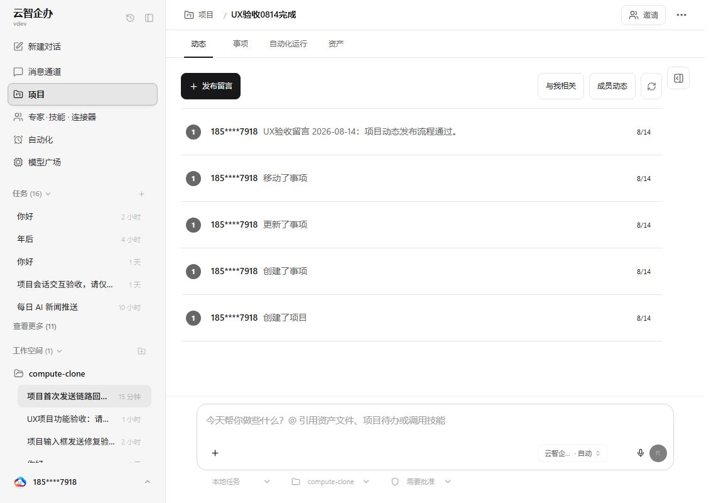

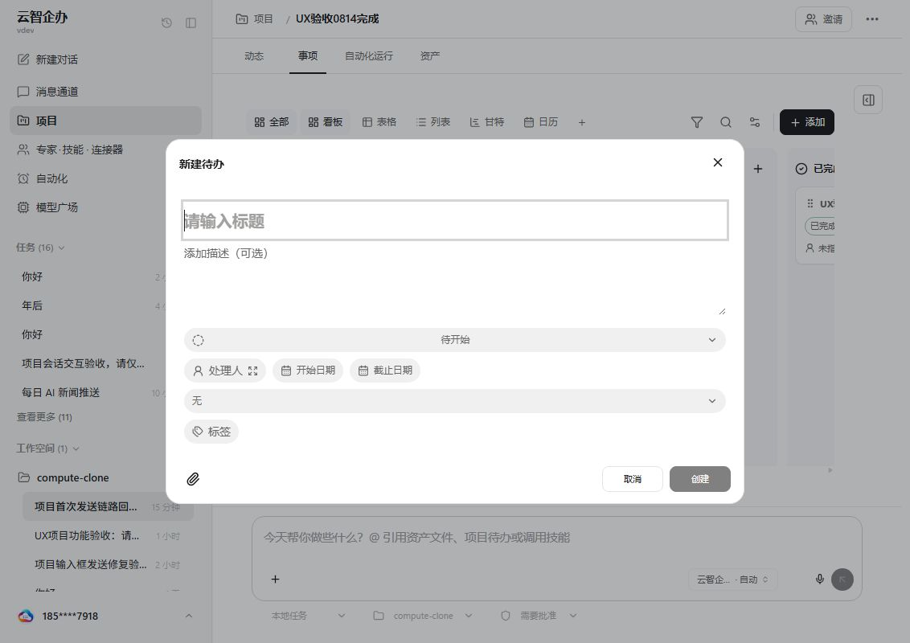

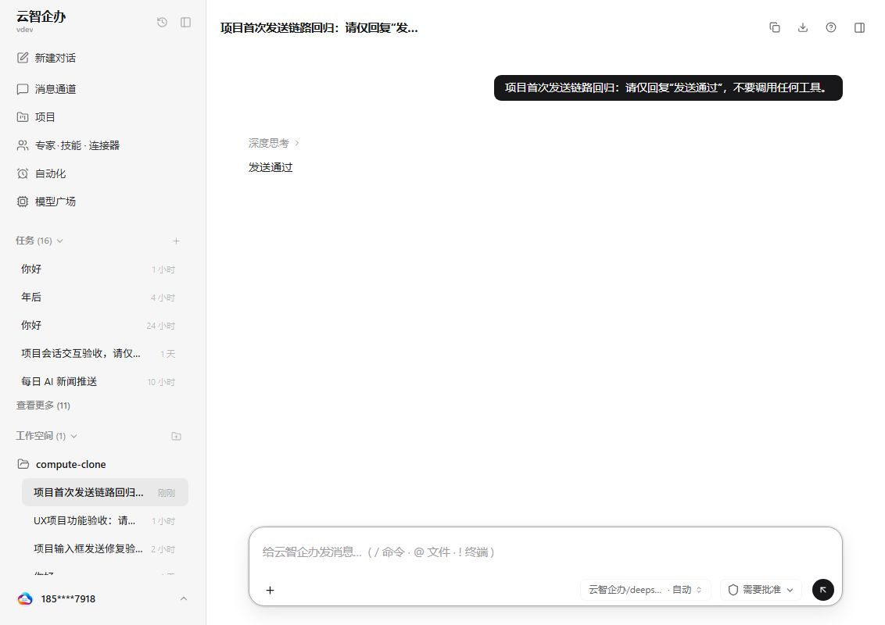

### 10.2 真实桌面冒烟结果

运行进程均来自当前工作树 `integration-main-v3-20260814`：Vite 监听 `127.0.0.1:5175`，`kwu-desktop-dev.exe` 监听 `127.0.0.1:34238`。在项目 `UX验收0814完成` 完成以下复测：

1. 动态、事项、自动化运行、资产四个页签均可访问，未再出现“执行会话”入口。
2. 配置覆盖层不改变主体宽度、无页面级水平滚动，键盘关闭和焦点恢复通过。
3. 事项新建弹窗实测 720 × 454 px，位于 1132 × 800 视口内，无固定大高度或全屏按钮。
4. 自动化条目菜单显示紧凑的“重命名 / 删除”，完成和失败记录均可打开菜单。
5. 资产表格和成员抽屉正常；无待处理邀请时不显示空邀请分组。
6. 项目指令弹窗只显示项目说明、项目指令、计数和操作按钮，不再显示说明性引导或“来源：云端项目指令”。
7. 缺少工作空间时 Enter 自动聚焦并展开选择器；选择 `compute-clone` 后，首次运行遇到模型路由初始化的瞬时失败，草稿完整保留；同一草稿重试成功，进入普通任务并收到“发送通过”。本次新增任务为 `项目首次发送链路回归：请仅回复“发送通过”…`。

### 10.3 修复后自动化结果

| 范围 | 命令 / 门禁 | 结果 |
|---|---|---|
| 前端单元 | `pnpm run test:vitest` | **通过：24 文件，150/150** |
| 项目浏览器与视觉 | `pnpm run test:browser -- --workers=4` | **通过：37/37**；含 6 个 axe、8 个视觉场景 |
| Composer 键盘回归 | `pnpm exec tsx src/__tests__/composer-responsive-toolbar.test.tsx` | **通过：148/148** |
| Composer 生产契约 | `pnpm exec tsx src/__tests__/project-composer-app.contract.test.ts` | **通过** |
| 前端构建 | `pnpm run build` | **通过**；仅保留既有大 chunk 警告 |
| Desktop Go | `go test ./...`（`desktop`） | **通过** |
| 自动化服务 | `go test ./internal/automation/...` | **通过** |
| Root Go 编译 | `go test ./... -list '^$'` | **通过** |
| Root 可疑单测 | `go test ./internal/boot -run '^TestBuildAppendsUserDecisionPolicyToCustomSystemPrompt$' -count=1 -timeout 3m` | **通过** |
| Root Go 全套 | `go test ./...` | **未完成：连续 10 分钟无包级输出后超时**；不能宣称全套通过 |
| Go 静态检查 | 根仓库与 `desktop` 的 `go vet ./...` | **均通过** |
| Cloud PostgreSQL 项目门禁 | `scripts/workbuddy-project-full-gate.ps1` | **通过**；迁移至 92，`internal/projects` 全套通过，专用测试库已删除 |
| 仓库守卫 | `go run ./scripts/code_guard` 与基线文件三项检查 | **通过**；基线文件无工作区或暂存差异 |

### 10.4 仍需说明的边界

- Cloud Composer 运行由云端领取与执行接口管理，不在本地自动化运行注册表内；本次没有错误宣称它支持本地句柄取消。
- 真实冒烟没有修改成员关系、永久删除项目、删除既有自动化记录或上传私人文件。成员权限拒绝、资产批量部分失败和自动化各运行态通过自动化测试验证，未对生产数据执行破坏性演练。
- 根仓库完整 Go 套件仍有并行运行超时，虽然涉及的项目/自动化包、Desktop 全套、Cloud 全套、单独 boot 用例以及两处 `go vet` 均已通过。在解决该超时前，不应宣称仓库完整测试全绿。
